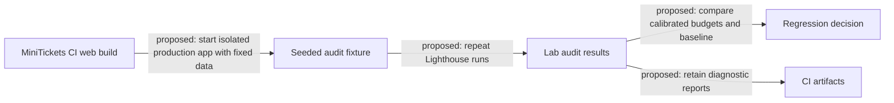

# Lighthouse ci

History: see [CHANGELOG.md](../CHANGELOG.md) or run `pnpm docs:history`

Area: Testing · Status: 📖 explain-only

<!-- interview-card: v2 -->

## 1. What is it?

Lighthouse CI would repeat browser audits during a build pipeline and compare results with chosen limits. It can flag large performance or asset-size regressions before release.

## 2. Why do we need it?

A MiniTickets change could ship much more JavaScript while all functional tests pass. A repeatable lab audit could reveal that cost before buyers encounter it.

## 3. How does it work?

1. A proposed job would audit a production build with stable data.
2. It would repeat measurements to reduce noise.
3. Metric and asset budgets would identify regressions worth investigating.

## 4. How do we use it in MiniTickets?

Lighthouse CI is explain-only: no dependency, configuration or job is installed. Existing field-vital reporting and axe accessibility checks are separate built features. A future audit would complement those checks rather than replace real-user measurements or human review.

## 5. Interview-ready answer

“MiniTickets could add Lighthouse audits to a seeded production build and compare repeated results with explicit performance and asset budgets. I would track regressions and diagnostic reports, not chase a perfect score. Shared runners are noisy, so budgets need calibration. This remains a proposal; current browser vitals and axe checks are built separately and answer different questions.”

## 6. Important follow-up questions

- **Which build should be audited?** A production build; development mode changes performance behavior.
- **Why repeat runs?** Shared machines and browser scheduling introduce measurement noise.
- **Can a good score prove real-user INP?** No. Field interactions and device populations differ from a lab run.
- **What makes a useful gate?** Stable fixtures, calibrated metric/byte budgets and actionable reports, rather than a fragile score alone.

## 7. Advanced details

Technical reference

### Proposed location and scope

Existing integration point: `.github/workflows/ci.yml`. A future root Lighthouse CI config/job would run after the web build, serving isolated API/web ports with seeded public events. Suggested budgets cover LCP/CLS, JavaScript bytes and accessibility; retain multiple runs/reports and compare medians with a baseline. No Lighthouse package, config, job or runnable feature demo currently exists.

### Trade-offs and growth

Hard score thresholds on shared runners can be flaky. Lab metrics help reproduce regressions, while built P10 telemetry reports field measurements and axe checks accessibility rules. A lab audit cannot establish p75 field INP or complete accessibility. Later work could add representative routes/devices, controlled runners, trend storage and field/lab correlation. No deployment or audit execution was performed here.

### Related reading

[current system](../00-big-picture.md) · [scenario](../guides/interview-scenarios.md#lighthouse) · [explorer tour](../guides/infra-explorer.html?tour=security-layers)

[Open this concept in the city explorer](../guides/infra-explorer.html?concept=lighthouse-ci#chapter=13&piece=github).

## Where it appears in the story

- [app-story: 9b. A booking reaches its transaction](../app-story.md#9b-a-booking-reaches-its-transaction)

