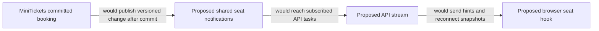

# Live seats

History: see [CHANGELOG.md](../CHANGELOG.md) or run `pnpm docs:history`

Area: Frontend · Status: 📖 explain-only
<!-- interview-card: v2 -->

## 1. What is it?

Live seat updates refresh the availability shown on a page without a full reload. MiniTickets has a proposed streaming design; no live-seat stream or shared notification channel is built.

## 2. Why do we need it?

During a popular sale, an open event page can display seats that somebody else just booked. Faster updates would improve the hint, while the database still decides whether a purchase succeeds.

## 3. How does it work?

1. A committed change would produce a versioned notification.
2. API tasks would forward it to interested browsers.
3. Connect and reconnect would reload a snapshot to repair missed messages.

## 4. How do we use it in MiniTickets?

Proposed server-sent events would carry one-way hints, with a Redis adapter between API copies. Streams, fan-out and a browser hook remain explain-only. Existing booking transactions keep their authoritative seat check regardless of display freshness.

## 5. Interview-ready answer

“For MiniTickets I would choose polling first or server-sent events for one-way seat hints. Shared notifications would reach every API copy, while snapshots and versions repair reconnect gaps. Messages cannot reserve seats or authorize a purchase; every booking still reaches Postgres. Connection limits and slow-client behavior need an explicit design.”

## 6. Important follow-up questions

- **What if a notification is missed?** Reload an authoritative snapshot; do not guess from a gap.
- **Why not WebSockets by default?** They suit two-way interaction but add connection protocol and state.
- **Can a displayed count guarantee a seat?** No. Other purchases can race before the booking transaction.
- **How would reconnect storms behave?** Use bounded connections, backoff with proposed jitter, and controlled snapshot work.

## 7. Advanced details

Technical reference

### Source references

Not in our app as an anchored feature. The proposed or observational location is explained below; it must not be mistaken for a deployed resource.

WHERE IN MINITICKETS: proposed API procedure/service stream in apps/api/src/services/live-seats.ts, Redis adapter in queries/live-seats.ts and browser hook features/events/hooks/use-live-seats.ts. Publish only after commit, include event id and version, snapshot on connect/reconnect, heartbeats and bounded buffers. Backoff with jitter; close idle slow clients. No SSE/WebSocket endpoint or pub/sub deployment exists. Walk the Live seats explain-only explorer tour.

Existing integration point: `apps/api/src/services/bookings.ts`.

### Configuration and design

Explain-only: SSE with reconnect snapshots and versioned Redis fan-out would refresh hints across API tasks; no stream endpoint/pub-sub channel is implemented. A catalogue benefits from fresher hints without weakening booking correctness.

### Checks and troubleshooting

Use the linked scenario and tour to trace the existing integration point. This proposed extension has no runnable feature demo.

How recover a missed pub/sub message? Reload an authoritative snapshot; do not infer availability from a gap. Do not change a live stack to demonstrate it.

Can an SSE seat count authorize a purchase? **No; Postgres decides.**

### Trade-offs and alternatives

SSE supports one-way HTTP streaming; proxy buffering/timeouts need checks. WebSockets add connection protocol/state. Polling costs repeated reads but survives missed notifications.

10x: cap connections and reconnect storms. 100x: partition events, fan-out gateways, snapshot/version catch-up and regional ownership.

### Further technical context

Use polling for simplicity, SSE for one-way seat notifications and WebSockets for bidirectional interaction. Seat messages are hints, not a purchase guarantee. Every booking still reaches Postgres. Across API instances, publish committed changes through Redis pub/sub or an outbox-driven channel; Redis pub/sub loses messages while a subscriber is disconnected.

### Related reading

Uses the [current system](../00-big-picture.md); gives a concrete decision to the [scenario](../guides/interview-scenarios.md#live-seats) and [explorer tour](../guides/infra-explorer.html?tour=live-seats).

[Open this piece in the city explorer](../guides/infra-explorer.html?concept=live-seats#chapter=8&piece=api-task).

## Where it appears in the story

- [app-story: 9b. A booking reaches its transaction](../app-story.md#9b-a-booking-reaches-its-transaction)

