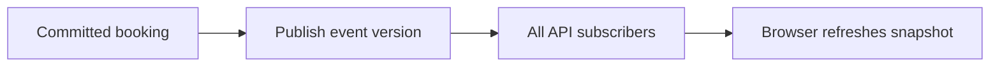

# Live seats

History: see [CHANGELOG.md](../CHANGELOG.md) or run `pnpm docs:history`

Area: Frontend · Status: 📖 explain-only

## 1. In one line

Explain-only: SSE with reconnect snapshots and versioned Redis fan-out would refresh hints across API tasks; no stream endpoint/pub-sub channel is implemented.

## 2. Real-life comparison

Two clerks cannot promise the same last seat: one holds the ledger until the reservation is recorded.

## 3. Picture it

## 4. Where in our code

Not in our app as an anchored feature. The proposed or observational location is explained below; it must not be mistaken for a deployed resource.

WHERE IN MINITICKETS: proposed API procedure/service stream in apps/api/src/services/live-seats.ts, Redis adapter in queries/live-seats.ts and browser hook features/events/hooks/use-live-seats.ts. Publish only after commit, include event id and version, snapshot on connect/reconnect, heartbeats and bounded buffers. Backoff with jitter; close idle slow clients. No SSE/WebSocket endpoint or pub/sub deployment exists. Walk the Live seats explain-only explorer tour.

Existing integration point: `apps/api/src/services/bookings.ts`.

## 5. See it yourself

Use the linked scenario and tour to trace the existing integration point. This proposed extension has no runnable feature demo.

Failure thought experiment: How recover a missed pub/sub message? Reload an authoritative snapshot; do not infer availability from a gap. Do not change a live stack to demonstrate it.

## 6. How it connects

Uses the [current system](../00-big-picture.md); gives a concrete decision to the [scenario](../guides/interview-scenarios.md#live-seats) and [explorer tour](../guides/infra-explorer.html?tour=live-seats).

## 7. Our settings and WHY

Explain-only: SSE with reconnect snapshots and versioned Redis fan-out would refresh hints across API tasks; no stream endpoint/pub-sub channel is implemented. A catalogue benefits from fresher hints without weakening booking correctness.

## 8. Trade-offs

SSE supports one-way HTTP streaming; proxy buffering/timeouts need checks. WebSockets add connection protocol/state. Polling costs repeated reads but survives missed notifications.

## 9. Alternatives and when to choose them

10x: cap connections and reconnect storms. 100x: partition events, fan-out gateways, snapshot/version catch-up and regional ownership.

## 10. What breaks and how we notice

How recover a missed pub/sub message? Reload an authoritative snapshot; do not infer availability from a gap.

## 13. Interview answers at 3 levels

- **Simple:** Explain-only: SSE with reconnect snapshots and versioned Redis fan-out would refresh hints across API tasks; no stream endpoint/pub-sub channel is implemented..
- **Senior:** Use polling for simplicity, SSE for one-way seat notifications and WebSockets for bidirectional interaction. Seat messages are hints, not a purchase guarantee. Every booking still reaches Postgres. Across API instances, publish committed changes through Redis pub/sub or an outbox-driven channel; Redis pub/sub loses messages while a subscriber is disconnected.
- **Lead:** 10x: cap connections and reconnect storms. 100x: partition events, fan-out gateways, snapshot/version catch-up and regional ownership.

## 14. Follow-up questions with answers

How recover a missed pub/sub message? Reload an authoritative snapshot; do not infer availability from a gap.

Can an SSE seat count authorize a purchase? **No; Postgres decides.**

## 15. Say it in 30 seconds

Use polling for simplicity, SSE for one-way seat notifications and WebSockets for bidirectional interaction. Seat messages are hints, not a purchase guarantee. Every booking still reaches Postgres. Across API instances, publish committed changes through Redis pub/sub or an outbox-driven channel; Redis pub/sub loses messages while a subscriber is disconnected.

## 16. Status and production work

Explain-only: no feature deployment exists. 10x: cap connections and reconnect storms. 100x: partition events, fan-out gateways, snapshot/version catch-up and regional ownership.

## Where it appears in the story

- [app-story: 9b. A booking reaches its transaction](../app-story.md#9b-a-booking-reaches-its-transaction)
