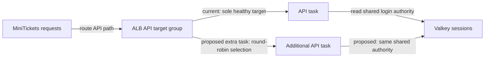

# Load balancing algorithms: round robin, least connections, IP hash

History: see [CHANGELOG.md](../CHANGELOG.md) or run `pnpm docs:history`

Area: Reliability · Status: 🟡 partial (ALB default) · Step doc: [18 ALB + web](../../18-infra-alb-web.md)

<!-- interview-card: v2 -->

## 1. What is it?

A load-balancing algorithm chooses which healthy server gets a request. Round robin takes turns; other algorithms consider outstanding work or distribute using weights.

## 2. Why do we need it?

If MiniTickets runs several API copies, requests should be spread usefully. Sending every buyer to the same busy copy would waste the extra capacity.

## 3. How does it work?

1. Select only eligible healthy targets.
2. Apply the target group’s balancing algorithm.
3. Keep session authority shared so requests need no fixed server.

## 4. How do we use it in MiniTickets?

MiniTickets leaves the ALB algorithm at its default and disables sticky sessions. Current desired count is one, so there is no meaningful distribution to measure. Adding copies would expose the choice; session storage already permits different tasks to serve the same user.

## 5. Interview-ready answer

“MiniTickets uses the ALB target group’s default round robin without stickiness. Shared sessions allow any healthy API copy to handle a user’s request. With one target today the algorithm has no practical choice. If request durations become uneven, I would compare per-target latency and outstanding work before changing algorithms; distributing requests is different from removing a database bottleneck.”

## 6. Important follow-up questions

- **Why avoid sticky sessions?** They can produce uneven load and make failure recovery depend on one server.
- **When might least-outstanding help?** When request durations vary and equal request counts do not mean equal work.
- **Does more targets fix slow SQL?** No. Shared database limits and hot rows can remain.
- **What is consistent hashing for?** Stable key placement in caches or shards with limited movement as nodes change.

## 7. Advanced details

Technical reference

### Current settings and inspection

`infra/src/entry/target-groups.ts` sets no algorithm, so ALB default `round_robin` applies; stickiness is off. API `desiredCount: 1` means one registered target. Valkey sessions remove the need for client affinity. ALB also offers `least_outstanding_requests` and `weighted_random`; NLB uses flow hashing rather than the same HTTP algorithm choices.

Read-only inspection: `aws elbv2 describe-target-group-attributes --profile ticketlite --target-group-arn <api-tg-arn> --query "Attributes[?Key=='load_balancing.algorithm.type' || Key=='stickiness.enabled']"`. Expected repository intent is round robin/false; live attributes were not inspected here.

### Trade-offs and safeguards

Round robin suits similar short requests but ignores work duration. Least-outstanding may better suit varied work; check supported algorithm/slow-start combinations rather than assuming the old card’s slow-start advice is valid for every algorithm. Affinity/hash choices can concentrate load or lose affinity on failure. Per-target p95 and work metrics help assess imbalance. Algorithm selection has no separate resource in this code, but load-balancer capacity/traffic costs still exist; no current pricing claim is made.

### Code anchors

- Anchor: `infra/src/entry/target-groups.ts` · `shared`: no algorithm is set, so the ALB default (round robin) applies.

### Related reading

[target-groups](target-groups.md) · [alb](alb.md) · [scaling](scaling.md)

[Open this concept in the city explorer](../guides/infra-explorer.html?concept=load-balancing-algorithms#chapter=10&piece=alb).

## Where it appears in the story

- [Infra story: 3. Target groups](../infra-story.md#3-target-groups)

