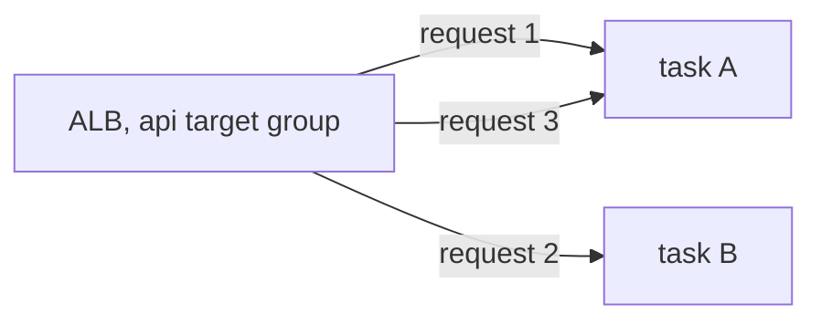

# Load balancing algorithms: round robin, least connections, IP hash

History: see [CHANGELOG.md](../CHANGELOG.md) or run `pnpm docs:history`

Area: Reliability · Status: 🟡 partial (ALB default) · Step doc: [18 ALB + web](../../18-infra-alb-web.md)

## 1. In one line

A **load balancing algorithm** decides which healthy target gets the next request: **round robin**
(in turn), **least outstanding requests / connections** (the least busy), or **hash-based** (same
client → same target).

## 2. Real-life comparison

Supermarket tills. Round robin: the next customer goes to the next till in order. Least busy: to the
till with the shortest queue. Hash: you always go to "your" cashier.

## 3. Picture it



## 4. Where in our code

- Anchor: `infra/src/entry/target-groups.ts` · `shared`: no algorithm is set, so the ALB default (round robin) applies.

What we have:

1. The target groups do not set a load balancing algorithm, so ALB uses its default, **round robin**.
2. With `desiredCount: 1` there is only one target, so the algorithm makes no difference today.
3. No stickiness: sessions live in Valkey, so any task can serve any user; we need no "same client →
   same target".

ALB supports `round_robin` (default), `least_outstanding_requests` and `weighted_random` per target
group, plus optional sticky sessions. (NLB uses a flow hash instead.)

## 5. See it yourself

```bash
aws elbv2 describe-target-group-attributes --profile ticketlite --target-group-arn <api-tg-arn> \
  --query "Attributes[?Key=='load_balancing.algorithm.type' || Key=='stickiness.enabled']"
```

Expect `round_robin` and `false`.

## 6. How it connects

- **Uses ←** [target-groups](target-groups.md), [alb](alb.md).
- **Gives →** load spreading once [scaling](scaling.md) adds tasks.

## 7. Our settings and WHY

Default round robin and no stickiness: requests are short and similar, and the api is stateless.

## 8. Trade-offs

- **Round robin:** simple and fair for similar requests; ignores how busy a target is.
- **Least outstanding requests:** better when request times vary a lot; can overload a newly added
  target (use slow start).
- **Sticky / hash:** keeps a client on one target; uneven load and lost affinity on failure.

## 9. Alternatives and when to choose them

- `least_outstanding_requests` when some calls (reports, uploads) are much slower than others.
- Stickiness only for legacy apps that keep sessions in memory.

## 10. What breaks, and how we'd notice

With round robin and very uneven requests, one task can be slow while others idle: higher p95
latency on one target (needs per-target metrics).

## 11. Reach / Allowed / Password

Not a connection.

## 12. Cost

Free.

## 13. Interview answers at 3 levels

- **Simple:** The load balancer sends requests to servers in turn.
- **Senior:** Our ALB target groups use the default round robin without stickiness; that is fine because
  the api is stateless and requests are short. ALB also offers least outstanding requests and weighted
  random.
- **Lead:** I'd pick the algorithm from the latency distribution: round robin for uniform requests,
  least outstanding requests when durations vary, and avoid stickiness by keeping services stateless.

## 14. Follow-up questions interviewers ask

- *What is consistent hashing used for?* Keeping a key on the same node in caches and shards, with
  little reshuffling when nodes change.
- *Why avoid sticky sessions?* Uneven load and lost sessions when a target dies.

## 15. Say it in 30 seconds

"We use the ALB's default round robin with no stickiness. Sessions live in Valkey, so any task can
serve any request. If request durations grew uneven, I'd switch the target group to least outstanding
requests."

## 16. Status

🟡 partial: the default only, and one target today.
