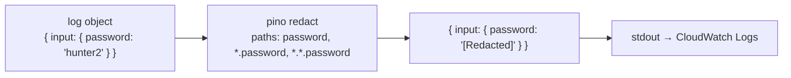

# Log redaction: no passwords in logs

History: see [CHANGELOG.md](../CHANGELOG.md) or run `pnpm docs:history`

Area: Auth & Security · Status: ✅ built · Step doc: [02 errors](../../02-errors.md), [06 signup api](../../06-signup-api.md)

## 1. In one line

Fastify's logger replaces `password`, `confirmPassword` and `passwordHash` with `"[Redacted]"` if
they ever appear in a log line, and we never log request bodies in the first place.

## 2. Real-life comparison

A CCTV system that blurs the keypad automatically, so even if a camera points at it, the PIN never
ends up in the recordings.

## 3. Picture it



## 4. Where in our code

- Anchor: `apps/api/src/app.ts` · `Fastify({ logger: { redact: { paths, censor: "[Redacted]" } } })`.

Step by step:

1. Fastify's logger is pino ([structured-logging](structured-logging.md)).
2. `redact.paths` lists the fields at the top level, one level deep (`*.password`) and two levels
   deep (`*.*.password`), for all three names.
3. Any object passed to `request.log.*` or `app.log.*` is filtered before it's written.
4. First line of defence: we don't log bodies at all. Request logs show method, URL, IP; errors log
   `err` with message and stack ([error-handling](error-handling.md)).
5. Logs go to stdout; on AWS to CloudWatch Logs, where anyone with log access could read them
   ([cloudwatch-logs](cloudwatch-logs.md)).

## 5. See it yourself

During my checks for this handbook I ran a local api instance on another port, signed up and logged
in several times, and searched its log file for the passwords used: **0 matches**.

```bash
# a second api on port 4400, so it never clashes with your pnpm dev on 4000
cd apps/api && PORT=4400 ./node_modules/.bin/tsx --env-file=.env src/server.ts > /tmp/api.log 2>&1 &
# ...sign up / log in against localhost:4400 with curl, then:
grep -c "correct-horse" /tmp/api.log     # 0
kill %1                                  # stop only the job you started
```

**Break it on purpose:** add `request.log.info({ body: request.body })` in a route. The body is
logged, but `body.password` shows `"[Redacted]"` (one level deep, `*.password`). A field four
levels deep would not be covered.

## 6. How it connects

- **Uses ←** [structured-logging](structured-logging.md).
- **Gives →** safe [cloudwatch-logs](cloudwatch-logs.md); supports [password-hashing](password-hashing.md)
  (the hash never leaks either).

## 7. Our settings and WHY

Explicit paths at three depths with a clear censor string. WHY: pino's redaction works on known
paths (it is fast because it doesn't scan everything), so we list where these fields could appear.

## 8. Trade-offs

- **Pros:** cheap, automatic, survives careless log calls.
- **Cons:** only listed names and depths; new secrets (tokens, API keys) must be added; it doesn't
  catch secrets inside free-text messages.

## 9. Alternatives and when to choose them

- **Allow-list logging:** log only chosen fields, never whole objects.
- **Log pipeline scrubbing** (Fluent Bit filters, CloudWatch data protection policies): a second
  net after the app.

## 10. What breaks, and how we'd notice

A new sensitive field (`resetToken`) not in the list. Nothing alerts; review new fields against the
redact list.

## 13. Interview answers at 3 levels

- **Simple:** Passwords are blanked out if they ever reach the logs.
- **Senior:** pino's `redact` in the Fastify logger censors `password`, `confirmPassword` and
  `passwordHash` at three depths; we don't log bodies, and 500 details stay server-side only.
- **Lead:** Logs are a data store with wide access and long retention; treat them as such. Prefer
  never logging sensitive data, keep a redact list as a net, and add pipeline-level scrubbing and
  access controls for production.

## 14. Follow-up questions interviewers ask

- *Why not log the request body for debugging?* It contains passwords and personal data.
- *What about personal data like emails?* Not redacted today; a privacy review would decide.

## 15. Say it in 30 seconds

"Fastify's pino logger redacts password, confirmPassword and passwordHash at three nesting depths,
and we never log request bodies. I checked a local run's logs after real logins: no passwords. New
secret fields have to be added to the list."

## 16. Status

✅ built.
