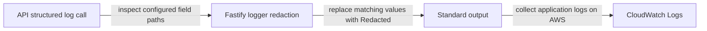

# Log redaction: no passwords in logs

History: see [CHANGELOG.md](../CHANGELOG.md) or run `pnpm docs:history`

Area: Auth & Security · Status: ✅ built · Step doc: [02 errors](../../02-errors.md), [06 signup api](../../06-signup-api.md)
<!-- interview-card: v2 -->

## 1. What is it?

Log redaction removes selected sensitive values before logs are written. It is a safety net alongside choosing not to log private data in the first place.

## 2. Why do we need it?

Debugging a MiniTickets login failure should not create a permanent copy of the password. Logs may be readable by people and systems that do not need the original request data.

## 3. How does it work?



1. Log only the fields needed to diagnose the operation.
2. Apply configured redaction before writing structured records.
3. Control access and retention for the resulting logs too.

## 4. How do we use it in MiniTickets?

Our logger censors password, confirmation and password-hash fields at three configured nesting depths. Request bodies are not logged. New token names and secrets embedded in plain text are outside that automatic coverage.

## 5. Interview-ready answer

“MiniTickets avoids logging request bodies and redacts known password fields in structured logs. That protects common accidental object logging, but it is not a scanner for every secret. I review new fields and prefer explicit safe identifiers. Logs are another data store, so access, retention and incident handling matter as well.”

## 6. Important follow-up questions

- **Does it catch a password inside a sentence?** No. The configured paths apply to structured fields, not arbitrary text.
- **Are emails automatically redacted?** No. Their handling needs a deliberate privacy policy.
- **What if we add resetToken?** Review and update logging rules before exposing the new field.
- **Why not log whole requests temporarily?** Temporary debugging can still copy credentials and personal data into durable logs.

## 7. Advanced details

<details>
<summary>Technical reference</summary>

### Source references

- Anchor: `apps/api/src/app.ts` · `Fastify({ logger: { redact: { paths, censor: "[Redacted]" } } })`.

Step by step:

1. Fastify's logger is pino ([structured-logging](structured-logging.md)).
2. `redact.paths` lists the fields at the top level, one level deep (`*.password`) and two levels
   deep (`*.*.password`), for all three names.
3. Any object passed to `request.log.*` or `app.log.*` is filtered before it's written.
4. First line of defence: we don't log bodies at all. Request logs show method, URL, IP; errors log
   `err` with message and stack ([error-handling](error-handling.md)).
5. Logs go to stdout; on AWS to CloudWatch Logs, where anyone with log access could read them
   ([cloudwatch-logs](cloudwatch-logs.md)).

### Configuration and design

Explicit paths at three depths with a clear censor string. WHY: pino's redaction works on known
paths (it is fast because it doesn't scan everything), so we list where these fields could appear.

### Checks and troubleshooting

During my checks for this handbook I ran a local api instance on another port, signed up and logged
in several times, and searched its log file for the passwords used: **0 matches**.

```bash
# a second api on port 4400, so it never clashes with your pnpm dev on 4000
cd apps/api && PORT=4400 ./node_modules/.bin/tsx --env-file=.env src/server.ts > /tmp/api.log 2>&1 &
# ...sign up / log in against localhost:4400 with curl, then:
grep -c "correct-horse" /tmp/api.log     # 0
kill %1                                  # stop only the job you started
```

**Isolated thought experiment (not performed):** add `request.log.info({ body: request.body })` in a route. The body is
logged, but `body.password` shows `"[Redacted]"` (one level deep, `*.password`). A field four
levels deep would not be covered.

A new sensitive field (`resetToken`) not in the list. Nothing alerts; review new fields against the
redact list.

- *Why not log the request body for debugging?* It contains passwords and personal data.
- *What about personal data like emails?* Not redacted today; a privacy review would decide.

### Trade-offs and alternatives

- **Pros:** cheap, automatic, survives careless log calls.
- **Cons:** only listed names and depths; new secrets (tokens, API keys) must be added; it doesn't
  catch secrets inside free-text messages.

- **Allow-list logging:** log only chosen fields, never whole objects.
- **Log pipeline scrubbing** (Fluent Bit filters, CloudWatch data protection policies): a second
  net after the app.

### Further technical context

pino's `redact` in the Fastify logger censors `password`, `confirmPassword` and
  `passwordHash` at three depths; we don't log bodies, and 500 details stay server-side only.

### Related reading

- **Uses ←** [structured-logging](structured-logging.md).
- **Gives →** safe [cloudwatch-logs](cloudwatch-logs.md); supports [password-hashing](password-hashing.md)
  (the hash never leaks either).

[Open this piece in the city explorer](../guides/infra-explorer.html?concept=log-redaction#chapter=8&piece=logs).

## Where it appears in the story

- [App story: 4. Fastify: CORS, trustProxy, cookie](../app-story.md#4-fastify-cors-trustproxy-cookie)

</details>
