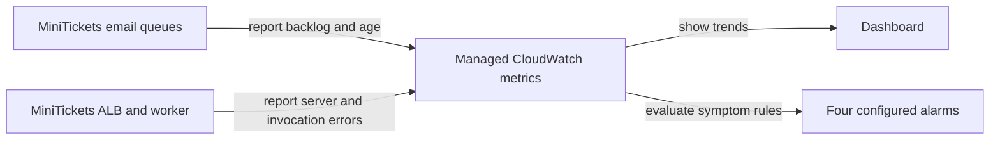

# Metrics

History: see [CHANGELOG.md](../CHANGELOG.md) or run `pnpm docs:history`

Area: Observability · Status: ✅ built in repository; live AWS acceptance is separate

<!-- interview-card: v2 -->

## 1. What is it?

A metric summarizes measurements over time, such as error count or queued work. It helps answer “how widespread is the problem?” rather than explaining one request.

## 2. Why do we need it?

One failed confirmation may be isolated. A growing queue age shows that many buyers could be waiting, even if the website still responds normally.

## 3. How does it work?

1. Collect measurements with known meanings and time windows.
2. Aggregate them into useful trends and warning rules.
3. Use logs to investigate the individual events behind a symptom.

## 4. How do we use it in MiniTickets?

The dashboard and four alarms use managed service metrics. Browser performance measurements currently arrive as JSON logs; dedicated field-percentile analytics is not built. Live dashboard, notification and AWS acceptance checks remain separate from local evidence.

## 5. Interview-ready answer

“MiniTickets uses metrics to see system symptoms across time: old queue work, dead letters, worker invocation failures and server errors. Dashboards show trends and alarms flag configured thresholds. Logs explain particular requests. We distinguish what is measured today from future analytics: a browser performance log does not automatically create reliable percentile reports or a service-level objective.”

## 6. Important follow-up questions

- **Why not use only logs?** Logs explain individual events; aggregate measurements reveal rates, trends and backlog.
- **Can averages hide failures?** Yes. Tail latency and the fraction of affected users may tell a different story.
- **Does missing data mean healthy?** Not always; the alarm must deliberately define how silence affects state.
- **Should user IDs be metric labels?** Usually avoid unbounded identifiers; they increase series count and privacy risk.

## 7. Advanced details

Technical reference

### Built measurements and references

`infra/src/compute/cluster.ts` configures cluster monitoring; `infra/src/observability/dashboard-body.ts` builds dashboard graphs. Four configured symptom alarms observe queue age, DLQ visible count, worker Lambda Errors and combined ALB/target 5xx. Logs Insights/saved queries support investigation; correlation propagation is in `apps/api/src/http/correlation-id.ts` and worker log helpers.

Browser vitals are structured JSON events, not a built field-percentile backend. Dedicated analytics, tracing and SLOs remain explain-only. ALB errors alone cannot establish business booking success. Counters need denominators and windows before they become meaningful error rates.

### Evidence and operational limits

Historical P2 local timings: **115 ms request-to-email**, retry recovery around **10 s**. They neither prove current AWS metrics nor define service targets. Runbook §3.12 provides deployment checks; SNS subscription confirmation/live alarm delivery remain acceptance work. The original proposed-extension sentence did not describe the already-built managed dashboard correctly.

At higher traffic, consider error-rate/p99 analysis, sampling and deliberate metric cardinality, retention and cost budgets. SLO burn-rate alerting and trace sampling are future designs, not consequences of having a dashboard. Validate incoming correlation IDs and avoid logging full customer messages while investigating metrics.

### Code anchors

- Anchor: `infra/src/compute/cluster.ts` — `cluster`; follow the numbered comments at this boundary.
- Anchor: `infra/src/observability/dashboard-body.ts` — `graph`; follow the numbered comments at this boundary.

### Related reading

[current system](../00-big-picture.md) · [scenario](../guides/interview-scenarios.md#observability) · [explorer tour](../guides/infra-explorer.html?tour=failing-email)

[Open this concept in the city explorer](../guides/infra-explorer.html?concept=metrics#chapter=19&piece=dashboard).

## Where it appears in the story

- [infra-story: 9b. Follow a booking through symptoms](../infra-story.md#9b-follow-a-booking-through-symptoms)

