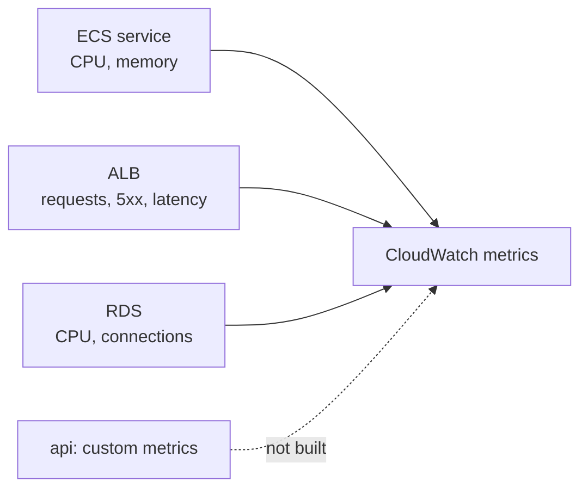

# Metrics

History: see [CHANGELOG.md](../CHANGELOG.md) or run `pnpm docs:history`

Area: Observability · Status: 🟡 partial (AWS basic metrics only) · Step doc: [17 ECS api](../../17-infra-ecs-api.md)

## 1. In one line

**Metrics** are numbers measured over time (CPU, requests, errors, latency); we only have the free
metrics AWS publishes for ECS, the ALB, RDS, ElastiCache and CloudFront, and our app publishes none.

## 2. Real-life comparison

A car dashboard. We have the speedometer and fuel gauge that came with the car, but no extra gauges
of our own and no warning lights wired up.

## 3. Picture it



## 4. Where in our code

- Anchor: `infra/src/compute/cluster.ts` · `containerInsights: "disabled"`: no per-task metrics.

What we have:

1. ECS publishes service-level CPU and memory utilisation for free.
2. The ALB, RDS, ElastiCache and CloudFront publish their standard metrics automatically (we configure
   nothing for them).
3. Container Insights (per-task CPU, memory, network) is **off**: billed as custom metrics, a few
   dollars a month even for one task.
4. The api publishes no metrics of its own (no Prometheus endpoint, no CloudWatch SDK calls).

## 5. See it yourself

```bash
aws cloudwatch get-metric-statistics --profile ticketlite --namespace AWS/ECS --metric-name CPUUtilization \
  --dimensions Name=ClusterName,Value=minitickets-dev Name=ServiceName,Value=minitickets-dev-api \
  --start-time $(date -u -v-1H +%FT%TZ) --end-time $(date -u +%FT%TZ) --period 300 --statistics Average
```

(`date -v` is the macOS form.) Or open the ECS service's **Metrics** tab in the console.

## 6. How it connects

- **Uses ←** the [cluster](ecs-cluster.md), [ALB](alb.md), [RDS](rds-postgres.md).
- **Gives →** the raw material for [alerting](alerting.md), [scaling](scaling.md) and SLOs (explain-only).

## 7. Our settings and WHY

Container Insights off and no custom metrics: dev has no traffic worth measuring and every custom
metric costs money.

## 8. Trade-offs

- **Pros:** free, nothing to run.
- **Cons:** no per-task view, no business metrics (signups per minute), no app latency percentiles
  except what the ALB measures.

## 9. Alternatives and when to choose them

- **Container Insights:** per-task resource usage.
- **Embedded Metric Format** in our JSON logs: custom metrics with no extra agent.
- **OpenTelemetry + Prometheus/Grafana:** vendor-neutral metrics and traces.

## 10. What breaks, and how we'd notice

Without alarms, nothing notifies us; we see problems only when we look or users complain.

## 11. Reach / Allowed / Password

Not a connection. Custom metrics would need `cloudwatch:PutMetricData` on the task role.

## 12. Cost

Basic metrics: free. Container Insights: a few dollars a month per the cluster comment (not measured).

## 13. Interview answers at 3 levels

- **Simple:** We have AWS's built-in graphs, nothing custom.
- **Senior:** ECS service CPU/memory, ALB request counts, 5xx and target response time, and RDS and
  ElastiCache metrics come for free. Container Insights is off to save cost and the api emits no
  custom metrics.
- **Lead:** I'd start with the four golden signals (latency, traffic, errors, saturation) from the ALB
  and RDS, add a few business metrics via EMF, and tie them to SLOs before buying more tooling.

## 14. Follow-up questions interviewers ask

- *Which metric would you alarm on first?* ALB 5xx rate and target response time.
- *Logs vs metrics?* Metrics are cheap aggregates for alerting; logs are detailed events for debugging.

## 15. Say it in 30 seconds

"We rely on AWS's free metrics: ECS service CPU and memory, ALB requests and errors, RDS and cache
metrics. Container Insights is off for cost and the api emits no custom metrics, so the next step would
be golden-signal alarms from the ALB."

## 16. Status

🟡 partial. **To make it production-grade:** golden-signal dashboards, custom metrics, SLOs.
