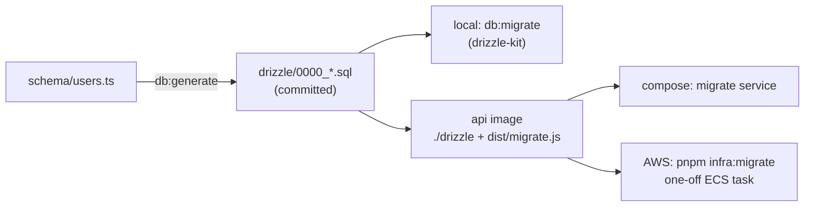

# SQL migrations: generate, apply, one-off runner

History: see [CHANGELOG.md](../CHANGELOG.md) or run `pnpm docs:history`

Area: Data · Status: ✅ built · Step doc: [05 database](../../05-database.md), [11 docker](../../11-docker.md), [17 ECS api](../../17-infra-ecs-api.md)

## 1. In one line

A **migration** is a committed SQL file that changes the database; we generate it from the Drizzle
schema and apply it with a separate one-off job, never from inside the api at startup.

## 2. Real-life comparison

Renovation work orders, numbered and kept in a binder. Each order is done once, ticked off, and
done before the new furniture (new code) moves in. One crew does it, not every tenant at once.

## 3. Picture it



## 4. Where in our code

- Anchor: `apps/api/drizzle.config.ts` · `defineConfig`: where `drizzle-kit` reads the schema and writes SQL (local tool).
- Anchor: `apps/api/src/db/migrate.ts` · `migrate(drizzle(pool), { migrationsFolder: "./drizzle" })`: the production runner (no drizzle-kit).
- Anchor: `docker-compose.yml` · service `migrate`: runs once before the api (`service_completed_successfully`).
- Anchor: `scripts/run-migrations.sh` · `aws ecs run-task … node dist/migrate.js`: the same on AWS.

Step by step:

1. Change `db/schema/*.ts`, run `pnpm --filter @minitickets/api db:generate`: a new SQL file in
   `apps/api/drizzle/` plus a snapshot in `drizzle/meta/`. Commit them.
2. Locally: `pnpm --filter @minitickets/api db:migrate` (drizzle-kit, uses `DATABASE_URL`).
3. CI e2e job: `drizzle-kit migrate` against the service-container Postgres.
4. Docker image: `./drizzle` and `dist/migrate.js` travel **with** the code that needs them.
5. Compose: `migrate` runs `node dist/migrate.js`; the api starts only after it exits 0.
6. AWS: `pnpm infra:migrate` runs the api's task definition once with the command overridden, on
   on-demand Fargate (not Spot), waits, prints the logs and exits with the container's exit code.
7. Drizzle records applied migrations in the database, so reruns apply nothing
   ([idempotency](idempotency.md)).

## 5. See it yourself

```bash
pnpm --filter @minitickets/api db:migrate      # second run: nothing new to apply
docker exec minitickets-postgres-1 psql -U minitickets -d minitickets \
  -c 'select * from drizzle.__drizzle_migrations'
```

On the owner's laptop this shows one row (`id` 1, the SHA-256 `hash` of
`0000_first_northstar.sql`, `created_at` as epoch milliseconds): one migration, applied once.

**Break it on purpose:** edit an already-applied SQL file. Existing databases never see the
change (it is recorded as done), while fresh ones do: environments drift. Always add a new file.

## 6. How it connects

- **Uses ←** [drizzle-schema](drizzle-schema.md), [config-validation](config-validation.md)
  (`DatabaseEnvSchema`), [task-definition](task-definition.md) on AWS.
- **Gives →** the tables the api needs; [zero-downtime-deploys](zero-downtime-deploys.md) depend
  on migrations being backward compatible.

## 7. Our settings and WHY

| Choice | Why |
| ------ | --- |
| Migrations, not `drizzle-kit push` | Reviewed, repeatable SQL in git. |
| Separate one-off job | Several api tasks starting together would race each other. |
| `migrate.ts` instead of drizzle-kit in prod | drizzle-kit is a dev tool, not in the production image. |
| On-demand Fargate | A migration must not be interrupted halfway. |

## 8. Trade-offs

- **Pros:** reproducible; same SQL everywhere; failures stop deploys (compose) or are visible
  (script exit code).
- **Cons:** on AWS the migration is a manual step, not gated before the service update; no
  expand-and-contract discipline yet; one migration so far, no rollback scripts.

## 9. Alternatives and when to choose them

- **Migrate on api startup with a lock:** simpler, slows startup, risky with many tasks.
- **Dedicated CD migration task**: phase A points it at the new API SHA, it must exit 0 before phase B rolls services. Expand/contract protects overlapping versions.
- **Expand and contract:** add, deploy, backfill, then remove (explain-only card
  `expand-contract-migrations`, Phase 5).

## 10. What breaks, and how we'd notice

- Forgot to migrate on AWS: `relation "users" does not exist` in the api logs; signup 500s.
- A migration fails: `pnpm infra:migrate` exits non-zero with the last log lines; compose never
  starts the api.
- Breaking change during a rolling deploy: old tasks fail against the new schema.

## 13. Interview answers at 3 levels

- **Simple:** Database changes are saved as numbered SQL files and applied once, in order.
- **Senior:** Drizzle generates SQL from the schema; we commit it and ship it in the api image.
  `migrate.ts` applies pending files and records them; compose runs it as a one-off service before
  the api, and on AWS `pnpm infra:migrate` runs the same image as a one-off on-demand ECS task.
- **Lead:** The risk is coupling schema changes to code deploys. I'd gate migrations in CD before
  the service update and require expand-and-contract so old and new code both work during the
  rollout.

## 14. Follow-up questions interviewers ask

- *Why not run migrations at app start?* Races between tasks, slower starts, and a failed migration
  takes the app down.
- *How do you roll back?* Prefer roll-forward with a new migration; destructive changes only after
  the code no longer uses the old shape.

## 15. Say it in 30 seconds

"Migrations are SQL files generated from the Drizzle schema and committed. They ship inside the api
image with a small runner. Compose runs it as a one-off before the api; on AWS a script runs the same
task definition once on on-demand Fargate. Drizzle records what ran, so reruns are safe."

## 16. Status

✅ built.

## Where it appears in the story

- [App story: 10. Postgres and Redis](../app-story.md#10-postgres-and-redis)
