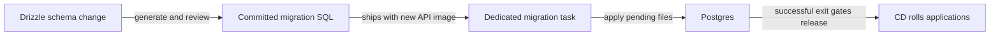

# SQL migrations: generate, apply, one-off runner

History: see [CHANGELOG.md](../CHANGELOG.md) or run `pnpm docs:history`

Area: Data · Status: ✅ built · Step doc: [05 database](../../05-database.md), [11 docker](../../11-docker.md), [17 ECS api](../../17-infra-ecs-api.md)
<!-- interview-card: v2 -->

## 1. What is it?

A migration is a versioned database change saved as SQL. A runner applies pending changes and records which ones have already completed.

## 2. Why do we need it?

New MiniTickets code may require a new column. Updating containers before that column exists breaks requests, while letting every task run migrations at startup creates competing migration attempts.

## 3. How does it work?

1. Generate and commit a new migration file.
2. Run the new image’s migration task before application rollout.
3. Proceed only after it succeeds, keeping old and new code compatible during overlap.

## 4. How do we use it in MiniTickets?

Local tooling, Compose and CI apply the same committed SQL. Current approved CD uses a dedicated on-demand Fargate migration recipe before rolling services. The API does not migrate during normal startup. Live AWS deployment acceptance remains pending.

## 5. Interview-ready answer

“MiniTickets ships reviewed SQL migrations with the API image. Delivery first runs the new image’s dedicated migration task and requires success before rolling applications. The migration journal prevents ordinary reruns from reapplying completed files. Schema and code still overlap during deployment, so additive changes and a deliberate removal sequence matter more than simply having a runner.”

## 6. Important follow-up questions

- **Why not edit an old migration?** Existing databases already recorded it, while fresh databases would see the edit and drift.
- **What if a migration fails?** Stop the rollout, inspect its exit reason and logs, then repair or roll forward.
- **Does rolling back the image reverse the schema?** No. The older image must remain compatible with the applied schema.
- **Why avoid Spot for migrations?** Regular capacity reduces interruption risk; it does not make migration design immune to failure.

## 7. Advanced details

Technical reference

### Sources and applied state

`apps/api/drizzle.config.ts` configures drizzle-kit input/output. Schema changes generate new SQL and snapshots under apps/api/drizzle and drizzle/meta; review and commit them together. Editing an already-applied file creates drift between old and fresh databases, so add a new migration instead. Drizzle tracks applied files in drizzle.__drizzle_migrations. Ordinary reruns skip completed work; interruption/error handling still requires diagnosis rather than assuming every operation is safe to retry blindly.

Local db:generate/db:migrate use the development CLI. The runtime runner `apps/api/src/db/migrate.ts` calls the Drizzle migration API with migrationsFolder ./drizzle. SQL files and dist/migrate.js ship inside the API image; drizzle-kit itself is not required in that runtime image. CI applies migrations before browser tests. Compose's migrate service runs once, and API depends on service_completed_successfully.

### Current approved delivery

CD phase A points the dedicated migration task at the new API SHA while running applications retain the existing release. scripts/run-migrations.sh reads migrationTaskDefinitionArn, cluster, subnets and API security group from outputs, runs one on-demand FARGATE task, waits for stop, prints its migration log stream and propagates its exit code. It uses node dist/migrate.js. Missing container exit status is failure and can indicate image/secret startup problems. It runs with public networking and API's group for database access. AWS-changing execution remains an owner/CD operation; this rewrite ran none.

Only successful migration permits phase B to update release state and roll applications. Earlier shared API-task command overrides, manually ungated updates and one-row migration-journal counts were historical and are no longer the current delivery design. The dedicated migration image is separate so schema can change before the running app image. Live AWS acceptance remains pending.

### Failure and compatibility

Missing relations usually require inspecting whether the intended migration ran. A failed migration stops rollout and requires logs plus stopped reason; Compose will not start dependent API. On-demand capacity avoids Spot interruption risk, not every possible failure. Old and new application tasks overlap during rolling release, so schema changes must remain compatible with both.

Prefer a new roll-forward migration over assuming an older image undoes schema. Expand/contract adds a compatible shape, deploys, backfills and removes old shape only after all readers stop using it; that discipline is a design requirement for destructive changes. Startup migrations with a lock are an alternative, but add startup coupling/race complexity. No rollback-script or restore drill is claimed by this runner.

### Source anchors

- Anchor: `apps/api/drizzle.config.ts` · `defineConfig`: where `drizzle-kit` reads the schema and writes SQL (local tool).
- Anchor: `apps/api/src/db/migrate.ts` · `migrate(drizzle(pool), { migrationsFolder: "./drizzle" })`: the production runner (no drizzle-kit).
- Anchor: `docker-compose.yml` · service `migrate`: runs once before the api (`service_completed_successfully`).
- Anchor: `scripts/run-migrations.sh` · `aws ecs run-task … node dist/migrate.js`: the same on AWS.

### Related reading

- [05 database](../../05-database.md)
- [11 docker](../../11-docker.md)
- [17 ECS api](../../17-infra-ecs-api.md)
- [idempotency](idempotency.md)
- [drizzle-schema](drizzle-schema.md)
- [config-validation](config-validation.md)
- [task-definition](task-definition.md)
- [zero-downtime-deploys](zero-downtime-deploys.md)
- [Open this piece in the city explorer](../guides/infra-explorer.html?concept=migrations#chapter=8&piece=migration-task)
- [App story: 10. Postgres and Redis](../app-story.md#10-postgres-and-redis)

## Where it appears in the story

- [App story: 10. Postgres and Redis](../app-story.md#10-postgres-and-redis)

