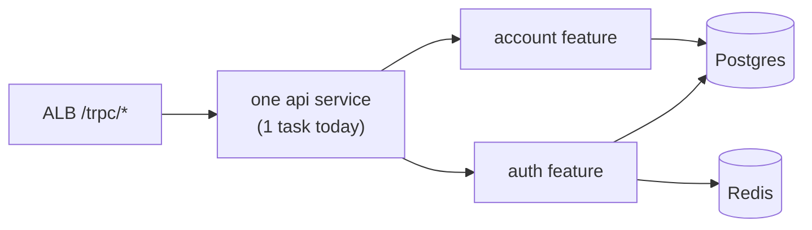

# Monolith vs microservices

History: see [CHANGELOG.md](../CHANGELOG.md) or run `pnpm docs:history`

Area: Reliability · Status: ✅ built (a modular monolith) · Step doc: [01 setup](../../01-setup.md)

## 1. In one line

Our api is a **modular monolith**: one deployable service, split inside by feature (`auth`,
`account`), instead of many small services that call each other over the network.

## 2. Real-life comparison

One restaurant kitchen with clear stations (a modular monolith) versus separate food trucks that
phone each other for every dish (microservices). Trucks scale and fail independently, but every
order needs phone calls.

## 3. Picture it



## 4. Where in our code

- Anchor: `apps/api/src/trpc/router.ts` · `appRouter = router({ auth: authRouter, account: accountRouter })`.

Step by step:

1. One api process with one router; one key per feature.
2. Each feature has its own file in each layer (`procedures/auth.ts`, `services/auth.ts`, …)
   ([layered-api](layered-api.md)).
3. Features call each other in-process (e.g. `account` uses `queries/users.ts`), no network.
4. The web app is a second service, but it is the UI, not a split of the domain.

## 5. See it yourself

```bash
ls apps/api/src/procedures apps/api/src/services apps/api/src/queries
```

Two features, one deployable. On AWS: one ECS service `minitickets-dev-api`.

**Break it on purpose (thought experiment):** move `account` to its own service. It now needs
network calls to read users or a copy of the users table, its own auth check, its own deploy, and
tracing to debug a slow profile page.

## 6. How it connects

- **Uses ←** [rpc-vs-rest](rpc-vs-rest.md) (the router), [layered-api](layered-api.md).
- **Gives →** simple deploys ([ecs-service](ecs-service.md)); scaling is "more of the same task"
  ([scaling](scaling.md), [stateless-servers](stateless-servers.md)).

## 7. Our settings and WHY

One api, features as folders and router keys. WHY: one small team, one database, a few features;
network boundaries would add cost and failure modes without a benefit yet.

## 8. Trade-offs

- **Pros:** one deploy, in-process calls, transactions across features possible, simple debugging.
- **Cons:** everything scales together; one bad deploy affects every feature; boundaries are only
  conventions.

## 9. Alternatives and when to choose them

- **Microservices:** separate teams owning separate domains, very different scaling needs, or
  independent release cycles.
- **Extract one service** (e.g. a background worker for emails) when its load or lifecycle is
  different: the first likely split for us.

## 10. What breaks, and how we'd notice

Feature boundaries erode (services reaching into other features' queries); only review notices.

## 13. Interview answers at 3 levels

- **Simple:** One backend, organised inside by feature.
- **Senior:** A modular monolith: one Fastify + tRPC service with `appRouter` keyed by feature, each
  feature split into procedure/service/query files, sharing one Postgres and Redis. It's stateless,
  so we scale by adding identical tasks.
- **Lead:** Start with a modular monolith and clear boundaries; split when a team, a scaling profile
  or a release cadence demands it. The first split I'd expect is async work (emails, notifications)
  into a worker behind a queue.

## 14. Follow-up questions interviewers ask

- *When do microservices make sense?* Independent teams and domains, different scaling, separate
  release cycles.
- *What do you lose by splitting?* In-process calls, simple transactions, simple debugging.

## 15. Say it in 30 seconds

"We have a modular monolith: one api service, one router keyed by feature, each feature split into
layers, sharing one database. It's stateless, so we scale by adding tasks. I'd split out a service
only when a team or workload needs its own lifecycle; first likely a queue worker."

## 16. Status

✅ built.
