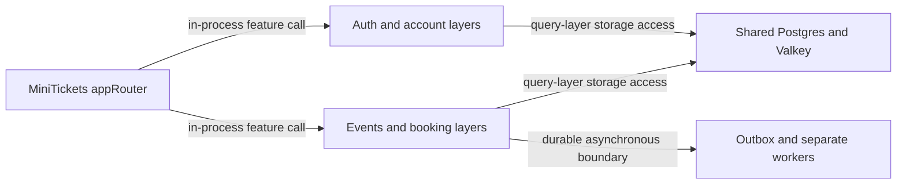

# Monolith vs microservices

History: see [CHANGELOG.md](../CHANGELOG.md) or run `pnpm docs:history`

Area: Reliability · Status: ✅ built (a modular monolith) · Step doc: [01 setup](../../01-setup.md)

<!-- interview-card: v2 -->

## 1. What is it?

A modular monolith keeps related business features inside one deployable API with clear internal boundaries. Microservices split business responsibilities into independently deployed network services.

## 2. Why do we need it?

MiniTickets has a small team and closely related booking rules. Splitting every feature would add network failures, deployments and coordination before those boundaries provide a practical benefit.

## 3. How does it work?

1. Keep feature responsibilities and layers clear within the API.
2. Use in-process calls where independent deployment provides little value.
3. Choose a separate service boundary when ownership or workload lifecycle warrants it.

## 4. How do we use it in MiniTickets?

The API remains a modular monolith with one router keyed by feature. Web is a separate UI service, and background email/ticket workers are already separate processes. The older “first likely worker split” description is now historical, not future work.

## 5. Interview-ready answer

“MiniTickets keeps its synchronous business API as a modular monolith: features share a deployment and database while preserving procedure, service and query responsibilities. Separate workers handle asynchronous lifecycles. I would split another domain only for clear ownership, independent scaling or release needs, because a network boundary adds distributed failures, data consistency decisions and operational work rather than creating modularity by itself.”

## 6. Important follow-up questions

- **When would you split a domain?** When its ownership, scaling profile or release cadence needs genuine independence.
- **What is simpler inside one API?** Calls, debugging and transactions can remain local.
- **What does the monolith risk?** Features share deployment/scaling and a bad change can affect several of them.
- **How do boundaries erode?** Unreviewed cross-feature data access can turn clear modules into tightly coupled code.

## 7. Advanced details

Technical reference

### Current architecture and sources

`apps/api/src/trpc/router.ts` defines `appRouter` with auth, account, telemetry, events, bookings, tickets and posters. Features live in procedure/service/query or queue files; procedures validate, services decide, query/queue adapters access external systems. The old two-feature router example is illustrative history, not the full current list.

Web is a separate UI deployable, not a split of the synchronous business domain. Email/ticket worker execution is already separate behind durable outbox/SNS/SQS boundaries; the original proposed worker extraction has been realized. One API ECS service still contains the synchronous feature modules. List layer files with `ls apps/api/src/procedures apps/api/src/services apps/api/src/queries`.

### Trade-offs and extraction example

A small team gains one API release, local calls and simpler shared transactions; scaling/deployment failures remain shared. Conventions require review because the current lint does not enforce all boundaries. Moving account into its own service would require a data-ownership decision, network/auth boundary, independent deployment and cross-service diagnosis. Extract only when those costs serve concrete team/workload needs, rather than to increase the number of services.

### Code anchors

- Anchor: `apps/api/src/trpc/router.ts` · `appRouter`: the current router contains auth/account plus telemetry, events, bookings, tickets and posters.

### Related reading

[layered-api](layered-api.md) · [rpc-vs-rest](rpc-vs-rest.md) · [ecs-service](ecs-service.md) · [scaling](scaling.md) · [stateless-servers](stateless-servers.md)

[Open this concept in the city explorer](../guides/infra-explorer.html?concept=monolith-vs-microservices#chapter=8&piece=api-task).

## Where it appears in the story

- [App story: 12. Monorepo and shared types](../app-story.md#12-monorepo-and-shared-types)

