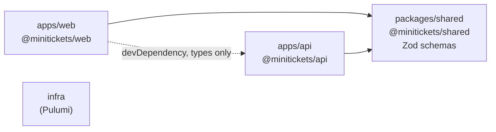

# Monorepo with pnpm workspaces, shared package

History: see [CHANGELOG.md](../CHANGELOG.md) or run `pnpm docs:history`

Area: DevOps & CI/CD · Status: ✅ built · Step doc: [01 setup](../../01-setup.md)

## 1. In one line

One git repository holds the web app, the api, a shared package and the infra code as separate
**pnpm workspace** packages that depend on each other by name (`@minitickets/shared`).

## 2. Real-life comparison

One building with several companies sharing a reception, a mail room and one key system, instead of
separate buildings across town. Changes that touch two companies happen in one go.

## 3. Picture it



## 4. Where in our code

- Anchor: `pnpm-workspace.yaml` · `packages: ["apps/*", "packages/*", "infra"]`.
- Anchor: `packages/shared/src/index.ts` · the one public entry point of the shared package.
- Anchor: `apps/web/next.config.ts` · `transpilePackages: ["@minitickets/shared"]`: Next compiles the shared TypeScript source.

Step by step:

1. Each folder has its own `package.json`; `"@minitickets/shared": "workspace:*"` links to the local
   copy, never a published one.
2. `packages/shared` ships **TypeScript source** (`"exports": { ".": "./src/index.ts" }`): no build
   step. Consumers compile it: Next via `transpilePackages`, the api bundle via esbuild (it is
   deliberately left out of `external` in `apps/api/build.mjs`), tsx in dev.
3. `CLAUDE.md` rule: shared contains only Zod schemas and inferred types.
4. One lockfile (`pnpm-lock.yaml`), one `tsconfig.base.json` that every package extends, one ESLint
   config, one Vitest config.
5. Root scripts run across packages: `pnpm typecheck` (`pnpm -r typecheck`), `pnpm dev`
   (`--parallel --filter "./apps/*"`).
6. Docker builds use `--filter @minitickets/api...` ("this package and what it depends on"), so
   each image installs only what it needs.

## 5. See it yourself

```bash
pnpm -r ls --depth -1                 # the workspace packages
pnpm why @minitickets/shared          # who depends on it
```

**Break it on purpose:** remove `transpilePackages` from `next.config.ts`: `next build` can no longer
compile the `.ts` file it imports from `packages/shared` (exact error text depends on the Next
version).

## 6. How it connects

- **Uses ←** pnpm 10 (`packageManager` in the root `package.json`, enabled by corepack in Docker).
- **Gives →** [end-to-end-types](end-to-end-types.md), shared schemas for
  [validation-at-boundaries](validation-at-boundaries.md), one [ci-pipeline](ci-pipeline.md).

## 7. Our settings and WHY

| Choice | Why |
| ------ | --- |
| pnpm workspaces | Fast, strict `node_modules` (no phantom dependencies), good `--filter`. |
| Shared package as raw TS | No build step to forget; each consumer compiles it. |
| Shared = schemas only | Keeps runtime code from leaking between apps. |

## 8. Trade-offs

- **Pros:** atomic changes across web, api and schemas; one CI; one set of tool versions.
- **Cons:** CI checks everything on every push (no affected-only builds yet); Docker builds need the
  whole repo as context (`.dockerignore` trims it); raw-TS packages need care in every bundler.

## 9. Alternatives and when to choose them

- **Turborepo / Nx** on top: caching and "affected" builds when CI gets slow.
- **Polyrepo:** independent teams with separate release cycles; needs published packages or
  generated clients for shared types.

## 10. What breaks, and how we'd notice

- Lockfile out of date: `pnpm install --frozen-lockfile` fails in CI and Docker.
- A package imported but not declared: pnpm's strict layout makes it fail locally, not only in prod.

## 13. Interview answers at 3 levels

- **Simple:** All our code lives in one repo, split into packages that share code.
- **Senior:** pnpm workspaces with `apps/web`, `apps/api`, `packages/shared` and `infra`. Shared
  holds Zod schemas as raw TypeScript; Next transpiles it, esbuild bundles it into the api. The web
  imports only the api's router type. One lockfile, one base tsconfig, filtered installs in Docker.
- **Lead:** A monorepo makes cross-cutting changes atomic and type-checked, which is why tRPC works
  well here. As it grows, add task caching and affected-only CI, and enforce package boundaries.

## 14. Follow-up questions interviewers ask

- *Why not publish the shared package?* Versioning overhead with no external consumers.
- *What does `workspace:*` mean?* Always use the local package, whatever its version.

## 15. Say it in 30 seconds

"pnpm workspaces: web, api, a shared package and infra in one repo. The shared package is only Zod
schemas, shipped as TypeScript source that Next and esbuild compile. One lockfile and one base
tsconfig, and Docker installs only what each app needs with --filter."

## 16. Status

✅ built.

## Where it appears in the story

- [App story: 12. Monorepo and shared types](../app-story.md#12-monorepo-and-shared-types)
