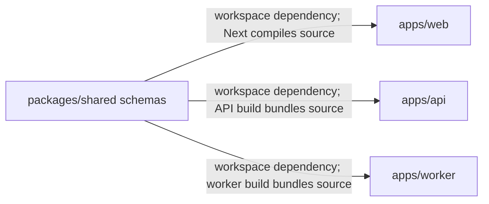

# Monorepo with pnpm workspaces, shared package

History: see [CHANGELOG.md](../CHANGELOG.md) or run `pnpm docs:history`

Area: DevOps & CI/CD · Status: ✅ built · Step doc: [01 setup](../../01-setup.md)
<!-- interview-card: v2 -->

## 1. What is it?

A monorepo keeps several related packages in one version-controlled repository. MiniTickets uses pnpm workspaces to connect its applications, shared schemas and infrastructure package.

## 2. Why do we need it?

A booking input change affects both browser and API. One repository lets us update the schema and its consumers together, then check that the pieces still agree.

## 3. How does it work?



1. Declare each package and its dependencies.
2. Link shared packages locally through the workspace.
3. Run repository checks over the affected relationships.

## 4. How do we use it in MiniTickets?

Shared code contains Zod schemas and inferred types. Web imports only the API router type, not runtime server code. A shared lockfile and base tooling keep installs consistent; Docker uses filtered workspace dependencies.

## 5. Interview-ready answer

“MiniTickets uses one repository with explicit packages so schema and application changes can be reviewed together. pnpm links the local shared package, and each consumer compiles its TypeScript source. The convenience needs boundaries: shared holds schemas and types, web cannot import server runtime code, and broad CI work can grow as the repository expands.”

## 6. Important follow-up questions

- **Does one repository mean one deployment?** No. Packages can still build and deploy as separate applications.
- **Why not publish shared schemas?** There are no external consumers requiring a release process today.
- **What if a dependency is undeclared?** pnpm’s strict package layout helps expose the missing declaration.
- **What would help a much larger repository?** Measured task caching and affected-only checks, while preserving package boundaries.

## 7. Advanced details

<details>
<summary>Technical reference</summary>

### Source references

- Anchor: `pnpm-workspace.yaml` · `packages: ["apps/*", "packages/*", "infra"]`.
- Anchor: `packages/shared/src/index.ts` · the one public entry point of the shared package.
- Anchor: `apps/web/next.config.ts` · `transpilePackages: ["@minitickets/shared"]`: Next compiles the shared TypeScript source.

Step by step:

1. Each folder has its own `package.json`; `"@minitickets/shared": "workspace:*"` links to the local
   copy, never a published one.
2. `packages/shared` ships **TypeScript source** (`"exports": { ".": "./src/index.ts" }`): no build
   step. Consumers compile it: Next via `transpilePackages`, the api bundle via esbuild (it is
   deliberately left out of `external` in `apps/api/build.mjs`), tsx in dev.
3. `CLAUDE.md` rule: shared contains only Zod schemas and inferred types.
4. One lockfile (`pnpm-lock.yaml`), one `tsconfig.base.json` that every package extends, one ESLint
   config, one Vitest config.
5. Root scripts run across packages: `pnpm typecheck` runs workspace checks plus scripts; `pnpm dev` runs stack:up then dev:apps (`--parallel --filter "./apps/*"`).
6. Docker builds use `--filter @minitickets/api...` ("this package and what it depends on"), so
   each image installs only what it needs.

### Configuration and design

| Choice | Why |
| ------ | --- |
| pnpm workspaces | Fast, strict `node_modules` (no phantom dependencies), good `--filter`. |
| Shared package as raw TS | No build step to forget; each consumer compiles it. |
| Shared = schemas only | Keeps runtime code from leaking between apps. |

### Checks and troubleshooting

```bash
pnpm -r ls --depth -1                 # the workspace packages
pnpm why @minitickets/shared          # who depends on it
```

**Isolated thought experiment (not performed):** remove `transpilePackages` from `next.config.ts`: `next build` can no longer
compile the `.ts` file it imports from `packages/shared` (exact error text depends on the Next
version).

- Lockfile out of date: `pnpm install --frozen-lockfile` fails in CI and Docker.
- A package imported but not declared: pnpm's strict layout makes it fail locally, not only in prod.

- *Why not publish the shared package?* Versioning overhead with no external consumers.
- *What does `workspace:*` mean?* Always use the local package, whatever its version.

### Trade-offs and alternatives

- **Pros:** atomic changes across web, api and schemas; one CI; one set of tool versions.
- **Cons:** CI checks everything on every push (no affected-only builds yet); Docker builds need the
  whole repo as context (`.dockerignore` trims it); raw-TS packages need care in every bundler.

- **Turborepo / Nx** on top: caching and "affected" builds when CI gets slow.
- **Polyrepo:** independent teams with separate release cycles; needs published packages or
  generated clients for shared types.

### Further technical context

pnpm workspaces with `apps/web`, `apps/api`, `packages/shared` and `infra`. Shared
  holds Zod schemas as raw TypeScript; Next transpiles it, esbuild bundles it into the api. The web
  imports only the api's router type. One lockfile, one base tsconfig, filtered installs in Docker.

### Related reading

- **Uses ←** pnpm 10 (`packageManager` in the root `package.json`, enabled by corepack in Docker).
- **Gives →** [end-to-end-types](end-to-end-types.md), shared schemas for
  [validation-at-boundaries](validation-at-boundaries.md), one [ci-pipeline](ci-pipeline.md).

[Open this piece in the city explorer](../guides/infra-explorer.html?concept=monorepo#chapter=0&piece=laptop-api).

## Where it appears in the story

- [App story: 12. Monorepo and shared types](../app-story.md#12-monorepo-and-shared-types)

</details>
