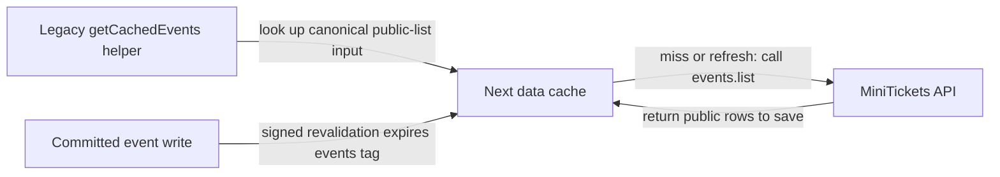

# Next data cache

History: see [CHANGELOG.md](../CHANGELOG.md) or run `pnpm docs:history`

Area: Performance & Caching · Status: ✅ built in repository; live AWS acceptance is separate

<!-- interview-card: v2 -->

## 1. What is it?

The Next data cache saves a server-side function result for reuse. Cached data is separate from the HTML page that displays it.

## 2. Why do we need it?

Several visitors may need the same public event list. Reusing that data can avoid repeated API work while still producing a separate, secure HTML response for each visitor.

## 3. How does it work?

1. Name the public result using complete, normalized inputs.
2. Reuse the saved function result until refresh or invalidation.
3. Expire related tagged entries after a committed change.

## 4. How do we use it in MiniTickets?

The legacy helper remains built, but current search rendering bypasses it to avoid multiplying entries for arbitrary search text and cursors. MiniTickets produces private, uncached HTML with fresh script authorization; that does not forbid explicitly caching suitable public data.

## 5. Interview-ready answer

“MiniTickets separates data caching from page caching. Its legacy Next helper can reuse a public list result under normalized inputs and an invalidation tag. Current search prefetch bypasses that helper, while HTML remains dynamic and no-store. The important trade-off is layered freshness: a server cache can save data that was already old in Redis, and different web tasks have separate cache state.”

## 6. Important follow-up questions

- **Does dynamic HTML forbid cached data?** No. A correctly keyed public result can be cached independently.
- **Can this hold a personalized account response?** Not under a shared public key; keep user-bound data out.
- **Is the helper’s refresh time a hard age cap?** No. Background refresh and failure can retain older data.
- **What changes with multiple web tasks?** Each cache is separate; a revalidation call does not automatically reach every copy.

## 7. Advanced details

Technical reference

### Helper contract and current route

`apps/web/src/features/events/server/cached-events.ts` uses `unstable_cache` around `events.list`, key parts `events.list`, canonical arguments, tag `events`, `revalidate: 30`. `revalidateEventsCache` calls `revalidateTag(EVENTS_TAG, { expire: 0 })` for immediate expiration from the signed revalidation route. This is the existing caching model; Cache Components/use-cache would be a broader rendering change, not enabled by this helper.

`apps/web/src/features/events/server/prefetch-events.ts` currently prefetches `events.search`, bypassing the helper to avoid unbounded text/cursor keys. `apps/web/src/app/layout.tsx` waits for a request; HTML/RSC is private,no-store with fresh CSP nonces. There is no static export.

### Layered freshness and evidence

The helper’s 30-second interval is soft, not a hard bound: stale data may be served during refresh, including failed background refresh. It is process/disk-local to a web copy. Browser queries and Redis have independent clocks; freshness can compound and one revalidation request reaches only one web instance.

`pnpm demo:security` exercises production-mode local HTML/cache behavior, not live AWS/CI acceptance. Future work may measure TTFB/hit rates and deliberately evaluate static hash-based CSP or separate public/static routes. No new command was run for this rewrite.

### Code anchors

- Anchor: `apps/web/src/features/events/server/cached-events.ts` — `getCachedEvents`; follow the numbered comments at this boundary.

### Related reading

[current system](../00-big-picture.md) · [scenario](../guides/interview-scenarios.md#rendering-models) · [explorer tour](../guides/infra-explorer.html?tour=search)

[Open this concept in the city explorer](../guides/infra-explorer.html?concept=next-data-cache#chapter=8&piece=web-task).

## Where it appears in the story

- [app-story: 1b. Search input, hydration and bounded rows](../app-story.md#1b-search-input-hydration-and-bounded-rows)

