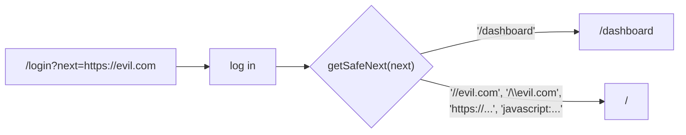

# Open redirect protection

History: see [CHANGELOG.md](../CHANGELOG.md) or run `pnpm docs:history`

Area: Auth & Security · Status: ✅ built · Step doc: [09 dashboard](../../09-dashboard.md)

## 1. In one line

An **open redirect** is our site forwarding users to any URL an attacker puts in a link; after login
we only follow `?next=` if it is a path on **our** site.

## 2. Real-life comparison

A trusted receptionist who says "go to room 12" is fine. One who reads "go to the building across
the street" from a sticky note anyone could write, and repeats it with authority, helps scammers.

## 3. Picture it



## 4. Where in our code

- Anchor: `apps/web/src/features/auth/lib/safe-next.ts` · `getSafeNext`.
- Anchor: `apps/web/src/features/auth/lib/safe-next.test.ts` · `describe("getSafeNext")`: the attack cases.
- Anchor: `apps/web/src/features/auth/components/login-form.tsx` · `next = getSafeNext(useSearchParams().get("next"))`.

Step by step:

1. `proxy.ts` puts the wanted path in `?next=` ([route-guard-proxy](route-guard-proxy.md)).
2. The login form reads it and passes it through `getSafeNext` before `router.push(next)`.
3. Allowed: starts with `/`, not `//` (protocol-relative: "any host"), no `\` (browsers treat it like
   `/`).
4. Anything else (full URLs, `javascript:`) → `/`.

## 5. See it yourself

```bash
pnpm test safe-next      # 6 cases: keeps /dashboard, home for null, rejects 4 attack shapes
```

e2e: `dashboard.spec.ts` "an external ?next= is ignored after login (no open redirect)": log in
from `/login?next=https://evil.com` and land on `/`.

**Break it on purpose:** change the check to `next.startsWith("/")`. The test "rejects a
protocol-relative URL" (`//evil.com`) fails.

## 6. How it connects

- **Uses ←** [route-guard-proxy](route-guard-proxy.md) (sets `next`).
- **Gives →** safe post-login navigation; also blocks `javascript:` URLs ([xss](xss.md)).

## 7. Our settings and WHY

Allow-list by shape (relative path only) rather than a deny-list of bad hosts. WHY: there are
endless ways to write another host; there's one simple shape for "our path".

## 8. Trade-offs

- **Pros:** tiny, pure function, fully unit-tested.
- **Cons:** can't redirect to legitimate other domains (we have none).

## 9. Alternatives and when to choose them

- **`new URL(next, origin)` and compare `origin`:** robust parsing; good when full same-origin URLs
  must be accepted.
- **An allow-list of route names:** strictest, for a few fixed destinations.

## 10. What breaks, and how we'd notice

A new redirect parameter elsewhere that skips `getSafeNext`. Code review; the e2e test covers login
only.

## 13. Interview answers at 3 levels

- **Simple:** After login we only send you to pages on our own site.
- **Senior:** `getSafeNext` accepts only paths that start with `/` but not `//` and contain no
  backslash; everything else goes home. Unit tests cover protocol-relative, backslash, full URL and
  `javascript:`; an e2e test logs in with `next=https://evil.com`.
- **Lead:** Open redirects make phishing believable because the link starts with our domain. Treat
  every URL parameter as untrusted, validate by allow-list, and centralise it in one tested helper.

## 14. Follow-up questions interviewers ask

- *Why block `//evil.com`?* It's a protocol-relative URL: the browser goes to evil.com.
- *Why the backslash?* Browsers normalise `\` to `/`, so `/\evil.com` becomes `//evil.com`.

## 15. Say it in 30 seconds

"After login we redirect to ?next=, but only through getSafeNext, which accepts a path starting
with a single slash and no backslash. Full URLs, protocol-relative URLs and javascript: all go home.
Unit tests cover the tricks and an e2e test tries https://evil.com."

## 16. Status

✅ built.

## Where it appears in the story

- [App story: 13. Validation at boundaries](../app-story.md#13-validation-at-boundaries)
