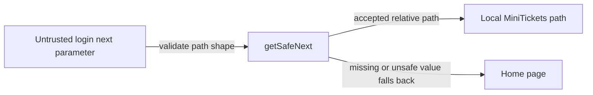

# Open redirect protection

History: see [CHANGELOG.md](../CHANGELOG.md) or run `pnpm docs:history`

Area: Auth & Security · Status: ✅ built · Step doc: [09 dashboard](../../09-dashboard.md)
<!-- interview-card: v2 -->

## 1. What is it?

An open redirect lets an attacker make our website forward a visitor to another site. A safe return path keeps post-login navigation inside MiniTickets.

## 2. Why do we need it?

A phishing link could begin with our genuine login page but send the visitor to an attacker’s imitation afterward. Trust in our domain should not authorize a caller-chosen destination.

## 3. How does it work?



1. Read the requested destination as untrusted input.
2. Allow only the supported local-path shape.
3. Navigate to that result; otherwise go home.

## 4. How do we use it in MiniTickets?

The login form calls `getSafeNext` before navigation. It accepts paths beginning with one slash, rejects protocol-relative paths and backslashes, and falls back to `/`. New redirect locations need the same deliberate review.

## 5. Interview-ready answer

“MiniTickets keeps login return paths local through one small helper. It rejects full external URLs, protocol-relative destinations and backslashes before navigation. That prevents a trusted login URL being used as a bridge to a phishing site. If future flows need external destinations, I would add an explicit, carefully parsed allow-list.”

## 6. Important follow-up questions

- **Why reject two leading slashes?** Browsers treat them as a destination host rather than our local path.
- **Why reject backslashes?** Browser normalization can turn them into slash-based external redirects.
- **What happens to an invalid value?** The helper returns the home path.
- **Does one safe helper protect every redirect?** Only when every relevant redirect actually uses it; review new entry points.

## 7. Advanced details

<details>
<summary>Technical reference</summary>

### Source references

- Anchor: `apps/web/src/features/auth/lib/safe-next.ts` · `getSafeNext`.
- Anchor: `apps/web/src/features/auth/lib/safe-next.test.ts` · `describe("getSafeNext")`: the attack cases.
- Anchor: `apps/web/src/features/auth/components/login-form.tsx` · `next = getSafeNext(useSearchParams().get("next"))`.

Step by step:

1. `proxy.ts` puts the wanted path in `?next=` ([route-guard-proxy](route-guard-proxy.md)).
2. The login form reads it and passes it through `getSafeNext` before `router.push(next)`.
3. Allowed: starts with `/`, not `//` (protocol-relative: "any host"), no `\` (browsers treat it like
   `/`).
4. Anything else (full URLs, `javascript:`) → `/`.

### Configuration and design

Allow-list by shape (relative path only) rather than a deny-list of bad hosts. WHY: there are
endless ways to write another host; there's one simple shape for "our path".

### Checks and troubleshooting

```bash
pnpm test safe-next      # 6 cases: keeps /dashboard, home for null, rejects 4 attack shapes
```

e2e: `dashboard.spec.ts` "an external ?next= is ignored after login (no open redirect)": log in
from `/login?next=https://evil.com` and land on `/`.

**Isolated thought experiment (not performed):** change the check to `next.startsWith("/")`. The test "rejects a
protocol-relative URL" (`//evil.com`) fails.

A new redirect parameter elsewhere that skips `getSafeNext`. Code review; the e2e test covers login
only.

- *Why block `//evil.com`?* It's a protocol-relative URL: the browser goes to evil.com.
- *Why the backslash?* Browsers normalise `\` to `/`, so `/\evil.com` becomes `//evil.com`.

### Trade-offs and alternatives

- **Pros:** tiny, pure function, fully unit-tested.
- **Cons:** can't redirect to legitimate other domains (we have none).

- **`new URL(next, origin)` and compare `origin`:** robust parsing; good when full same-origin URLs
  must be accepted.
- **An allow-list of route names:** strictest, for a few fixed destinations.

### Further technical context

`getSafeNext` accepts only paths that start with `/` but not `//` and contain no
  backslash; everything else goes home. Unit tests cover protocol-relative, backslash, full URL and
  `javascript:`; an e2e test logs in with `next=https://evil.com`.

### Related reading

- **Uses ←** [route-guard-proxy](route-guard-proxy.md) (sets `next`).
- **Gives →** safe post-login navigation; also blocks `javascript:` URLs ([xss](xss.md)).

[Open this piece in the city explorer](../guides/infra-explorer.html?concept=open-redirect#chapter=8&piece=web-task).

## Where it appears in the story

- [App story: 13. Validation at boundaries](../app-story.md#13-validation-at-boundaries)

</details>
