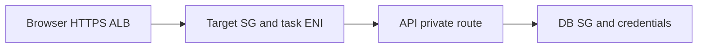

# Origin protection: prefix list + secret header

History: see [CHANGELOG.md](../CHANGELOG.md) or run `pnpm docs:history`

Area: AWS Network · Status: ✅ built in repository; live AWS acceptance is separate

## 1. In one line

CloudFront mode restricts ALB ingress and requires X-Origin-Verify. ALB-only mode instead uses selected allowedCidrs and HTTPS; current cdnEnabled=false means the CDN secret/prefix-list path is inactive.

## 2. Real-life comparison

Road signs find the right building, guards allow the right door and staff badges allow specific service actions.

## 3. Picture it

## 4. Where in our code

- Anchor: `infra/src/entry/cdn.ts` — `module configuration`; follow the numbered comments at this boundary.
- Anchor: `infra/src/entry/listener.ts` — `hasSecretHeader`; follow the numbered comments at this boundary.
- Anchor: `infra/src/entry/origin-secret.ts` — `createOriginSecret`; follow the numbered comments at this boundary.
- Anchor: `infra/src/security.ts` — `cloudFrontPrefixList`; follow the numbered comments at this boundary.

`infra/src/network.ts` defines routes; `security.ts` allows ALB→web/API and API→Postgres/Valkey. `compute/service-connect.ts` defines namespace aliases. API_INTERNAL_URL is for web server code; browser tRPC uses same-origin ALB routing. Read `infra/src/compute/service-connect.ts` and follow the private-name console tour.

## 5. See it yourself

Use the linked scenario and tour to trace the existing integration point. This proposed extension has no runnable feature demo.

Failure thought experiment: Can browser JS call the Service Connect hostname? No; it is private service discovery for tasks. Do not change a live stack to demonstrate it.

## 6. How it connects

Uses the [current system](../00-big-picture.md); gives a concrete decision to the [scenario](../guides/interview-scenarios.md#network-boundaries) and [explorer tour](../guides/infra-explorer.html?tour=database-reach).

## 7. Our settings and WHY

CloudFront mode restricts ALB ingress and requires X-Origin-Verify. ALB-only mode instead uses selected allowedCidrs and HTTPS; current cdnEnabled=false means the CDN secret/prefix-list path is inactive. A valid password cannot repair a missing route or blocked SG.

## 8. Trade-offs

Public ECS task IPs avoid NAT in this small design but require strict inbound SGs. Private subnets with NAT/endpoints change cost and reach.

## 9. Alternatives and when to choose them

10x: map all egress and proxy trust. 100x: segmentation, IPv6/endpoints and flow logs after a concrete need.

## 10. What breaks and how we notice

Can browser JS call the Service Connect hostname? No; it is private service discovery for tasks.

## 11. Reach / Allowed / Password

Prove the network path separately from the scoped IAM action and the runtime credential. [Every IAM badge](../guides/infra-build-along.md#every-iam-badge-who--what--attached) shows trust, permissions and attachment. No AWS endpoint needs an inbound SG simply because a non-VPC Lambda calls it.

## 12. Cost

Existing resource/usage costs are detailed in the corresponding infra guide chapter. No new resources were deployed by this documentation change. Historical phase costs are illustrative snapshots, not a current quote; inspect billing and current regional pricing before a capacity decision.

## 13. Interview answers at 3 levels

- **Simple:** CloudFront mode restricts ALB ingress and requires X-Origin-Verify.
- **Senior:** First prove reach: address, route, subnet and listener. Then prove allowed: SG source/port and IAM for service APIs. Finally prove credentials. SGs are stateful; NACLs are subnet-level/stateless. An ENI is the task’s network interface. Service Connect gives web/api private names and ports without exposing internal traffic through a public browser URL.
- **Lead:** 10x: map all egress and proxy trust. 100x: segmentation, IPv6/endpoints and flow logs after a concrete need.

## 14. Follow-up questions with answers

Can browser JS call the Service Connect hostname? No; it is private service discovery for tasks.

Which control is stateful? **Security group.**

## 15. Say it in 30 seconds

First prove reach: address, route, subnet and listener. Then prove allowed: SG source/port and IAM for service APIs. Finally prove credentials. SGs are stateful; NACLs are subnet-level/stateless. An ENI is the task’s network interface. Service Connect gives web/api private names and ports without exposing internal traffic through a public browser URL.

## 16. Status and production work

Repository implementation and local evidence are described above. Live AWS/CI execution remains owner acceptance. 10x: map all egress and proxy trust. 100x: segmentation, IPv6/endpoints and flow logs after a concrete need.

## Where it appears in the story

- [infra-story: 4b. Private service discovery and asynchronous workers](../infra-story.md#4b-private-service-discovery-and-asynchronous-workers)
