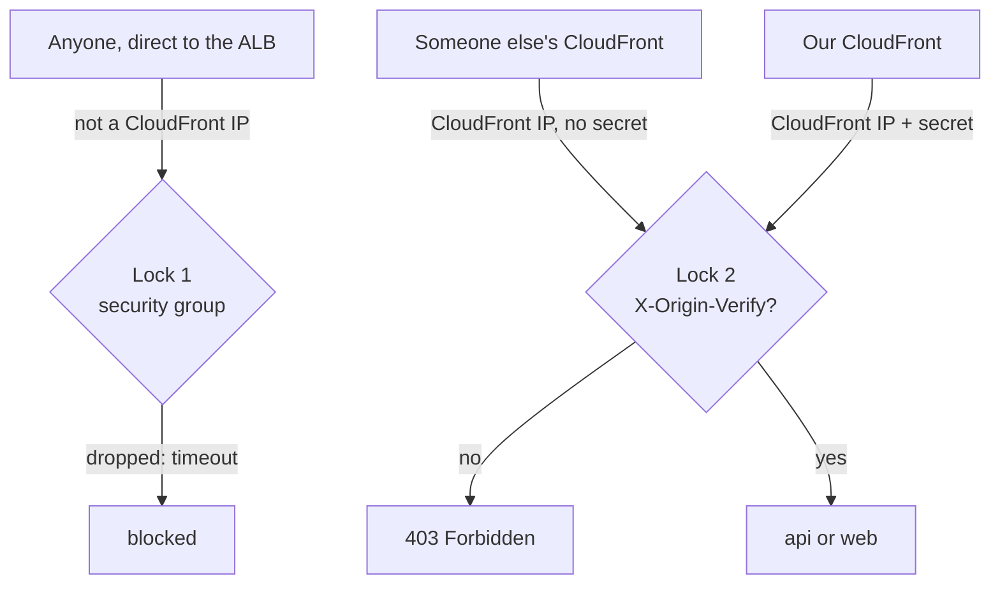

# Origin protection: prefix list + secret header

History: see [CHANGELOG.md](../CHANGELOG.md) or run `pnpm docs:history`

Area: AWS Network · Status: ✅ built · Step doc: [19 CloudFront](../../19-infra-cloudfront.md) (section 3.7)

## 1. In one line

Two locks make sure only **our** CloudFront distribution can reach the ALB: a security group that
admits only CloudFront's IP ranges, and a secret header that only our distribution sends.

## 2. Real-life comparison

A building that only lets in couriers from one delivery company (lock 1: the uniform). But every
customer of that company sends couriers in the same uniform, so the courier must also say our
password (lock 2).

## 3. Picture it



## 4. Where in our code

- Anchor: `infra/src/security.ts` · `cloudFrontPrefixList` and rule `alb-in-80`: lock 1.
- Anchor: `infra/src/entry/origin-secret.ts` · `createOriginSecret`: the random header value.
- Anchor: `infra/src/entry/cdn.ts` · `customHeaders`: CloudFront adds the header to every origin request.
- Anchor: `infra/src/entry/listener.ts` · `hasSecretHeader`: both forward rules require it; the default is 403.

Step by step:

1. `security.ts`: `aws.ec2.getManagedPrefixListOutput({ name: "com.amazonaws.global.cloudfront.origin-facing" })`;
   the alb group's only inbound rule is port 80 from that prefix list. AWS keeps the list current.
2. `origin-secret.ts`: `random.RandomPassword`, 32 characters, `special: false` (the ALB treats
   `*` and `?` in header conditions as wildcards). Pulumi stores it encrypted and prints `[secret]`.
   Header name: `X-Origin-Verify`.
3. `cdn.ts`: `customHeaders: [{ name, value }]` on the origin.
4. `listener.ts`: `hasSecretHeader` is a condition in both `trpcRule` and `webRule`; the listener's
   default action is `fixed-response` 403.

## 5. See it yourself

```bash
cd infra
curl -sS -m 10 -o /dev/null -w '%{http_code}\n' "http://$(pulumi stack output albDnsName)/"   # timeout, 000: lock 1
curl -s -o /dev/null -w '%{http_code}\n' "$(pulumi stack output appUrl)/"                   # 200 through CloudFront
aws ec2 describe-security-group-rules --profile ticketlite \
  --filters Name=group-id,Values=$(pulumi stack output albSgId) \
  --query "SecurityGroupRules[?!IsEgress].[FromPort,PrefixListId]"
```

**Break it on purpose (scratch branch):** remove the header condition from `webRule`. Lock 2 is now
open for pages: anyone could create their own CloudFront distribution pointing at our ALB and get
our pages.

## 6. How it connects

- **Uses ←** [security groups](security-groups.md), [CloudFront](cloudfront.md), the
  [ALB](alb.md) listener.
- **Gives →** no way to skip CloudFront's HTTPS (and, later, its edge protections such as WAF or rate
  limits). Makes `trustProxy` safe: hop 1 is always a CloudFront edge.

## 7. Our settings and WHY

| Choice | Why |
| ------ | --- |
| Prefix list, not IP ranges typed by hand | AWS updates it as CloudFront adds ranges. |
| Only port 80 | Nothing listens on 443; and the prefix list counts as 55 of the 60 rules a group may hold, so a second rule would not fit. |
| Secret header as well | Every AWS customer's CloudFront uses the same IPs; lock 1 alone lets them in. |
| Both locks | The security group stops strangers before the ALB does any work; the header stops other distributions. |
| 403 default | Deny unless a rule matches. |

## 8. Trade-offs

- **Pros:** cheap, simple, no extra service.
- **Cons:** the header value is visible to anyone who can read our CloudFront or listener config,
  travels unencrypted on the edge → ALB hop in dev, and is never rotated.

## 9. Alternatives and when to choose them

- **CloudFront VPC origins** (private ALB, no public address at all): strongest; check whether it fits
  the ALB and region before adopting (not explored here).
- **WAF on the ALB** checking the header: adds logging and rate limits.
- **Rotating the secret** (two values accepted during a switch): production hygiene.

## 10. What breaks, and how we'd notice

| Mistake | Effect |
| ------- | ------ |
| Header values differ (e.g. CloudFront change still rolling out) | Every request: plain-text `Forbidden` |
| alb group still open to `0.0.0.0/0` | Anyone can skip CloudFront |
| No header check | Anyone's distribution can use our ALB |
| Listener default still "forward to web" | Requests without the header reach web |

## 11. Reach / Allowed / Password

This **is** Reach (lock 1) plus Password (lock 2) for the CloudFront → ALB connection. No IAM.

## 12. Cost

Free: security group rules, the random value and listener rules cost nothing extra.

## 13. Interview answers at 3 levels

- **Simple:** We make sure people can only reach our app through CloudFront.
- **Senior:** The ALB's security group allows port 80 only from AWS's managed CloudFront
  origin-facing prefix list. Since every CloudFront customer shares those IPs, CloudFront also sends a
  random `X-Origin-Verify` header, and the listener's forward rules require it; anything else hits a
  fixed 403.
- **Lead:** This keeps every edge control (HTTPS, caching, future WAF) mandatory. For production I'd
  rotate the secret, encrypt the edge-to-origin hop, or move to a private origin so the ALB has no
  public address at all.

## 14. Follow-up questions interviewers ask

- *Why isn't the prefix list enough?* It identifies CloudFront, not our distribution.
- *Why not only the header?* Then anyone could open connections and make the ALB answer 403s.
- *Do health checks need the header?* No; they go from the ALB to targets, not through the listener.

## 15. Say it in 30 seconds

"Two locks: the ALB's security group accepts port 80 only from CloudFront's managed prefix list, and
the listener forwards only requests carrying a random `X-Origin-Verify` header that only our
distribution sends. Everything else gets a timeout or a 403."

## 16. Status

✅ built. **To make it production-grade:** rotate the secret, HTTPS on the edge-to-ALB hop, or a
private origin.
