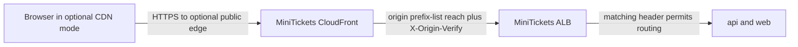

# Origin protection: prefix list + secret header

History: see [CHANGELOG.md](../CHANGELOG.md) or run `pnpm docs:history`

Area: AWS Network · Status: ✅ built in repository; live AWS acceptance is separate
<!-- interview-card: v2 -->

## 1. What is it?

Origin protection restricts who can call the application server behind a delivery network. It helps keep visitors from bypassing the intended public entry path.

## 2. Why do we need it?

If MiniTickets enabled CloudFront but left the ALB open, callers could skip the edge and contact it directly. The origin needs a gate as well as a public website address.

## 3. How does it work?

1. Restrict network entry to the delivery network.
2. Require an origin header known to our distribution.
3. Route matching requests and reject unmatched origin traffic.

## 4. How do we use it in MiniTickets?

This is the implemented optional CloudFront path, currently inactive. Today visitors use direct HTTPS to the ALB with its configured public ingress. Origin protection does not replace user login or authorization.

## 5. Interview-ready answer

“In optional CDN mode, MiniTickets protects the ALB with both CloudFront source ranges and a secret origin header. Source ranges alone include other distributions, so the header adds a separate check. That path is disabled today; our active design uses direct ALB HTTPS. Neither origin gate grants a user access to private data.”

## 6. Important follow-up questions

- **Why are source ranges insufficient?** Other CloudFront distributions use those ranges too.
- **Is the header a user session?** No. It authenticates the origin path, not the visitor.
- **What if the header leaks?** Treat it as a secret and coordinate replacement at the distribution and listener.
- **What if optional mode returns 403?** Compare the configured header and listener rules; do not open the origin broadly.

## 7. Advanced details

Technical reference

### Source anchors

- Anchor: `infra/src/entry/cdn.ts` — `module configuration`; follow the numbered comments at this boundary.
- Anchor: `infra/src/entry/listener.ts` — `hasSecretHeader`; follow the numbered comments at this boundary.
- Anchor: `infra/src/entry/origin-secret.ts` — `createOriginSecret`; follow the numbered comments at this boundary.
- Anchor: `infra/src/security.ts` — `cloudFrontPrefixList`; follow the numbered comments at this boundary.

### Optional CDN configuration

`infra/src/entry/origin-secret.ts` → `createOriginSecret` creates a 32-character alphanumeric Pulumi secret. It is not a user cookie or a Secrets Manager secret. CloudFront adds `X-Origin-Verify`; `listener.ts` requires it with `/trpc/*` at priority 100, and requires it for web at priority 200. Unmatched requests receive fixed 403.

The ALB security group accepts TCP 80 from `com.amazonaws.global.cloudfront.origin-facing` in CDN mode. AWS maintains that source list, which includes other distributions; the header supplies the second check. The HTTP origin hop carries that secret unencrypted. Never publish its value in logs/screenshots.

Current `cdnEnabled=false` instead uses direct ALB HTTPS and `allowedCidrs` public ingress. The optional prefix/header gate is inactive. Mode changes require the documented entry-off transition because both listener implementations own port 80. Private task names are server-only; browser API calls use same-origin public routing. ALB→app and API→store security groups remain separate gates.

### Checks and troubleshooting

CloudFront → Distributions → Origins shows the configured origin/header metadata; do not reveal the secret. EC2 → Load Balancers → minitickets-dev → Listeners and rules shows the header conditions; Security Groups shows source-list ingress. In optional mode, unexpected 403 suggests a header/rule mismatch; a network timeout suggests reach or ingress. Inspect configuration rather than weakening the gate. No live AWS acceptance or secret retrieval was performed.

### Trade-offs and alternatives

A leaked header still needs an allowed source path; it must nevertheless be rotated coherently. A private CloudFront VPC origin or HTTPS origin is an alternative requiring its own design. Network reach, IAM service permission and application credentials are distinct: even correct credentials cannot repair a blocked route. SGs are stateful, NACLs stateless, and ENIs provide task networking. Public task IPs avoid NAT cost in dev; segmentation/endpoints/IPv6/flow logs need a concrete requirement. Historical prices are not current quotes.

### Preserved references

- [current system](../00-big-picture.md)
- [scenario](../guides/interview-scenarios.md#network-boundaries)
- [explorer tour](../guides/infra-explorer.html?tour=database-reach)
- [Every IAM badge](../guides/infra-build-along.md#every-iam-badge-who--what--attached)

[Open this piece in the city explorer](../guides/infra-explorer.html?concept=origin-protection#chapter=12&piece=cloudfront).

## Where it appears in the story

- [infra-story: 4b. Private service discovery and asynchronous workers](../infra-story.md#4b-private-service-discovery-and-asynchronous-workers)

