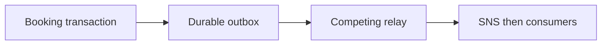

# Transactional outbox

History: see [CHANGELOG.md](../CHANGELOG.md) or run `pnpm docs:history`

Area: Async · Status: ✅ built in repository; live AWS acceptance is separate

## 1. In one line

The transactional outbox saves seats, booking and confirmation atomically. Competing locked batches publish SNS at least once; a crash before marking sent can duplicate delivery. Stable business identities make consumers safe.

## 2. Real-life comparison

A durable work tray keeps the task after the customer leaves; a completed stamp identifies a repeat.

## 3. Picture it

## 4. Where in our code

- Anchor: `apps/api/src/db/schema/outbox.ts` — `outbox`; follow the numbered comments at this boundary.
- Anchor: `apps/api/src/queries/bookings.ts` — `returns`; follow the numbered comments at this boundary.
- Anchor: `apps/api/src/queries/outbox.ts` — `deliverBatch`; follow the numbered comments at this boundary.
- Anchor: `apps/api/src/services/outbox.ts` — `retryInMs`; follow the numbered comments at this boundary.

`apps/api/src/queries/bookings.ts` inserts the outbox row. `queries/outbox.ts` uses FOR UPDATE SKIP LOCKED batches of 10; `services/outbox.ts` retries persisted rows. `pnpm demo:outbox` measured 24/24 recovered after queue restoration and atomic rollback on injected outbox failure.

## 5. See it yourself

Run `pnpm demo:outbox` and inspect the asserted outcome described above.

Failure thought experiment: What if SNS accepted before relay crash? Publish again with stable message identity; consumers deduplicate. Do not change a live stack to demonstrate it.

## 6. How it connects

Uses the [current system](../00-big-picture.md); gives a concrete decision to the [scenario](../guides/interview-scenarios.md#outbox) and [explorer tour](../guides/infra-explorer.html?tour=booking).

## 7. Our settings and WHY

The transactional outbox saves seats, booking and confirmation atomically. Competing locked batches publish SNS at least once; a crash before marking sent can duplicate delivery. Stable business identities make consumers safe. Commit-then-send has a gap; send-then-commit can announce a rolled-back purchase.

## 8. Trade-offs

Holding row locks while sending is simple but occupies a pool connection. Leases/CDC decouple IO at greater complexity. Sent rows need retention planning.

## 9. Alternatives and when to choose them

10x: batch sends/backlog age. 100x: separate relay or CDC, retention and publish throughput budgets.

## 10. What breaks and how we notice

What if SNS accepted before relay crash? Publish again with stable message identity; consumers deduplicate.

## 13. Interview answers at 3 levels

- **Simple:** The transactional outbox saves seats, booking and confirmation atomically.
- **Senior:** Store the booking, seat decrement and confirmation payload in one Postgres transaction. A relay publishes committed outbox rows and marks them sent. A crash after publish but before marking sent produces a duplicate, so consumers stay idempotent. This closes message loss, not exactly-once delivery.
- **Lead:** 10x: batch sends/backlog age. 100x: separate relay or CDC, retention and publish throughput budgets.

## 14. Follow-up questions with answers

What if SNS accepted before relay crash? Publish again with stable message identity; consumers deduplicate.

Does an outbox guarantee exactly-once delivery? **No; at-least-once with idempotent consumers.**

## 15. Say it in 30 seconds

Store the booking, seat decrement and confirmation payload in one Postgres transaction. A relay publishes committed outbox rows and marks them sent. A crash after publish but before marking sent produces a duplicate, so consumers stay idempotent. This closes message loss, not exactly-once delivery.

## 16. Status and production work

Repository implementation and local evidence are described above. Live AWS/CI execution remains owner acceptance. 10x: batch sends/backlog age. 100x: separate relay or CDC, retention and publish throughput budgets.

## Where it appears in the story

- [app-story: 9c. Side path: outbox, fan-out and recoverable work](../app-story.md#9c-side-path-outbox-fan-out-and-recoverable-work)
