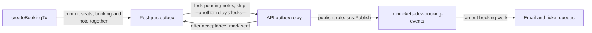

# Outbox: the city ledger with a dispatch note

History: see [CHANGELOG.md](../CHANGELOG.md) or run `pnpm docs:history`

Area: Async · Status: ✅ built in repository; live AWS acceptance is separate
<!-- interview-card: v2 -->

## 1. What is it?

An outbox is a saved note saying “this work still needs sending.” MiniTickets saves that note together with a successful booking. A relay, a small background loop, sends pending notes later.

## 2. Why do we need it?

A buyer books the last seat, then the API crashes before sending the confirmation request. Without a durable note, the booking exists but its background work can disappear.

## 3. How does it work?

1. Commit the booking and note together, or roll both back.
2. A relay reads and locks pending notes.
3. Publish each note, then mark it sent. Failed notes remain retryable.

## 4. How do we use it in MiniTickets?

`createBookingTx` saves seats, booking and outbox in one transaction. Each API process runs a relay that sends stored booking events to SNS for email and ticket work. Pending work survives API restarts; live AWS acceptance remains separate.

## 5. Interview-ready answer

“MiniTickets commits a booking and an outbox note in the same database transaction. A relay sends committed notes and marks them sent afterward. This closes the crash gap between saving a booking and requesting background work. It cannot make the database and SNS one transaction: a crash after publishing can repeat the message, so consumers must handle duplicates.”

## 6. Important follow-up questions

- **Is delivery exactly once?** No. Acceptance followed by a crash before marking sent can cause a duplicate.
- **How do competing relays share work?** Each locks different pending notes and skips occupied ones.
- **What if SNS is unavailable?** Notes stay pending and retry later.
- **What is the main cost?** Publishing holds database locks and connections; a larger system may separate the relay.

## 7. Advanced details

Technical reference

### Data and delivery contract

The [outbox](../glossary.md#outbox) lives in Postgres. `apps/api/src/queries/bookings.ts` → `createBookingTx` locks the event and commits seats, booking and note together. `apps/api/src/db/schema/outbox.ts` → `outbox` defines:

- `id`: stable UUID `messageId`; unique `booking_id` references bookings with cascade deletion for existing demo/reset cleanup.
- JSONB payload contains customer data; log IDs rather than raw payloads.
- `created_at`, `available_at`, nonnegative `attempts`, nullable `sent_at`.
- Partial `(available_at,id)` index for unsent rows. Sent-note retention is undecided.

`apps/api/src/queries/outbox.ts` → `deliverBatch` locks up to ten due unsent rows with `FOR UPDATE SKIP LOCKED`, ordered by availability/id. It holds that SQL transaction across publish and mark-sent; rollback cannot undo an accepted SNS publish.

`apps/api/src/services/outbox.ts` → `relayOnce` / `startOutboxRelay` validates stored JSON and checks row/message/booking identity. Retry delay grows from 1 to 60 seconds and persists across restarts. SNS SDK retries are disabled (`maxAttempts: 1`); the outbox owns retry. Connect/request budgets are 1/2 seconds. Missing topic configuration pauses delivery without dropping notes. Full ten-row batches drain immediately; idle loops wait one second. Shutdown stops new work, waits for the current batch, then closes the pool.

### Reach, permissions and investigation

API → Postgres uses database credentials and TCP 5432, with `minitickets-dev-db-sg` admitting only `minitickets-dev-api-sg`. SNS uses HTTPS 443 and temporary credentials from `minitickets-dev-api-task-role`; its trust accepts `ecs-tasks.amazonaws.com`, and permission allows `sns:Publish` only to `minitickets-dev-booking-events`. Raw SNS subscriptions deliver to `minitickets-dev-jobs` / `minitickets-dev-tickets`; their policies allow that topic/account.

There is no AWS Outbox page. RDS → Databases → `minitickets-dev-db` → Connectivity & security checks reach; inspect rows through authorized SQL. CloudWatch → Logs → `/minitickets/dev/api` shows attempts. SNS → Topics → `minitickets-dev-booking-events` checks destination. Successful bookings with missing work call for pending-row age, relay logs and topic configuration checks. Repeated notices require stable business-identity handling downstream.

### Evidence, alternatives and growth

Historical local `pnpm demo:outbox` recovered 24/24 notices after queue restoration and rolled back seats/booking on injected outbox failure; not rerun here and not AWS proof. Email completion-by-booking still has send-before-record/race duplicate windows; ticket reservation is stronger.

Direct send is simpler when losing post-commit notifications is acceptable. A separately leased relay or change-data capture can reduce lock-held network work at additional complexity. Watch pending age, connection occupancy, throughput and retention. Existing infrastructure costs apply; no new resources or current-price claim. [Outbox scenario](../guides/interview-scenarios.md#outbox).

### Related boundaries

[Postgres](rds-postgres.md) holds atomic writes; [SNS](sns.md) fans out notices; [row locks](row-locks.md) coordinate relays. Check RDS connectivity, IAM → `minitickets-dev-api-task-role` → Permissions, and SQL locks respectively.

### Code anchors

- Anchor: `apps/api/src/db/schema/outbox.ts` — `outbox`; follow the numbered comments at this boundary.
- Anchor: `apps/api/src/queries/bookings.ts` — `returns`; follow the numbered comments at this boundary.
- Anchor: `apps/api/src/queries/outbox.ts` — `deliverBatch`; follow the numbered comments at this boundary.
- Anchor: `apps/api/src/services/outbox.ts` — `retryInMs`; follow the numbered comments at this boundary.

[Open this piece in the city explorer](../guides/infra-explorer.html?concept=outbox#chapter=24&piece=code-store).

## Where it appears in the story

- [app-story: 9c. Side path: outbox, fan-out and recoverable work](../app-story.md#9c-side-path-outbox-fan-out-and-recoverable-work)

