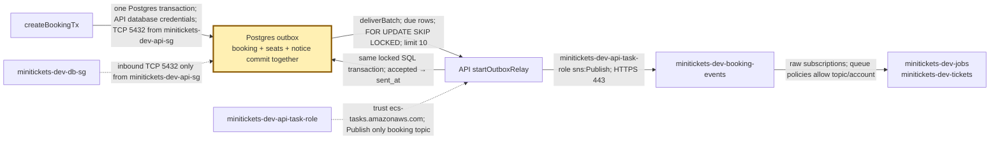
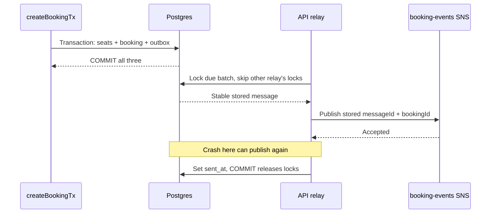

# Outbox: the city ledger with a dispatch note

History: see [CHANGELOG.md](../CHANGELOG.md) or run `pnpm docs:history`

Area: Async · Status: ✅ built in repository; live AWS acceptance is separate
<!-- interview-card: v1 -->

## 1. In one line

MiniTickets saves the booking and its dispatch note in one [transaction](../glossary.md#outbox), preserving its pending confirmation.

## 2. Where it sits

[Open this piece in the city explorer](../guides/infra-explorer.html?concept=outbox#chapter=24&piece=code-store).

## 3. How it works

## 4. What happens in MiniTickets

1. `createBookingTx` locks the event, takes seats and inserts the booking plus outbox notice.
2. Any failure rolls all three changes back.
3. Each API process locks up to ten due notes and skips notes another relay holds.
4. It publishes to SNS, then marks the note sent before releasing its database lock.
5. Failure keeps the note pending. Retries grow from 1 to 60 seconds and survive restarts.

## 5. Reach / Allowed / Password

**Reach:** API reaches Postgres on 5432 through the DB door guard; SNS over HTTPS 443.

**Allowed:** database credentials allow SQL; API task role allows `sns:Publish` on one topic.

**Password:** database password from injected secret; SNS uses temporary role credentials.

## 6. In our code

`apps/api/src/queries/bookings.ts` → `createBookingTx`; `apps/api/src/queries/outbox.ts` → `deliverBatch`.

`apps/api/src/services/outbox.ts` → `relayOnce` / `startOutboxRelay`; `apps/api/src/db/schema/outbox.ts` → `outbox`.

## 7. In the AWS console

No AWS “Outbox” page exists. **RDS → Databases → minitickets-dev-db → Connectivity & security** checks its network. Inspect `outbox` through SQL. **CloudWatch → Logs → Log groups → /minitickets/dev/api** shows attempts; **SNS → Topics → minitickets-dev-booking-events** shows SNS.

## 8. Good / Bad

**Good:** booking and pending notice survive together; multiple API relays avoid the same locked row.

**Bad:** network calls hold SQL connections/locks; a crash after publish can duplicate notices.

## 9. Other choices

- Pick direct send when losing a notification after commit is acceptable.
- Pick an outbox when database success must preserve work.
- Pick change-data capture when scale justifies a separate database-change pipeline.

## 10. Connected to

| Neighbor | Direction | What allows it | Console check |
| --- | --- | --- | --- |
| [Postgres](rds-postgres.md) | in/store | Transaction + DB SG 5432 | RDS → Connectivity & security |
| [SNS](sns.md) | out | Task role `sns:Publish` | IAM → minitickets-dev-api-task-role → Permissions |
| [Row locks](row-locks.md) | guard | `FOR UPDATE SKIP LOCKED` | SQL connection; no lock map in console |

## 11. When it breaks

- Bookings succeed but no jobs → pending `outbox` rows, topic configuration and relay logs → repair publishing; pending rows remain.
- Repeated notice → publish/sent gap → consumers must recognize stable business identities.

## 12. Say it in 30 seconds

“MiniTickets commits seats, booking and an outbox note together. A relay publishes committed notes, then marks them sent. This closes the gap where a booking succeeds but the API crashes before sending. It does not make Postgres and SNS one transaction: a crash after publish repeats the note, so consumers must handle duplicates.”

## 13. Likely follow-ups

**Exactly once?** No; publishing is at least once.

**Why SKIP LOCKED?** Another API relay takes different notes instead of waiting for occupied rows.

## 14. Remember it

Write the promise in the ledger before sending a messenger.

## 15. More detail

Schema, concurrency, evidence and later growth

- Anchor: `apps/api/src/db/schema/outbox.ts` — `outbox`; follow the numbered comments at this boundary.
- Anchor: `apps/api/src/queries/bookings.ts` — `returns`; follow the numbered comments at this boundary.
- Anchor: `apps/api/src/queries/outbox.ts` — `deliverBatch`; follow the numbered comments at this boundary.
- Anchor: `apps/api/src/services/outbox.ts` — `retryInMs`; follow the numbered comments at this boundary.

`outbox.id` is the stable UUID messageId. `booking_id` is unique and references bookings with cascade deletion for existing demo/reset cleanup. Payload is JSONB and contains customer data; logs use ids instead of raw payloads. Fields include `created_at`, `available_at`, nonnegative `attempts` and nullable `sent_at`. A partial `(available_at,id)` index covers unsent rows. Sent notes remain; retention is undecided.

`deliverBatch` locks only due, unsent rows, orders by availability/id and holds locks through publish plus mark-sent. A crash rolls back database updates but cannot undo SNS acceptance. The service validates stored JSON and checks row/message/booking identity before publishing. SNS SDK retries are disabled (`maxAttempts: 1`); outbox owns retries. Calls have 1-second connect and 2-second request budgets. Missing topic config pauses delivery without discarding notes. Full ten-row batches drain immediately; an idle loop waits one second. Shutdown stops new work and waits for the current batch before closing the pool.

Previously recorded `pnpm demo:outbox` evidence recovered 24/24 notices after queue restoration and rolled back seats/booking on injected outbox failure; those are historical local measurements, not rerun or live AWS proof here. Email's booking-key completion store still has send-before-record/race duplicate windows; ticket reservation is stronger. At greater load, inspect pending age, connection occupancy, publish throughput and retention. A separate leased relay or change-data capture reduces lock-held network work at added complexity. [Outbox scenario](../guides/interview-scenarios.md#outbox). Existing infrastructure usage costs apply; no new stack resources or current price claim.

## Where it appears in the story

- [app-story: 9c. Side path: outbox, fan-out and recoverable work](../app-story.md#9c-side-path-outbox-fan-out-and-recoverable-work)
