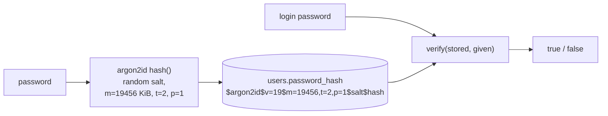

# Password hashing with argon2id

History: see [CHANGELOG.md](../CHANGELOG.md) or run `pnpm docs:history`

Area: Auth & Security · Status: ✅ built · Step doc: [06 signup api](../../06-signup-api.md)

## 1. In one line

We never store passwords; we store an **argon2id hash**: a one-way, deliberately slow and
memory-hungry fingerprint with a random **salt**, so a stolen database is expensive to crack.

## 2. Real-life comparison

A paper shredder that always shreds the same sheet into the same pattern (plus a random confetti mix
per person). You can check a sheet by shredding it again and comparing; you can't un-shred. And the
shredder is slow on purpose, so trying millions of sheets takes forever.

## 3. Picture it



## 4. Where in our code

- Anchor: `apps/api/src/services/auth.ts` · `signup` (`hash(input.password)`), `login` (`verify(...)`).

Step by step:

1. Signup: `hash` from `@node-rs/argon2` with the library defaults. The result is one string with the
   algorithm, version, settings, salt and hash.
2. That string goes into `users.password_hash`. The password itself is never stored or logged
   ([log-redaction](log-redaction.md)).
3. Login: `verify(storedHash, givenPassword)` re-hashes with the stored salt and settings and
   compares.
4. Unknown email: `verify` runs against `DUMMY_HASH` anyway ([user-enumeration](user-enumeration.md)).
5. The input schema caps passwords at 128 characters, so a huge input can't make hashing very slow.

**Our parameters**, verified by hashing on the owner's laptop with the installed library:
`$argon2id$v=19$m=19456,t=2,p=1$…`: argon2id, 19,456 KiB (19 MiB) of memory, 2 iterations, 1 lane.
That equals OWASP's minimum: "Use Argon2id with a minimum configuration of 19 MiB of memory, an
iteration count of 2, and 1 degree of parallelism"
([OWASP Password Storage Cheat Sheet](https://cheatsheetseries.owasp.org/cheatsheets/Password_Storage_Cheat_Sheet.html)).

## 5. See it yourself

```bash
docker exec minitickets-postgres-1 psql -U minitickets -d minitickets \
  -c "select left(password_hash, 40) from users limit 2"
# $argon2id$v=19$m=19456,t=2,p=1$...   (different salt per user)
cd apps/api && node -e "require('@node-rs/argon2').hash('x').then(console.log)"
```

Hash the same password twice: two different strings (different salts), and both verify.

**Break it on purpose (thought experiment):** store `sha256(password)`. Identical passwords give
identical hashes, and a GPU can try billions of SHA-256 guesses per second; argon2's memory cost is
what makes that expensive.

## 6. How it connects

- **Uses ←** [validation-at-boundaries](validation-at-boundaries.md) (length limits),
  [drizzle-schema](drizzle-schema.md) (`password_hash`).
- **Gives →** login ([sessions-vs-jwt](sessions-vs-jwt.md)); equal timing for
  [user-enumeration](user-enumeration.md).

## 7. Our settings and WHY

| Setting | Value | Why |
| ------- | ----- | --- |
| Algorithm | argon2id | Memory-hard; resists GPU cracking; OWASP's first choice. |
| Parameters | library defaults = OWASP minimum | Safe baseline; no custom tuning to get wrong. |
| Library | `@node-rs/argon2` (native) | Fast native code; needs glibc, hence the `slim` image. |
| Max length | 128 | Bounded work per request. |

## 8. Trade-offs

- **Pros:** cracking a leaked hash is slow and costly; salt per user defeats precomputed tables.
- **Cons:** CPU and memory per login and signup (on purpose); a native module complicates builds
  (Alpine/musl issues, `.dockerignore` must exclude host `node_modules`).

## 9. Alternatives and when to choose them

- **bcrypt:** widely available; 72-byte input limit (per OWASP).
- **scrypt:** memory-hard, in Node's standard library.
- **PBKDF2:** when FIPS compliance requires it.
- **A pepper** (secret added before hashing, kept outside the database): extra defence in depth.
- **Passwordless / passkeys:** no password to store at all.

## 10. What breaks, and how we'd notice

- Parameters raised too far: logins get slow, CPU spikes on Spot tasks with ¼ vCPU. Response time
  in logs (`responseTime`).
- Native module built for the wrong platform: the api crashes on start ("exec format error" or
  missing binary). The Docker build and CI catch it.

## 13. Interview answers at 3 levels

- **Simple:** We store a scrambled, one-way version of the password, never the password.
- **Senior:** argon2id via `@node-rs/argon2` with defaults `m=19456,t=2,p=1`, OWASP's minimum; the
  encoded string holds salt and parameters so we can raise them later and rehash on login. Login
  always verifies once, even for unknown emails, and passwords are capped at 128 characters.
- **Lead:** Hash cost is a budget: high enough to slow attackers, low enough for login latency and
  our ¼-vCPU tasks. I'd add rehash-on-login when parameters change, consider a pepper in Secrets
  Manager, and push MFA or passkeys for real protection.

## 14. Follow-up questions interviewers ask

- *Hashing vs encryption?* Hashing is one-way; encryption can be reversed with a key.
- *What is a salt for?* Same password, different hash per user; defeats rainbow tables.
- *Why is SHA-256 fine for session ids but not passwords?* Session ids are 256 random bits: nothing
  to guess. Passwords are low-entropy.

## 15. Say it in 30 seconds

"Passwords are hashed with argon2id using the library defaults, 19 MiB of memory, 2 iterations, 1
lane, which is exactly OWASP's minimum. The stored string has its own salt and parameters. Login
verifies once even for unknown emails, and passwords are capped at 128 characters so hashing can't
be abused."

## 16. Status

✅ built.

## Where it appears in the story

- [App story: 8. The service](../app-story.md#8-the-service)
