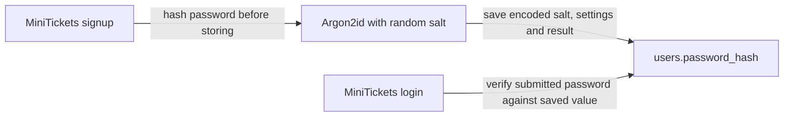

# Password hashing with argon2id

History: see [CHANGELOG.md](../CHANGELOG.md) or run `pnpm docs:history`

Area: Auth & Security · Status: ✅ built · Step doc: [06 signup api](../../06-signup-api.md)
<!-- interview-card: v2 -->

## 1. What is it?

Password hashing stores a one-way check value instead of the password. MiniTickets uses Argon2id, which deliberately makes each guess require time and memory.

## 2. Why do we need it?

If our users table leaks, attackers should not receive everyone’s passwords directly. Making guesses expensive reduces the usefulness of that stolen database, especially compared with fast ordinary hashes.

## 3. How does it work?



1. Signup hashes the password with a fresh random salt.
2. Postgres stores the encoded result, not the password.
3. Login verifies the submitted password using the stored salt and settings.

## 4. How do we use it in MiniTickets?

Our auth service hashes and verifies passwords. Unknown-email login still performs one verification against a dummy hash. Input length is bounded, and request bodies are not logged. Rehash-on-login and passkeys are possible improvements, not built behavior.

## 5. Interview-ready answer

“MiniTickets stores Argon2id password hashes with a separate random salt for each user. The stored encoding includes the settings needed for verification. This makes a leaked database harder to crack, but hash cost also consumes our login capacity. I pair it with bounded input, generic login failures and rate limits.”

## 6. Important follow-up questions

- **Why use a salt?** Equal passwords get different stored results, defeating reusable precomputed guesses.
- **Why not SHA-256?** It is fast, which helps attackers guessing ordinary passwords.
- **Can we decrypt the hash?** No. We verify guesses rather than recover the original password.
- **What if hashing becomes too expensive?** Measure latency and resource use before tuning parameters; retain enough cost to slow offline guessing.

## 7. Advanced details

<details>
<summary>Technical reference</summary>

### Source references

- Anchor: `apps/api/src/services/auth.ts` · `signup` (`hash(input.password)`), `login` (`verify(...)`).

Step by step:

1. Signup: `hash` from `@node-rs/argon2` with the library defaults. The result is one string with the
   algorithm, version, settings, salt and hash.
2. That string goes into `users.password_hash`. The password itself is never stored or logged
   ([log-redaction](log-redaction.md)).
3. Login: `verify(storedHash, givenPassword)` re-hashes with the stored salt and settings and
   compares.
4. Unknown email: `verify` runs against `DUMMY_HASH` anyway ([user-enumeration](user-enumeration.md)).
5. The input schema caps passwords at 128 characters, so a huge input can't make hashing very slow.

**Our parameters**, verified by hashing on the owner's laptop with the installed library:
`$argon2id$v=19$m=19456,t=2,p=1$…`: argon2id, 19,456 KiB (19 MiB) of memory, 2 iterations, 1 lane.
That equals OWASP's minimum: "Use Argon2id with a minimum configuration of 19 MiB of memory, an
iteration count of 2, and 1 degree of parallelism"
([OWASP Password Storage Cheat Sheet](https://cheatsheetseries.owasp.org/cheatsheets/Password_Storage_Cheat_Sheet.html)).

### Configuration and design

| Setting | Value | Why |
| ------- | ----- | --- |
| Algorithm | argon2id | Memory-hard; resists GPU cracking; OWASP's first choice. |
| Parameters | library defaults = OWASP minimum | Safe baseline; no custom tuning to get wrong. |
| Library | `@node-rs/argon2` (native) | Fast native code; needs glibc, hence the `slim` image. |
| Max length | 128 | Bounded work per request. |

### Checks and troubleshooting

```bash
docker exec minitickets-postgres-1 psql -U minitickets -d minitickets \
  -c "select left(password_hash, 40) from users limit 2"
# $argon2id$v=19$m=19456,t=2,p=1$...   (different salt per user)
cd apps/api && node -e "require('@node-rs/argon2').hash('x').then(console.log)"
```

Hash the same password twice: two different strings (different salts), and both verify.

**Break it on purpose (thought experiment):** store `sha256(password)`. Identical passwords give
identical hashes, and a GPU can try billions of SHA-256 guesses per second; argon2's memory cost is
what makes that expensive.

- Parameters raised too far: logins get slow, CPU spikes on small tasks (current entry-on API uses 0.5 vCPU; older measurements used 0.25 vCPU). Response time
  in logs (`responseTime`).
- Native module built for the wrong platform: the api crashes on start ("exec format error" or
  missing binary). The Docker build and CI catch it.

- *Hashing vs encryption?* Hashing is one-way; encryption can be reversed with a key.
- *What is a salt for?* Same password, different hash per user; defeats rainbow tables.
- *Why is SHA-256 fine for session ids but not passwords?* Session ids are 256 random bits: nothing
  to guess. Passwords are low-entropy.

### Trade-offs and alternatives

- **Pros:** cracking a leaked hash is slow and costly; salt per user defeats precomputed tables.
- **Cons:** CPU and memory per login and signup (on purpose); a native module complicates builds
  (Alpine/musl issues, `.dockerignore` must exclude host `node_modules`).

- **bcrypt:** widely available; 72-byte input limit (per OWASP).
- **scrypt:** memory-hard, in Node's standard library.
- **PBKDF2:** when FIPS compliance requires it.
- **A pepper** (secret added before hashing, kept outside the database): extra defence in depth.
- **Passwordless / passkeys:** no password to store at all.

### Further technical context

argon2id via `@node-rs/argon2` with defaults `m=19456,t=2,p=1`, OWASP's minimum; the
  encoded string holds salt and parameters so we can raise them later and rehash on login. Login
  always verifies once, even for unknown emails, and passwords are capped at 128 characters.

### Related reading

- **Uses ←** [validation-at-boundaries](validation-at-boundaries.md) (length limits),
  [drizzle-schema](drizzle-schema.md) (`password_hash`).
- **Gives →** login ([sessions-vs-jwt](sessions-vs-jwt.md)); equal timing for
  [user-enumeration](user-enumeration.md).

[Open this piece in the city explorer](../guides/infra-explorer.html?concept=password-hashing#chapter=8&piece=api-task).

## Where it appears in the story

- [App story: 8. The service](../app-story.md#8-the-service)

</details>
