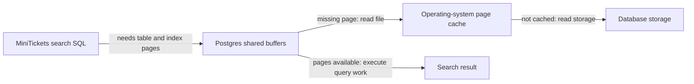

# Postgres page cache

History: see [CHANGELOG.md](../CHANGELOG.md) or run `pnpm docs:history`

Area: Data · Status: 🟡 partial
<!-- interview-card: v2 -->

## 1. What is it?

Postgres keeps recently used table and index pages in memory. The operating system can cache file pages too, reducing repeated storage reads.

## 2. Why do we need it?

MiniTickets may run the same search often. A warm database can reuse pages instead of fetching each one from storage, even when the API still executes a fresh SQL query.

## 3. How does it work?

1. Look for needed database pages in shared buffers.
2. Load missing pages through the operating system’s file path.
3. Execute visibility checks, filtering and other query work using those pages.

## 4. How do we use it in MiniTickets?

Current catalogue search still executes SQL. Legacy list cache misses do too. A database page hit is different from Redis returning a previously assembled list. Production buffer sizing and cold-cache behaviour have not been benchmarked.

## 5. Interview-ready answer

“Postgres caching can make MiniTickets queries faster without an application-result cache. It keeps table and index pages in shared buffers, with possible operating-system caching underneath. A hit avoids some storage work, but SQL still runs. I inspect buffers, CPU and the working set before assuming another Redis cache will solve the bottleneck.”

## 6. Important follow-up questions

- **Does a shared-buffer hit skip SQL execution?** No. Filtering, joins, visibility checks and sorting can still consume work.
- **Does a reported read mean physical disk access?** Not necessarily. The operating system may already cache the file page.
- **Should every benchmark clear caches?** No. Forced eviction can disrupt other work; compare representative warm and controlled cold conditions.
- **Why not allocate all memory to shared buffers?** Connections, sorts, other database work and the operating system need memory too.

## 7. Advanced details

Technical reference

### Current implementation

This is built-in Postgres behaviour, not a custom MiniTickets result-cache implementation. EXPLAIN (ANALYZE, BUFFERS) helps distinguish page hits/reads while executing a controlled read. work_mem can multiply across operations and sessions. The existing partial status reflects unbenchmarked tuning rather than a missing application feature.

### Technical limits and diagnosis

There is no general automatic result cache for arbitrary SELECTs. Shared buffers hold table/index pages; visibility checks, filtering, joins and sorting still execute. A database buffer read can hit OS memory rather than physical storage. Redis's completed public result, Next public data and browser cache representations are separate.

Current search executes SQL; queries/events.ts also executes SQL on a legacy Redis miss. A warm database can be fast without an additional application cache. Inspect EXPLAIN (ANALYZE, BUFFERS) for controlled reads and representative warm/cold comparisons. Historical demo:search reports isolated plans; no production cache sizing benchmark was performed here.

Shared buffers compete with memory for connections and other work. work_mem can multiply across operations and sessions. Forcing cache eviction can disrupt other workloads. Inspect hit/read counts, CPU, working set and IO before tuning memory or assuming Redis fixes load. Partial status describes observational/tuning scope, not a missing custom feature.

### Related reading

- [current system](../00-big-picture.md)
- [scenario](../guides/interview-scenarios.md#postgres-cache)
- [explorer tour](../guides/infra-explorer.html?tour=database-reach)
- [app-story: 10c. Public list caches and freshness](../app-story.md#10c-public-list-caches-and-freshness)

[Open this piece in the city explorer](../guides/infra-explorer.html?concept=postgres-page-cache#chapter=0&piece=laptop-postgres).

## Where it appears in the story

- [app-story: 10c. Public list caches and freshness](../app-story.md#10c-public-list-caches-and-freshness)

