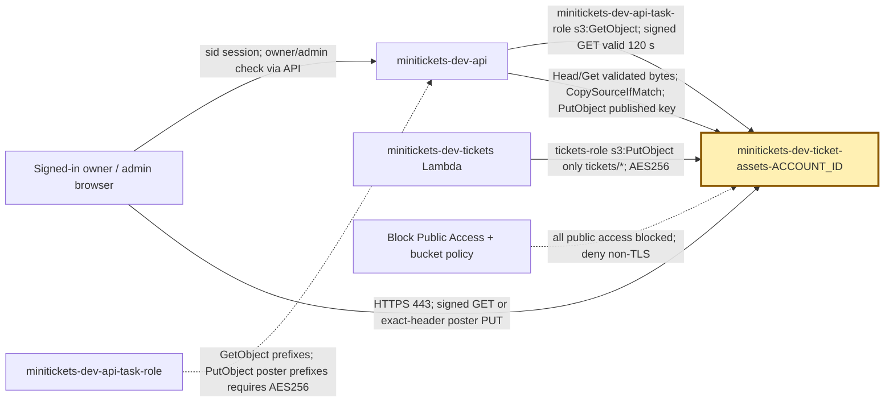
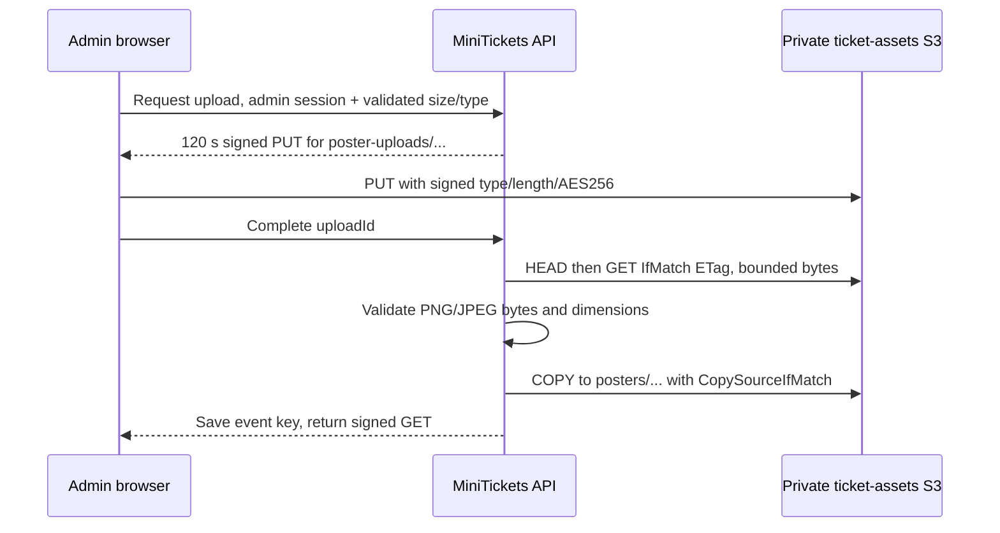

# S3 + presigned URLs: the city storehouse and timed passes

History: see [CHANGELOG.md](../CHANGELOG.md) or run `pnpm docs:history`

Area: Auth & Security · Status: ✅ built in repository; live AWS acceptance is separate
<!-- interview-card: v1 -->

## 1. In one line

MiniTickets keeps QR files private in S3 and gives an owner a [presigned URL](../glossary.md#presigned-url): a timed pass for one file action.

## 2. Where it sits

[Open this piece in the city explorer](../guides/infra-explorer.html?concept=presigned-urls#chapter=24&piece=s3-assets).

## 3. How it works

## 4. What happens in MiniTickets

1. The ticket worker writes `tickets/<bookingId>/<seat>.png` to private S3.
2. My tickets checks the session owner against booking and ticket records before signing a 120-second GET.
3. Admin poster uploads get a separate staging key and signed size/type/encryption headers.
4. Completion checks the stored image bytes, then copies that exact object to a new published key.
5. The event stores the lasting key. Published posters remain private; pages receive timed GET links.

## 5. Reach / Allowed / Password

**Reach:** HTTPS 443 to S3; browser CORS permits our configured origin.

**Allowed:** owner/admin checks precede signing; S3 enforces the signer's scoped IAM actions.

**Password:** the signed URL is a bearer pass: anyone holding it can use it before expiry.

## 6. In our code

`apps/api/src/queries/assets.ts` → `signAssetGet`; `apps/api/src/queries/posters.ts` → `signPosterPut` / `publishPoster`.

`apps/api/src/services/posters.ts` → `complete`; `infra/src/tickets/storage.ts` → `createTicketStorage`.

## 7. In the AWS console

`us-east-1` → **S3 → Buckets → minitickets-dev-ticket-assets-<your account ID> → Objects / Permissions / Properties**. Expect private `tickets/`, `poster-uploads/`, `posters/`; Block Public Access on; default AES256 encryption. The account suffix is calculated in code, not verified live here.

## 8. Good / Bad

**Good:** file bytes skip API uploads; links expire quickly.

**Bad:** a leaked pass works until expiry; validating headers alone cannot prove safe image content.

## 9. Other choices

- Pick API streaming when every byte needs a fresh authorization check.
- Pick signed S3 access when direct transfers need narrow, short access.

## 10. Connected to

| Neighbor | Direction | What allows it | Console check |
| --- | --- | --- | --- |
| [Lambda](aws-lambda.md) | in | `s3:PutObject` on tickets/* | IAM → tickets-role → Permissions |
| [DynamoDB](dynamodb.md) | before | Owner record + ready state | DynamoDB → tickets → Items |
| [IAM](execution-vs-task-role.md) | guard | Prefix/action restrictions | IAM → minitickets-dev-api-task-role → Permissions |

## 11. When it breaks

- URL returns 403 → expiry and signed headers → request a fresh link; send matching headers.
- Completion rejects → stored bytes/ETag → upload a valid unchanged image again.

## 12. Say it in 30 seconds

“S3 is our private storehouse. MiniTickets authorizes the person first, then signs one operation for 120 seconds. Ticket reads verify ownership. Poster uploads go to staging, get byte and size checks, then copy to a new key. A URL is a bearer pass; CORS is a browser rule, not permission.”

## 13. Likely follow-ups

**Can curl use a leaked URL?** Yes; CORS does not protect it.

**Is image validation antivirus?** No; scanning/re-encoding is not built.

## 14. Remember it

A timed pass opens one storehouse door; it does not identify its holder.

## 15. More detail

Object safety, upload checks and growth

- Anchor: `apps/api/src/queries/assets.ts` — `assetsEnabled`; follow the numbered comments at this boundary.
- Anchor: `apps/api/src/queries/posters.ts` — `signPosterPut`; follow the numbered comments at this boundary.
- Anchor: `apps/api/src/services/posters.ts` — `uploadKey`; follow the numbered comments at this boundary.

The bucket name ends with the AWS account ID from `getCallerIdentityOutput`; the literal label `ACCOUNT_ID` in the map is a placeholder. `BucketOwnerEnforced` disables ACL use, four public-access blocks reject public grants, the bucket policy denies non-TLS requests, and default SSE-S3 uses AES256. No paid KMS key/decryption grant is added. Issued QR files have no fixed-age deletion rule. Incomplete `tickets/` multipart uploads abort after one day. Staged `poster-uploads/` objects expire after one day.

GET links send `private, no-store`; downloads sign Content-Disposition. They are not kept in shared Redis/Next caches. Keys are server-made; validation rejects traversal or unrelated prefixes. Poster PUT signs exact Content-Length, Content-Type and AES256, unlike a POST policy's size range. Limits: PNG/JPEG, 2 MiB, 4096 pixels per side, 16 megapixels. HEAD/GET and copy are pinned to the inspected ETag, so replacing staging data cannot swap the published image after inspection. Postgres updates last; an unattached copy is preferable to a broken event reference. Header and bounded image checks are not a full decoder or malware scanner. A future isolated scan/re-encode pipeline would run before publication, with quarantined failures. At greater load, add upload quotas, cleanup and abuse response. `pnpm demo:p4-assets` exercises local isolation and constraints; live IAM/CORS/S3 acceptance is separate. [Upload scenario](../guides/interview-scenarios.md#presigned-uploads). Usage/storage charges apply; no current cost quote is implied.

## Where it appears in the story

- [app-story: 4b. Mutation admission and browser security](../app-story.md#4b-mutation-admission-and-browser-security)
