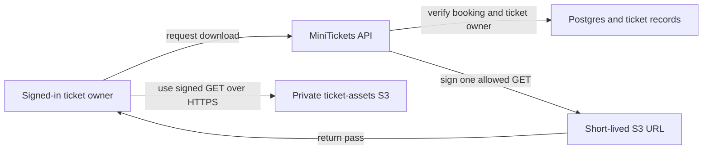

# S3 + presigned URLs: the city storehouse and timed passes

History: see [CHANGELOG.md](../CHANGELOG.md) or run `pnpm docs:history`

Area: Auth & Security · Status: ✅ built in repository; live AWS acceptance is separate
<!-- interview-card: v2 -->

## 1. What is it?

A [presigned URL](../glossary.md#presigned-url) is a temporary pass for one action in S3, AWS's file store. Whoever holds it can use that action before it expires.

## 2. Why do we need it?

A customer should download their MiniTickets QR without making the bucket public. The API checks ownership, then gives a short-lived link while S3 handles the actual file transfer.

## 3. How does it work?

1. The API authorizes the requester using current records.
2. It signs a narrowly scoped operation.
3. The browser transfers bytes directly with S3.

## 4. How do we use it in MiniTickets?

My tickets signs downloads only after ownership checks. Admin poster uploads use separate staging keys. Completion inspects the uploaded image and publishes an unchanged copy under a new key; events store lasting keys rather than expiring URLs.

## 5. Interview-ready answer

“MiniTickets keeps S3 objects private and authorizes users before issuing short-lived presigned URLs. The browser transfers files directly, while the API controls which action and key it signs. Poster uploads also need staging and byte checks before publication. A signed URL is a bearer pass, so leaking it grants temporary access.”

## 6. Important follow-up questions

- **Does CORS stop a leaked link?** No. It is a browser rule; another HTTP client can use the pass.
- **What if a download returns 403?** Check expiry and permissions, then request a fresh link.
- **Do signed upload headers prove safe content?** No. We inspect bounded image bytes; malware scanning is not built.
- **Why publish under a new key?** A checked object stays distinct from mutable staging data and avoids stale shared references.

## 7. Advanced details

Technical reference

### Configuration and security

The ticket Lambda role permits `s3:PutObject` only under `tickets/*`. The API task role permits scoped object reads and poster-prefix writes; its poster write policy requires AES256. Download signing uses `s3:GetObject`. IAM restrictions still apply to an otherwise valid signature.

Ticket files use `tickets/<bookingId>/<seat>.png`. Owner GET links last 120 seconds and require both booking and ticket ownership checks. Admin upload requests validate size/type before issuing a separate staged signed PUT. Browser CORS allows the configured origin; it is not an S3 authorization boundary. A leaked URL grants its action until expiry, subject to the signer’s permissions.

### Implementation and operational limits

- Anchor: `apps/api/src/queries/assets.ts` — `assetsEnabled`; follow the numbered comments at this boundary.
- Anchor: `apps/api/src/queries/posters.ts` — `signPosterPut`; follow the numbered comments at this boundary.
- Anchor: `apps/api/src/services/posters.ts` — `uploadKey`; follow the numbered comments at this boundary.

The bucket name ends with the AWS account ID from `getCallerIdentityOutput`; the literal label `ACCOUNT_ID` in the map is a placeholder. `BucketOwnerEnforced` disables ACL use, four public-access blocks reject public grants, the bucket policy denies non-TLS requests, and default SSE-S3 uses AES256. No paid KMS key/decryption grant is added. Issued QR files have no fixed-age deletion rule. Incomplete `tickets/` multipart uploads abort after one day. Staged `poster-uploads/` objects expire after one day.

GET links send `private, no-store`; downloads sign Content-Disposition. They are not kept in shared Redis/Next caches. Keys are server-made; validation rejects traversal or unrelated prefixes. Poster PUT signs exact Content-Length, Content-Type and AES256, unlike a POST policy's size range. Limits: PNG/JPEG, 2 MiB, 4096 pixels per side, 16 megapixels. HEAD/GET and copy are pinned to the inspected ETag, so replacing staging data cannot swap the published image after inspection. Postgres updates last; an unattached copy is preferable to a broken event reference. Header and bounded image checks are not a full decoder or malware scanner. A future isolated scan/re-encode pipeline would run before publication, with quarantined failures. At greater load, add upload quotas, cleanup and abuse response. `pnpm demo:p4-assets` exercises local isolation and constraints; live IAM/CORS/S3 acceptance is separate. [Upload scenario](../guides/interview-scenarios.md#presigned-uploads). Usage/storage charges apply; no current cost quote is implied.

### Source references

`apps/api/src/queries/assets.ts` → `signAssetGet`; `apps/api/src/queries/posters.ts` → `signPosterPut` / `publishPoster`.

`apps/api/src/services/posters.ts` → `complete`; `infra/src/tickets/storage.ts` → `createTicketStorage`.

### Console and troubleshooting

`us-east-1` → **S3 → Buckets → minitickets-dev-ticket-assets-<your account ID> → Objects / Permissions / Properties**. Expect private `tickets/`, `poster-uploads/`, `posters/`; Block Public Access on; default AES256 encryption. The account suffix is calculated in code, not verified live here.

- URL returns 403 → expiry and signed headers → request a fresh link; send matching headers.
- Completion rejects → stored bytes/ETag → upload a valid unchanged image again.

### Trade-offs and related concepts

- Pick API streaming when every byte needs a fresh authorization check.
- Pick signed S3 access when direct transfers need narrow, short access.

| Neighbor | Direction | What allows it | Console check |
| --- | --- | --- | --- |
| [Lambda](aws-lambda.md) | in | `s3:PutObject` on tickets/* | IAM → tickets-role → Permissions |
| [DynamoDB](dynamodb.md) | before | Owner record + ready state | DynamoDB → tickets → Items |
| [IAM](execution-vs-task-role.md) | guard | Prefix/action restrictions | IAM → minitickets-dev-api-task-role → Permissions |

[Open this piece in the city explorer](../guides/infra-explorer.html?concept=presigned-urls#chapter=24&piece=s3-assets).

## Where it appears in the story

- [app-story: 4b. Mutation admission and browser security](../app-story.md#4b-mutation-admission-and-browser-security)

