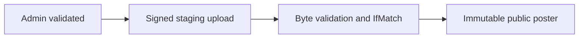

# Presigned urls

History: see [CHANGELOG.md](../CHANGELOG.md) or run `pnpm docs:history`

Area: Auth & Security · Status: ✅ built in repository; live AWS acceptance is separate

## 1. In one line

A presigned URL is a bearer capability, not public bucket access. Owner-checked ticket GETs expire in 120 s; staged poster PUTs sign exact length/type/AES256, then verified ETag-pinned copy publishes immutable content.

## 2. Real-life comparison

A guard checks both the visitor and the particular action; a readable invitation is not permission to every room.

## 3. Picture it

## 4. Where in our code

- Anchor: `apps/api/src/queries/assets.ts` — `assetsEnabled`; follow the numbered comments at this boundary.
- Anchor: `apps/api/src/queries/posters.ts` — `signPosterPut`; follow the numbered comments at this boundary.
- Anchor: `apps/api/src/services/posters.ts` — `uploadKey`; follow the numbered comments at this boundary.

`apps/api/src/services/posters.ts` validates admin workflow; `queries/posters.ts` signs staging/publish operations; `services/poster-image.ts` checks bounded bytes; `queries/assets.ts` signs private reads for 120 s. `pnpm demo:p4-assets` tests owner isolation and constrained upload/publication. No antivirus/re-encoding pipeline is built.

## 5. See it yourself

Run `pnpm demo:p4-assets` and inspect the asserted outcome described above.

Failure thought experiment: Can another origin with curl use a leaked URL? Yes; CORS does not constrain non-browser callers. Do not change a live stack to demonstrate it.

## 6. How it connects

Uses the [current system](../00-big-picture.md); gives a concrete decision to the [scenario](../guides/interview-scenarios.md#presigned-uploads) and [explorer tour](../guides/infra-explorer.html?tour=booking).

## 7. Our settings and WHY

A presigned URL is a bearer capability, not public bucket access. Owner-checked ticket GETs expire in 120 s; staged poster PUTs sign exact length/type/AES256, then verified ETag-pinned copy publishes immutable content. Direct uploads avoid buffering large files through the API while retaining controlled publication.

## 8. Trade-offs

A leaked URL works until expiry. Exact PUT length differs from POST length ranges. Proposed scanning worker belongs before publication and must quarantine failures.

## 9. Alternatives and when to choose them

10x: upload quotas and cleanup. 100x: scan/re-encode queues, retention and abuse response.

## 10. What breaks and how we notice

Can another origin with curl use a leaked URL? Yes; CORS does not constrain non-browser callers.

## 13. Interview answers at 3 levels

- **Simple:** A presigned URL is a bearer capability, not public bucket access.
- **Senior:** A presigned URL is a short-lived bearer capability with exactly the signer’s allowed action. CORS controls browser cross-origin use, not authorization. Validate the owner/admin before signing, constrain type/size, inspect actual image bytes and publish to an immutable key with conditional version identity. Never treat a declared Content-Type as malware scanning.
- **Lead:** 10x: upload quotas and cleanup. 100x: scan/re-encode queues, retention and abuse response.

## 14. Follow-up questions with answers

Can another origin with curl use a leaked URL? Yes; CORS does not constrain non-browser callers.

What is a presigned URL? **Bearer capability.**

## 15. Say it in 30 seconds

A presigned URL is a short-lived bearer capability with exactly the signer’s allowed action. CORS controls browser cross-origin use, not authorization. Validate the owner/admin before signing, constrain type/size, inspect actual image bytes and publish to an immutable key with conditional version identity. Never treat a declared Content-Type as malware scanning.

## 16. Status and production work

Repository implementation and local evidence are described above. Live AWS/CI execution remains owner acceptance. 10x: upload quotas and cleanup. 100x: scan/re-encode queues, retention and abuse response.

## Where it appears in the story

- [app-story: 4b. Mutation admission and browser security](../app-story.md#4b-mutation-admission-and-browser-security)
