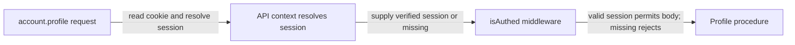

# Protected procedures: the real auth check

History: see [CHANGELOG.md](../CHANGELOG.md) or run `pnpm docs:history`

Area: Auth & Security · Status: ✅ built · Step doc: [09 dashboard](../../09-dashboard.md)
<!-- interview-card: v2 -->

## 1. What is it?

A protected procedure is an API operation with a required login check. MiniTickets runs that check before the operation’s body and rejects callers without a valid session.

## 2. Why do we need it?

A visitor can skip our dashboard and call the API directly. Private profile or booking data needs a server check that applies regardless of which interface sent the request.

## 3. How does it work?



1. Create context from the verified server-side session.
2. Run the shared login middleware.
3. Only then call the procedure with a known user identity.

## 4. How do we use it in MiniTickets?

Profile, bookings, tickets and all-device logout use protected procedures. Admin procedures add a separate current-role check. `auth.me` stays public because a logged-out header is a normal result, not an error.

## 5. Interview-ready answer

“MiniTickets puts its real login boundary in protected API procedures. Middleware rejects a missing session before private work runs and gives the handler a verified user identity. A browser route guard cannot replace that. Protection still needs an explicit ownership or role check when the operation accesses something beyond the caller’s basic profile.”

## 6. Important follow-up questions

- **Does this automatically enforce ownership?** No. Use the verified user ID in the relevant service checks.
- **Can developers choose public by mistake?** Yes. Review private data paths and test direct unauthenticated calls.
- **What if Redis is unavailable?** The request fails; unavailable authority never becomes a valid login.
- **Why is auth.me public?** The UI needs an ordinary null result when nobody is logged in.

## 7. Advanced details

<details>
<summary>Technical reference</summary>

### Source references

- Anchor: `apps/api/src/trpc/init.ts` · `isAuthed`, `protectedProcedure`.
- Anchor: `apps/api/src/procedures/account.ts` · `profile: protectedProcedure.output(ProfileSchema).query(...)`.

Step by step:

1. `createContext` resolved the session from Redis (`null` for missing, fake or expired).
2. `isAuthed`: `if (!ctx.session) throw new TRPCError({ code: "UNAUTHORIZED", message: "You must be logged in" })`.
3. Otherwise `next({ ctx: { session: ctx.session } })`: TypeScript now knows `ctx.session.userId`
   is a string in the procedure.
4. `protectedProcedure = publicProcedure.use(isAuthed)`.
5. Current users include `account.profile`, booking create/mine, ticket mine and logoutEverywhere. `auth.me` is public on purpose: "logged out" is a
   normal answer (`null`), not an error.

### Configuration and design

Every procedure that returns private data must be `protectedProcedure`. WHY: frontend guards can be
skipped with curl; this can't.

### Checks and troubleshooting

Recorded against a local api:

```bash
curl -s localhost:4000/trpc/account.profile
# {"error":{"message":"You must be logged in","code":-32001,"data":{"code":"UNAUTHORIZED","httpStatus":401,…}}}
curl -s -b 'sid=fake' localhost:4000/trpc/account.profile     # the same 401
```

e2e: `dashboard.spec.ts` "a fake sid cookie passes the route guard but the API's 401 sends us to
login".

**Isolated thought experiment (not performed):** change `profile` to `publicProcedure`. TypeScript fails at once:
`ctx.session` is possibly null. The type narrowing is part of the protection.

A private procedure built on `publicProcedure`: data exposed. Code review, and e2e tests that call
the api without a session.

- *Why is `auth.me` public?* Logged out is a normal state for the header, not an error.
- *What if Redis is down?* The context throws and the request fails with 500, never as "logged in".

### Trade-offs and alternatives

- **Pros:** one line per procedure; type-safe; impossible to forget the null check inside.
- **Cons:** choosing `publicProcedure` by mistake is still possible; there is no "deny by default".

- **Protected by default:** export only `protectedProcedure` from most modules and make public ones
  explicit.
- **Gateway auth** (API gateway or ALB OIDC): authenticate before the app; still need app-level
  authorization.

### Further technical context

`protectedProcedure` adds `isAuthed`, which throws 401 when the context has no session
  and narrows `ctx.session` to non-null. The Next.js proxy only checks that a cookie exists; this is
  the real check, and an e2e test proves a fake cookie gets 401.

### Related reading

- **Uses ←** [trpc-context](trpc-context.md), [trpc-middleware](trpc-middleware.md).
- **Gives →** the real guard behind [route-guard-proxy](route-guard-proxy.md); the base for
  [authn-vs-authz](authn-vs-authz.md); 401 for [ui-error-handling](ui-error-handling.md).

[Open this piece in the city explorer](../guides/infra-explorer.html?concept=protected-procedure#chapter=8&piece=api-task).

## Where it appears in the story

- [App story: 6. Middleware: errorMapper and protectedProcedure](../app-story.md#6-middleware-errormapper-and-protectedprocedure)

</details>
