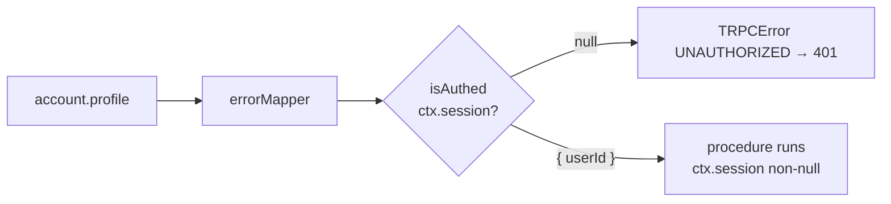

# Protected procedures: the real auth check

History: see [CHANGELOG.md](../CHANGELOG.md) or run `pnpm docs:history`

Area: Auth & Security · Status: ✅ built · Step doc: [09 dashboard](../../09-dashboard.md)

## 1. In one line

`protectedProcedure` is `publicProcedure` plus the `isAuthed` middleware: it refuses any call
without a valid session (401) **before** the procedure runs, on the server, where nobody can skip
it.

## 2. Real-life comparison

The vault door's card reader, which actually checks the card against the bank's system, unlike the
friendly receptionist upstairs (the route guard).

## 3. Picture it



## 4. Where in our code

- Anchor: `apps/api/src/trpc/init.ts` · `isAuthed`, `protectedProcedure`.
- Anchor: `apps/api/src/procedures/account.ts` · `profile: protectedProcedure.output(ProfileSchema).query(...)`.

Step by step:

1. `createContext` resolved the session from Redis (`null` for missing, fake or expired).
2. `isAuthed`: `if (!ctx.session) throw new TRPCError({ code: "UNAUTHORIZED", message: "You must be logged in" })`.
3. Otherwise `next({ ctx: { session: ctx.session } })`: TypeScript now knows `ctx.session.userId`
   is a string in the procedure.
4. `protectedProcedure = publicProcedure.use(isAuthed)`.
5. Today one procedure uses it: `account.profile`. `auth.me` is public on purpose: "logged out" is a
   normal answer (`null`), not an error.

## 5. See it yourself

Recorded against a local api:

```bash
curl -s localhost:4000/trpc/account.profile
# {"error":{"message":"You must be logged in","code":-32001,"data":{"code":"UNAUTHORIZED","httpStatus":401,…}}}
curl -s -b 'sid=fake' localhost:4000/trpc/account.profile     # the same 401
```

e2e: `dashboard.spec.ts` "a fake sid cookie passes the route guard but the API's 401 sends us to
login".

**Break it on purpose:** change `profile` to `publicProcedure`. TypeScript fails at once:
`ctx.session` is possibly null. The type narrowing is part of the protection.

## 6. How it connects

- **Uses ←** [trpc-context](trpc-context.md), [trpc-middleware](trpc-middleware.md).
- **Gives →** the real guard behind [route-guard-proxy](route-guard-proxy.md); the base for
  [authn-vs-authz](authn-vs-authz.md); 401 for [ui-error-handling](ui-error-handling.md).

## 7. Our settings and WHY

Every procedure that returns private data must be `protectedProcedure`. WHY: frontend guards can be
skipped with curl; this can't.

## 8. Trade-offs

- **Pros:** one line per procedure; type-safe; impossible to forget the null check inside.
- **Cons:** choosing `publicProcedure` by mistake is still possible; there is no "deny by default".

## 9. Alternatives and when to choose them

- **Protected by default:** export only `protectedProcedure` from most modules and make public ones
  explicit.
- **Gateway auth** (API gateway or ALB OIDC): authenticate before the app; still need app-level
  authorization.

## 10. What breaks, and how we'd notice

A private procedure built on `publicProcedure`: data exposed. Code review, and e2e tests that call
the api without a session.

## 13. Interview answers at 3 levels

- **Simple:** The server refuses private requests unless you're logged in.
- **Senior:** `protectedProcedure` adds `isAuthed`, which throws 401 when the context has no session
  and narrows `ctx.session` to non-null. The Next.js proxy only checks that a cookie exists; this is
  the real check, and an e2e test proves a fake cookie gets 401.
- **Lead:** Put the security boundary where the data is and make it the default. I'd make protected
  the default export and add a test that lists every public procedure, so a new one is a deliberate
  choice.

## 14. Follow-up questions interviewers ask

- *Why is `auth.me` public?* Logged out is a normal state for the header, not an error.
- *What if Redis is down?* The context throws and the request fails with 500, never as "logged in".

## 15. Say it in 30 seconds

"protectedProcedure is our real auth check: a tRPC middleware that throws 401 if the context has no
valid session, and narrows ctx.session for the procedure. The frontend guard is just UX; an e2e test
shows a fake cookie passes the guard but gets 401 here."

## 16. Status

✅ built.
