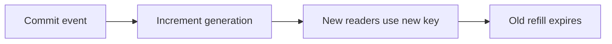

# Cache invalidation after a mutation

History: see [CHANGELOG.md](../CHANGELOG.md) or run `pnpm docs:history`

Area: Frontend · Status: ✅ built in repository; live acceptance is separate

## 1. In one line

Browser invalidation marks matching query keys stale and refetches observed queries. Server generation INCR and fixed-tag Next revalidation are separate layers. A new catalogue search request reads Postgres; an open tab still follows its query policy.

## 2. Real-life comparison

A dated catalogue at the ticket office: many readers can share it, but the clerk must know when a newer edition exists.

## 3. Picture it

## 4. Where in our code

- Anchor: `apps/web/src/features/auth/hooks/use-login.ts` · `useLogin`: `onSuccess` → `queryClient.invalidateQueries({ queryKey: trpc.auth.me.queryKey() })`.
- Anchor: `apps/web/src/features/auth/hooks/use-logout.ts` · `useLogout`: `onSuccess` → `queryClient.clear()`, then `router.push("/")`.

`apps/api/src/services/events.ts` → `invalidateUpcomingList` runs after event creation. `queries/events-cache.ts` builds generation/filter keys. `queries/web-cache.ts` calls signed Next revalidation. Run `pnpm demo:stampede`; inspect cache invalidation unit tests for late refill and failure.

## 5. See it yourself

`apps/api/src/services/events.ts` → `invalidateUpcomingList` runs after event creation. `queries/events-cache.ts` builds generation/filter keys. `queries/web-cache.ts` calls signed Next revalidation. Run `pnpm demo:stampede`; inspect cache invalidation unit tests for late refill and failure.

Failure thought experiment: Why read generation before SQL? Reading after SQL could place old rows in the new generation.

## 6. How it connects

Uses the [current system](../00-big-picture.md); gives a concrete decision to the [scenario](../guides/interview-scenarios.md#cache-invalidation) and [explorer tour](../guides/infra-explorer.html?tour=search).

## 7. Our settings and WHY

Browser invalidation marks matching query keys stale and refetches observed queries. Server generation INCR and fixed-tag Next revalidation are separate layers. A new catalogue search request reads Postgres; an open tab still follows its query policy. DEL alone allows an in-flight old reader to repopulate the same key.

## 8. Trade-offs

Generation keys increase transient cardinality. Redis and Next/browser caches have separate stale windows; one invalidation does not instantly refresh every tab.

## 9. Alternatives and when to choose them

10x: watch invalidation failures/key churn. 100x: outbox-driven invalidation and explicit freshness SLOs.

## 10. What breaks and how we notice

Why read generation before SQL? Reading after SQL could place old rows in the new generation.

## 13. Interview answers at 3 levels

- **Simple:** Browser invalidation marks matching query keys stale and refetches observed queries. Server generation INCR and fixed-tag Next revalidation are separate layers. A new catalogue search request reads Postgres; an open tab still follows its query policy.
- **Senior:** Commit the write, then increment a cache generation. A reader captures the generation before its database read and stores only under that generation. A slow pre-write reader can fill its old key, but new readers use the new generation. TTL bounds stale data if invalidation fails; errors are logged instead of undoing a committed event.
- **Lead:** 10x: watch invalidation failures/key churn. 100x: outbox-driven invalidation and explicit freshness SLOs.

## 14. Follow-up questions with answers

Why read generation before SQL? Reading after SQL could place old rows in the new generation.

## 15. Say it in 30 seconds

Commit the write, then increment a cache generation. A reader captures the generation before its database read and stores only under that generation. A slow pre-write reader can fill its old key, but new readers use the new generation. TTL bounds stale data if invalidation fails; errors are logged instead of undoing a committed event.

## 16. Status and production work

Repository implementation and local evidence are described above. Live AWS/CI execution remains owner acceptance. 10x: watch invalidation failures/key churn. 100x: outbox-driven invalidation and explicit freshness SLOs.

## Where it appears in the story

- [App story: 2. TanStack Query: cache, retries, invalidation](../app-story.md#2-tanstack-query-cache-retries-invalidation)
