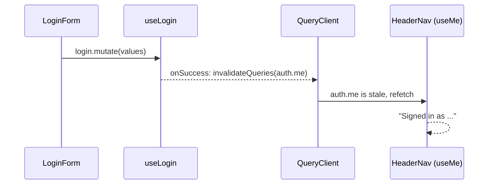

# Cache invalidation after a mutation

History: see [CHANGELOG.md](../CHANGELOG.md) or run `pnpm docs:history`

Area: Frontend · Status: ✅ built · Step doc: [07 login](../../07-login-session.md), [08 logout](../../08-logout.md)

## 1. In one line

After something changes on the server (login, logout), the browser's cached answers are out of
date, so we **invalidate** them (mark stale and refetch) or **clear** them (throw them all away).

## 2. Real-life comparison

After a team changes office, you don't just add a sticky note; you take down the old floor plan
(invalidate). When a new tenant moves into your desk, you empty every drawer (clear).

## 3. Picture it

## 4. Where in our code

- Anchor: `apps/web/src/features/auth/hooks/use-login.ts` · `useLogin`: `onSuccess` → `queryClient.invalidateQueries({ queryKey: trpc.auth.me.queryKey() })`.
- Anchor: `apps/web/src/features/auth/hooks/use-logout.ts` · `useLogout`: `onSuccess` → `queryClient.clear()`, then `router.push("/")`.

Step by step:

1. Before login, `auth.me` is cached as `null` (logged out).
2. `useLogin`'s `onSuccess` invalidates exactly that key. Components using it (`HeaderNav`, `Hero`)
   refetch and now show the email.
3. Logout is different: **every** cached answer belongs to the user who is leaving
   (`account.profile` too). `queryClient.clear()` removes them all, so the next person on this
   browser never sees them.
4. After `clear()`, the header asks `auth.me` again and gets `null`.

## 5. See it yourself

Network tab, log in: right after the `auth.login` POST you see a new `auth.me` GET. Log out: the
`auth.logout` POST, then `auth.me` again (answer `null`). The e2e tests `login.spec.ts` and
`logout.spec.ts` check the header text after each step.

**Break it on purpose:** remove `onSuccess` from `useLogin`. Log in: the form navigates, but the
header still says "Login / Sign up" until you reload or refocus the window.

## 6. How it connects

- **Uses ←** [tanstack-query](tanstack-query.md) keys; the tRPC helpers `queryKey()`.
- **Gives →** correct UI after auth changes; privacy between users on a shared browser.

## 7. Our settings and WHY

| Event | Action | Why |
| ----- | ------ | --- |
| Login | invalidate `auth.me` | Only "who am I" changed; keep the rest. |
| Logout | `clear()` everything | Never show one user's data to the next. |

## 8. Trade-offs

- **Pros:** precise refresh after login; nothing private survives logout.
- **Cons:** a refetch costs one extra request; forgetting to invalidate a new key is an easy bug as
  the app grows.

## 9. Alternatives and when to choose them

- **`setQueryData` with the mutation's answer:** login returns the user, so we could write it into
  the `auth.me` cache and skip the refetch. Saves a request, but two code paths must agree on shape.
- **Optimistic updates:** change the cache *before* the server answers, roll back on error (explain-only
  card `optimistic-updates`, Phase 5).
- **Full page reload after login:** simplest, slowest.

## 10. What breaks, and how we'd notice

- Missing invalidation: stale UI until refocus. Caught by the e2e header checks.
- Using `invalidateQueries()` on logout instead of `clear()`: inactive queries could still show old
  data briefly; `clear()` avoids it.

## 13. Interview answers at 3 levels

- **Simple:** After login or logout we refresh what the page knows about the user.
- **Senior:** `useLogin` invalidates only the `auth.me` key so the header refetches; `useLogout`
  clears the whole TanStack Query cache because every cached answer belonged to the old user.
- **Lead:** Invalidation rules are part of the data contract. I'd name keys by entity, invalidate by
  prefix after writes, and treat logout as a security event: clear caches, not just refresh them.

## 14. Follow-up questions interviewers ask

- *Invalidate vs refetch vs clear?* Invalidate marks stale and refetches active queries; refetch
  forces now; clear deletes everything.
- *Why is cache invalidation "hard"?* Knowing every place that depends on changed data.

## 15. Say it in 30 seconds

"After login we invalidate just the auth.me query, so the header refetches and shows the email.
After logout we clear the whole query cache, because every cached answer belonged to the user who
left. Both are in the feature hooks, not in components."

## 16. Status

✅ built.
