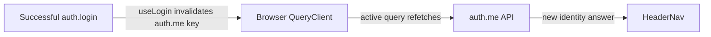

# Cache invalidation after a mutation

History: see [CHANGELOG.md](../CHANGELOG.md) or run `pnpm docs:history`

Area: Frontend · Status: ✅ built in repository; live acceptance is separate
<!-- interview-card: v2 -->

## 1. What is it?

Invalidation tells a cache that an earlier answer may be out of date. The cache then follows its own rules for replacing or refetching that answer.

## 2. Why do we need it?

After a MiniTickets login, the header’s cached “logged out” answer is wrong. After an event changes, old catalogue copies can also be wrong, but they live in different caches.

## 3. How does it work?

1. Complete the authoritative change first.
2. Mark the relevant cached answer stale.
3. Refetch observed data so the interface reflects the new answer.

## 4. How do we use it in MiniTickets?

Login invalidates auth.me; logout clears the query cache before navigation. Legacy server event lists use a separate Redis generation and signed Next revalidation. Current search reads Postgres directly, while an open browser tab still follows its own freshness policy.

## 5. Interview-ready answer

“Invalidation is about which old answer can still be used. MiniTickets invalidates browser identity queries after login and clears private cached data after logout. Its legacy server-list caches use generation changes so an old refill cannot restore the current key. Each cache layer needs its own policy; one invalidation does not instantly refresh every tab.”

## 6. Important follow-up questions

- **Why not just delete a Redis list key?** An earlier database read could refill it with old rows after deletion.
- **Why capture generation before SQL?** Otherwise an old read could be stored under the new generation.
- **What if invalidation fails after commit?** Log it and let bounded expiry limit stale public results; do not pretend the committed write failed.
- **Does browser invalidation refresh every visitor?** No. Each client cache follows its own observation and freshness rules.

## 7. Advanced details

Technical reference

### Current implementation

`apps/web/src/features/auth/hooks/use-login.ts` invalidates auth.me; use-logout.ts clears the entire QueryClient. Server `invalidateUpcomingList` runs after commit and increments the Redis generation; readers capture it before SQL. `apps/api/src/queries/web-cache.ts` requests fixed-tag revalidation afterward. Current events.search bypasses both legacy list caches. Generation cardinality, independent stale windows and future outbox-driven invalidation remain explicit trade-offs.

### Technical limits and diagnosis

Login marks auth.me stale and refetches active observers. Logout clears the whole browser cache before going home, so the next user does not see previous private answers. Server generation changes do not update every browser tab instantly.

A legacy list reader captures its generation before SQL and writes only under that key, including canonical filters. A late reader can refill its old generation without restoring the new one. DEL alone cannot close that race. Incrementing before commit or capturing generation after SQL could publish old rows under the new key. Invalidation follows commit; failure is logged rather than undoing a successful event write. Bounded expiry limits public stale data.

Redis generation churn creates temporary key cardinality; old keys expire. Redis, Next public data and browser queries have independent windows. Current search bypasses legacy list caching; nonce HTML is no-store. Historical demo:stampede and unit cases cover late-refill and failure scenarios. Monitor invalidation failures and key churn; outbox-driven invalidation and end-to-end freshness objectives remain designs.

### Source anchors

- Anchor: `apps/web/src/features/auth/hooks/use-login.ts` · `useLogin`: `onSuccess` → `queryClient.invalidateQueries({ queryKey: trpc.auth.me.queryKey() })`.
- Anchor: `apps/web/src/features/auth/hooks/use-logout.ts` · `useLogout`: `onSuccess` → `queryClient.clear()`, then `router.push("/")`.

### Related reading

- [current system](../00-big-picture.md)
- [scenario](../guides/interview-scenarios.md#cache-invalidation)
- [explorer tour](../guides/infra-explorer.html?tour=search)
- [App story: 2. TanStack Query: cache, retries, invalidation](../app-story.md#2-tanstack-query-cache-retries-invalidation)

[Open this piece in the city explorer](../guides/infra-explorer.html?concept=query-invalidation#chapter=24&piece=code-hook).

## Where it appears in the story

- [App story: 2. TanStack Query: cache, retries, invalidation](../app-story.md#2-tanstack-query-cache-retries-invalidation)

