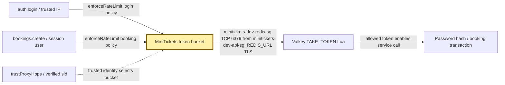
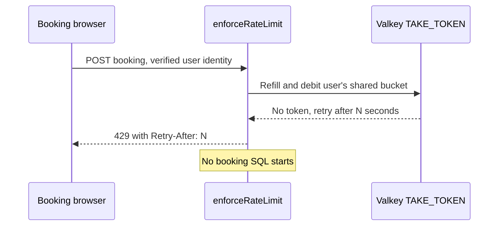

# Rate limiting: the ticket office turnstile

History: see [CHANGELOG.md](../CHANGELOG.md) or run `pnpm docs:history`

Area: API · Status: ✅ built in repository; live AWS acceptance is separate

<!-- interview-card: v1 -->

## 1. In one line

MiniTickets gives each caller a [token bucket](../glossary.md#token-bucket)—a small allowance that refills—before expensive login or booking work.

## 2. Where it sits

[Open this piece in the city explorer](../guides/infra-explorer.html?concept=rate-limiting#chapter=24&piece=api-task).

## 3. How it works

## 4. What happens in MiniTickets

1. Login uses the trusted client IP; booking uses the verified session’s user ID.
2. `enforceRateLimit` picks login **20 tokens / 1 new token per 3 seconds**, or booking **10 / 1 per second**.
3. One Redis Lua script reads Redis time, refills and spends a token as one operation. All API tasks share it.
4. Empty bucket: **429**, with `Retry-After`. Redis unavailable: **503**, so expensive work stays blocked.

## 5. Reach / Allowed / Password

**Reach:** API → Valkey :6379; minitickets-dev-redis-sg admits minitickets-dev-api-sg.

**Allowed:** verified user or trusted IP chooses the bucket; Redis executes one atomic script.

**Password:** `REDIS_URL` supplies the Valkey token over TLS.

## 6. In our code

`apps/api/src/services/rate-limits.ts` → `RATE_POLICIES`, `enforceRateLimit`

`apps/api/src/queries/rate-limits.ts` → `takeToken`, `TAKE_TOKEN`

`apps/api/src/config/trust-proxy.ts` → `trustProxyHops`

## 7. In the AWS console

ElastiCache → Valkey caches → `minitickets-dev-valkey` → Monitoring: memory/errors. EC2 → Load Balancers → `minitickets-dev` → Resource map: public request path. Bucket contents need an authorized Redis client.

## 8. Good / Bad

**Good:** limits work across tasks; allows a small normal burst.

**Bad:** shared-IP visitors share login allowance; Redis loss blocks these operations.

## 9. Other choices

- Pick fixed windows when simple counters and rough fairness are enough.
- Pick an edge limiter when attacks should be stopped before reaching the API.

## 10. Connected to

| Neighbor | Direction | What allows it | Console check |
| --- | --- | --- | --- |
| [ALB](alb.md) | → client identity | trusted proxy boundary: 1 hop now | EC2 → ALB → Resource map |
| [Sessions](sessions-vs-jwt.md) | → booking identity | verified `sid` | ElastiCache → cache |
| [Valkey](elasticache-valkey.md) | → shared debit | minitickets-dev-redis-sg :6379 from minitickets-dev-api-sg | ElastiCache → cache |

## 11. When it breaks

- Everyone shares an IP quota → proxy settings → use 1 trusted hop for current ALB-only mode.
- Login/booking 503 → Redis connection logs → restore Valkey reach/password.
- Unexpectedly generous quota → evicted keys → inspect memory policy; this is not durable accounting.

## 12. Say it in 30 seconds

“MiniTickets permits a short burst, then refills an allowance steadily. Login counts a trusted IP; booking counts the logged-in user. Redis runs refill and debit atomically so multiple API tasks share the same limit. We answer 429 with a retry time. If Redis fails, these expensive operations stop with 503.”

## 13. Likely follow-ups

- **Can a caller forge their IP?** Wrong proxy trust can allow that; MiniTickets trusts only its known boundary.
- **Is this a hard financial quota?** No. Redis eviction can reset a bucket.

## 14. Remember it

The turnstile spends one shared token before the clerk does expensive work.

## 15. More detail

Source notes, earlier detail and code anchors

A token bucket admits a bounded burst and refills over time. Atomic Redis Lua shares policy across API instances; trusted client IP limits login and authenticated user identity limits booking; rejection is 429 with Retry-After.

### Earlier card: 2. Real-life comparison

Two clerks cannot promise the same last seat: one holds the ledger until the reservation is recorded.

### Earlier card: 3. Picture it

### Earlier card: 4. Where in our code

- Anchor: `apps/api/src/queries/rate-limits.ts` — `TAKE_TOKEN`; follow the numbered comments at this boundary.
- Anchor: `apps/api/src/services/rate-limits.ts` — `RATE_POLICIES`; follow the numbered comments at this boundary.

`apps/api/src/queries/rate-limits.ts` stores buckets; `services/rate-limits.ts` chooses policy. `config/trust-proxy.ts` only trusts configured hops/CIDRs. `pnpm demo:sale` verifies shared quotas, spoof resistance and the inventory gate. Redis failure is an explicit failure policy, not a durable quota guarantee.

### Earlier card: 5. See it yourself

Run `pnpm demo:sale` and inspect the asserted outcome described above.

Failure thought experiment: Should auth failures all share one user key? No; unauthenticated identity needs a trusted edge/IP policy. Do not change a live stack to demonstrate it.

### Earlier card: 6. How it connects

Uses the [current system](../00-big-picture.md); gives a concrete decision to the [scenario](../guides/interview-scenarios.md#rate-limits) and [explorer tour](../guides/infra-explorer.html?tour=sale-day).

### Earlier card: 7. Our settings and WHY

A token bucket admits a bounded burst and refills over time. Atomic Redis Lua shares policy across API instances; trusted client IP limits login and authenticated user identity limits booking; rejection is 429 with Retry-After. One instance’s memory cannot enforce a shared quota.

### Earlier card: 8. Trade-offs

Fixed windows permit boundary bursts; sliding windows cost more state. IP limits affect NAT users. Redis allkeys-lru can evict quotas; strict financial quotas need durable accounting.

### Earlier card: 9. Alternatives and when to choose them

10x: key cardinality/TTL and fairness. 100x: gateway protections, per-tenant budgets and hot-key partitioning.

### Earlier card: 10. What breaks and how we notice

Should auth failures all share one user key? No; unauthenticated identity needs a trusted edge/IP policy.

### Earlier card: 13. Interview answers at 3 levels

- **Simple:** A token bucket admits a bounded burst and refills over time.
- **Senior:** Token buckets permit a burst then refill at a steady rate. Login limits a trustworthy client IP; booking limits an authenticated user. Redis Lua makes refill and debit atomic across instances. Return 429 and Retry-After. A spoofable forwarded header must not choose someone else’s bucket.
- **Lead:** 10x: key cardinality/TTL and fairness. 100x: gateway protections, per-tenant budgets and hot-key partitioning.

### Earlier card: 14. Follow-up questions with answers

Should auth failures all share one user key? No; unauthenticated identity needs a trusted edge/IP policy.

What makes a bucket update atomic across API tasks? **Redis Lua operation.**

### Earlier card: 15. Say it in 30 seconds

Token buckets permit a burst then refill at a steady rate. Login limits a trustworthy client IP; booking limits an authenticated user. Redis Lua makes refill and debit atomic across instances. Return 429 and Retry-After. A spoofable forwarded header must not choose someone else’s bucket.

### Earlier card: 16. Status and production work

Repository implementation and local evidence are described above. Live AWS/CI execution remains owner acceptance. 10x: key cardinality/TTL and fairness. 100x: gateway protections, per-tenant budgets and hot-key partitioning.

## Where it appears in the story

- [app-story: 9b. A booking reaches its transaction](../app-story.md#9b-a-booking-reaches-its-transaction)
