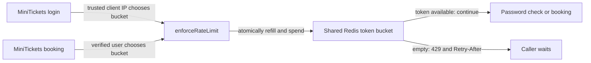

# Rate limiting: the ticket office turnstile

History: see [CHANGELOG.md](../CHANGELOG.md) or run `pnpm docs:history`

Area: API · Status: ✅ built in repository; live AWS acceptance is separate

<!-- interview-card: v2 -->

## 1. What is it?

Rate limiting gives a caller a small allowance of requests that refills over time. A token bucket tracks that allowance. This stops repeated requests from consuming unlimited application work.

## 2. Why do we need it?

Someone repeatedly guesses passwords or clicks Book. MiniTickets should reject excess attempts before doing expensive password checks or database transactions.

## 3. How does it work?

1. Choose the caller’s bucket using a trustworthy identity.
2. Refill its allowance and spend one token as one operation.
3. Continue only when permitted; otherwise tell the caller when to retry.

## 4. How do we use it in MiniTickets?

`enforceRateLimit` chooses separate login and booking policies. One Redis script makes all API tasks share the same allowance. An empty bucket returns **429**. If Redis is unavailable, these operations return **503** rather than starting expensive work.

## 5. Interview-ready answer

“MiniTickets uses token buckets: callers can make a short burst, then their allowance refills steadily. Login counts a trusted client IP; booking counts an authenticated user. Redis updates each bucket atomically across API instances. Excess requests receive 429 with a retry time. If Redis fails, we block these operations, accepting lower availability to preserve protection.”

## 6. Important follow-up questions

- **Why not use process memory?** Different API tasks would each grant a separate allowance.
- **Can a caller forge their IP?** Incorrect proxy trust can permit that; only the known boundary should be trusted.
- **Are shared networks treated fairly?** Login users behind one public IP share an allowance, which is a trade-off.
- **Is this a durable financial quota?** No. Eviction can reset Redis state; strict accounting needs durable storage.

## 7. Advanced details

Technical reference

### Policy and atomic update

A [token bucket](../glossary.md#token-bucket) permits bursts while limiting sustained requests. `apps/api/src/services/rate-limits.ts` → `RATE_POLICIES`, `enforceRateLimit` sets:

- Login: **20 tokens**, refilling **1 per 3 seconds**, keyed by trusted client IP.
- Booking: **10 tokens**, refilling **1 per second**, keyed by verified session user ID.

`apps/api/src/queries/rate-limits.ts` → `takeToken`, `TAKE_TOKEN` stores buckets and uses Redis time to refill/debit in one atomic Lua operation. Empty returns 429 with `Retry-After`; Redis failure returns 503 before password-hash or booking SQL work. Unauthenticated failures cannot safely share a supposed authenticated-user key.

`apps/api/src/config/trust-proxy.ts` → `trustProxyHops` trusts only configured hops/CIDRs. Current ALB-only mode uses **1 trusted hop**. A forwarded header from an untrusted boundary must not choose another caller’s allowance. [ALB](alb.md) supplies that boundary, [sessions](sessions-vs-jwt.md) supply booking identity and [Valkey](elasticache-valkey.md) shares the debit.

### Access and operations

API → Valkey uses TCP 6379; `minitickets-dev-redis-sg` admits `minitickets-dev-api-sg`. `REDIS_URL` provides the token over TLS. Verified identity selects a bucket; the Redis script enforces its update.

Console: ElastiCache → Valkey caches → `minitickets-dev-valkey` → Monitoring for memory/errors. EC2 → Load Balancers → `minitickets-dev` → Resource map checks request path. Bucket contents require an authorized Redis client. Everyone sharing a quota suggests proxy identity settings; login/booking 503 suggests Redis reach/password failure. Unexpectedly generous quotas suggest evicted keys.

Redis `allkeys-lru` can evict quotas; this is protection rather than durable accounting. Fixed windows are simpler but permit boundary bursts. Sliding windows cost more state. Edge limits stop abusive traffic before the API; strict financial quotas need a durable ledger.

### Evidence and growth

`pnpm demo:sale` exercises shared quotas, spoof resistance and the inventory gate locally. This rewrite claims no fresh execution or live AWS/CI acceptance. At 10x, inspect key cardinality, expiry and fairness; at 100x, consider gateway protection, per-tenant budgets and hot-key partitioning.

Read the [current system](../00-big-picture.md), [rate-limit scenario](../guides/interview-scenarios.md#rate-limits) and [sale-day tour](../guides/infra-explorer.html?tour=sale-day).

### Code anchors

- Anchor: `apps/api/src/queries/rate-limits.ts` — `TAKE_TOKEN`; follow the numbered comments at this boundary.
- Anchor: `apps/api/src/services/rate-limits.ts` — `RATE_POLICIES`; follow the numbered comments at this boundary.

[Open this piece in the city explorer](../guides/infra-explorer.html?concept=rate-limiting#chapter=24&piece=api-task).

## Where it appears in the story

- [app-story: 9b. A booking reaches its transaction](../app-story.md#9b-a-booking-reaches-its-transaction)

