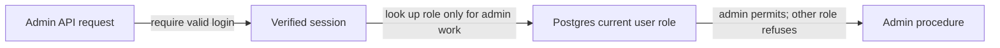

# Rbac

History: see [CHANGELOG.md](../CHANGELOG.md) or run `pnpm docs:history`

Area: Auth & Security · Status: ✅ built in repository; live AWS acceptance is separate
<!-- interview-card: v2 -->

## 1. What is it?

Role-based access control gives permissions to named roles such as admin. A caller must have the required current role before performing that role’s actions.

## 2. Why do we need it?

Any MiniTickets customer may buy seats, but only admins should create events. Hiding an admin button does not stop someone calling its API directly.

## 3. How does it work?

1. Authenticate the session.
2. Read the current role for an admin request.
3. Allow the operation only when the role matches.

## 4. How do we use it in MiniTickets?

`adminProcedure` adds the role check after the login check. Normal protected calls do not depend on this unrelated database lookup. Our role-changing service revokes indexed sessions around its update; this is not an atomic two-store transaction.

## 5. Interview-ready answer

“MiniTickets checks admin privileges on the server using the current Postgres role. We do not keep a permanent role copy inside a week-long session. Authentication runs first, then the required role check. That gives clear access decisions, while ownership checks still protect personal records and role-change races remain a separate concern.”

## 6. Important follow-up questions

- **Why not trust the session’s old role?** It could preserve privileges after a role change.
- **401 or 403?** 401 means no accepted identity; 403 means the identified user lacks permission.
- **What if role lookup fails?** Refuse the action; do not assume the user is an admin.
- **Does admin replace ownership rules?** No. Each operation must define the authority it actually needs.

## 7. Advanced details

Technical reference

### Source references

- Anchor: `apps/api/src/services/users.ts` — `makeAdmin`; follow the numbered comments at this boundary.
- Anchor: `apps/api/src/trpc/init.ts` — `router`; follow the numbered comments at this boundary.

`apps/api/src/queries/sessions.ts` implements indexed creation/read/revokeAll; `services/users.ts` revokes around makeAdmin. `pnpm demo:security` checks old-cookie, all-device and role revocation. Cookies are HttpOnly/SameSite with Secure in production. An in-flight authorized request cannot be recalled; two-store role/revocation is not a global transaction.

### Configuration and design

Role-based access control checks whether an authenticated user is allowed an action. adminProcedure reads Postgres lazily per admin request; changing a role revokes indexed sessions before and after the update. A role embedded forever in a session becomes stale after a privilege change.

### Checks and troubleshooting

Run `pnpm demo:security` and inspect the asserted outcome described above.

Is the presence cookie authorization? No; it only avoids a predictable redirect flash; API verifies the real session. Do not change a live stack to demonstrate it.

What happens if session membership is missing? **Authentication fails closed.**

### Trade-offs and alternatives

Redis/index eviction fails closed and forces login. The 20-device bound makes revoke work bounded. Session-versioning/transactional role changes are proposed improvements for larger deployments.

10x: monitor auth-store failures and session churn. 100x: coordinated auth versioning, device management and key/credential rotation.

### Further technical context

Opaque session cookies keep revocation server-side; JWTs reduce lookup dependence but revocation/role changes need expiry or another authoritative version. MiniTickets hashes random tokens in Redis, rotates login sessions, indexes at most 20 devices and checks membership on every read. Admin authorization reads Postgres; role changes revoke sessions before and after the update.

### Related reading

Uses the [current system](../00-big-picture.md); gives a concrete decision to the [scenario](../guides/interview-scenarios.md#sessions-roles) and [explorer tour](../guides/infra-explorer.html?tour=security-layers).

[Open this piece in the city explorer](../guides/infra-explorer.html?concept=rbac#chapter=8&piece=api-task).

## Where it appears in the story

- [app-story: 5b. Session identity, roles and revocation](../app-story.md#5b-session-identity-roles-and-revocation)

