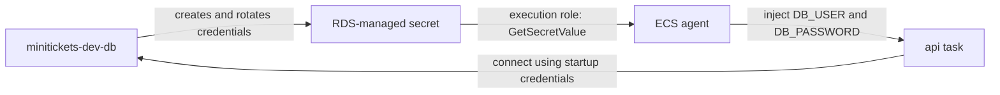

# RDS-managed master password (and the rotation limit)

History: see [CHANGELOG.md](../CHANGELOG.md) or run `pnpm docs:history`

Area: AWS Data · Status: ✅ built (with a known limitation) · Step docs: [14 data](../../14-infra-data.md) (section 3.6), [17 ECS api](../../17-infra-ecs-api.md) (section 3.17)
<!-- interview-card: v2 -->

## 1. What is it?

RDS-managed passwords let AWS generate, store and rotate the database administrator password. MiniTickets references the stored secret instead of choosing the password in code.

## 2. Why do we need it?

Writing a database password into deployment code creates another sensitive copy to protect. Letting RDS own it reduces handling, while the API receives only the credentials needed at startup.

## 3. How does it work?



1. RDS creates its secret and returns the secret address.
2. ECS reads its username and password when starting the API.
3. After rotation, running processes still hold their previous values.

## 4. How do we use it in MiniTickets?

Our API uses the managed master credentials, which is broader than an application needs. The known rotation limitation needs a coordinated rollout or a future runtime-refresh design; live rotation behavior was not exercised.

## 5. Interview-ready answer

“RDS generates and stores MiniTickets database credentials, and ECS injects them when a task starts. This keeps the chosen password out of our infrastructure configuration. The important limit is rotation: existing processes retain old values, so new database connections can fail until readers refresh. A restricted application user is also a production improvement.”

## 6. Important follow-up questions

- **Do existing database connections immediately break?** Normally rotation affects new authentication; existing connections can continue.
- **Does changing the secret refresh ECS?** No. Startup-injected values need new tasks.
- **Why separate username and password variables?** ECS injects individual JSON fields; our schema combines validated connection settings.
- **What would improve this design?** A narrower SQL user and deliberate credential refresh or coordinated restart on rotation.

## 7. Advanced details

<details>
<summary>Technical reference</summary>

### Source references

- Anchor: `infra/src/data/postgres.ts` · `manageMasterUserPassword: true`, `masterSecretArn`: RDS creates and stores the password.
- Anchor: `infra/src/compute/task.ts` · `secrets`: `DB_USER` and `DB_PASSWORD` from the secret's JSON keys.

Step by step:

1. `manageMasterUserPassword: true`: no chosen or literal managed database password in infrastructure code or Pulumi config. Runtime database configuration still has a password field populated from the secret.
2. `masterSecretArn` comes from `db.masterUserSecrets[0].secretArn`; the code throws a clear error if
   it is missing rather than writing "undefined" into an IAM policy.
3. `infra/src/compute/iam.ts` → `executionSecrets` allows `GetSecretValue` on that ARN.
4. `task.ts` → `valueFrom: "<arn>:username::"` and `"<arn>:password::"` pick the two JSON keys.
5. `apps/api/src/config/database.ts` → `DatabaseEnvSchema` accepts `DB_*` parts (ECS cannot glue them
   into a URL).

### Configuration and design

| Choice | Why |
| ------ | --- |
| RDS-managed, not our own random password | The value never enters our code, config or Pulumi state. |
| Inject at task start | Database credential injection needs no application Secrets Manager SDK call. |
| Accept the rotation limit | This was a short-lived dev assumption; a longer-running environment needs a coordinated refresh before rotation causes failures. |

This is the **Password** for Postgres. Getting it is an **Allowed** question (execution role →
Secrets Manager), reached over the public endpoint.

### Checks and troubleshooting

```bash
cd infra
aws secretsmanager describe-secret --profile ticketlite --secret-id $(pulumi stack output dbMasterSecretArn) \
  --query "[Name,RotationEnabled,RotationRules,LastRotatedDate]"
```

This shows metadata only; never run `get-secret-value` on a shared screen.

**Owner-only rotation scenario (not performed):** a deliberate rotation uses
`aws secretsmanager rotate-secret --secret-id <arn>`. In this hypothetical scenario existing connections may keep working, while new authentication can
fail with `password authentication failed`, `/ready` can return 503 when its query needs a new connection; already-pooled connections may still pass. Fix:
`aws ecs update-service … --force-new-deployment`. (Not tried in our account.)

- After rotation: `password authentication failed for user "minitickets"`, `/ready` can become 503 once a new connection is needed; affected logins can return generic 500. This is a failure scenario, not a measured rotation test.
- Execution role lacks the ARN: `ResourceInitializationError: unable to pull secrets`.

- *Do existing connections break on rotation?* No; only new ones.
- *Why `DB_*` parts and not `DATABASE_URL`?* ECS injects each secret key into its own env var; it
  cannot build a URL.

### Trade-offs and alternatives

- **Pros:** no human needs to handle the password; AWS-managed rotation; every read is in CloudTrail.
- **Cons:** running tasks keep the old password after rotation; the app uses the **master** user
  (too powerful for an app).

- **Read the secret on connect with caching** (pg accepts `password` as an async function): survives
  rotation.
- **Restart on rotation** (EventBridge rule → force new deployment).
- **A separate app user with fewer rights**, or **IAM database authentication**: production.

### Further technical context

`manageMasterUserPassword` puts a JSON secret in Secrets Manager. The execution role may
  read exactly that ARN, and the task definition maps its `username` and `password` keys to `DB_USER`
  and `DB_PASSWORD`. Known limit: RDS defaults to seven-day rotation ([AWS managed-password documentation](https://docs.aws.amazon.com/AmazonRDS/latest/UserGuide/rds-secrets-manager.html)); confirm the live configuration and tasks read the secret only at start.

Historical cost notes (not a current quote):

The RDS-managed secret costs like any secret, about $0.40 a month (counted in the ~$0.80 for two
secrets).

### Related reading

- **Uses ←** [RDS](rds-postgres.md), [Secrets Manager](secrets-manager.md).
- **Gives →** the `DB_USER`/`DB_PASSWORD` injection via the [execution role](execution-vs-task-role.md);
  an example of [secrets management](secrets-management.md).

[Open this piece in the city explorer](../guides/infra-explorer.html?concept=rds-managed-password#chapter=5&piece=rds).

## Where it appears in the story

- [Infra story: 6. Secrets Manager](../infra-story.md#6-secrets-manager)
- [Big picture: 4. Components](../00-big-picture.md#4-components)

</details>
