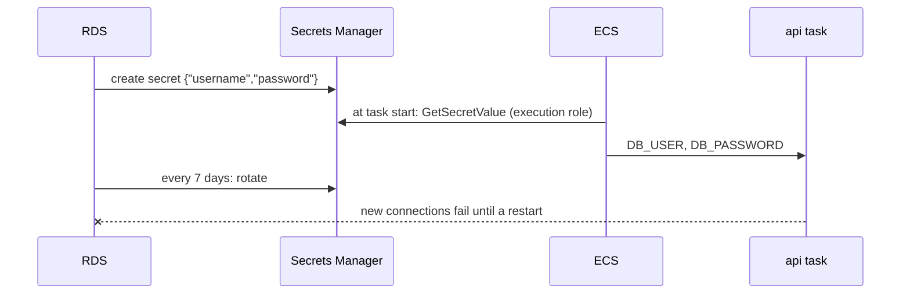

# RDS-managed master password (and the rotation limit)

History: see [CHANGELOG.md](../CHANGELOG.md) or run `pnpm docs:history`

Area: AWS Data · Status: ✅ built (with a known limitation) · Step docs: [14 data](../../14-infra-data.md) (section 3.6), [17 ECS api](../../17-infra-ecs-api.md) (section 3.17)

## 1. In one line

With `manageMasterUserPassword`, RDS creates the database password itself, stores it in Secrets
Manager and rotates it; we only ever handle the secret's ARN.

## 2. Real-life comparison

The vault company sets the combination, writes it into a locked safe, and changes it every week. We
never see it; we only know which safe holds it.

## 3. Picture it



## 4. Where in our code

- Anchor: `infra/src/data/postgres.ts` · `manageMasterUserPassword: true`, `masterSecretArn`: RDS creates and stores the password.
- Anchor: `infra/src/compute/task.ts` · `secrets`: `DB_USER` and `DB_PASSWORD` from the secret's JSON keys.

Step by step:

1. `manageMasterUserPassword: true`: no `password` field anywhere in our code or Pulumi config.
2. `masterSecretArn` comes from `db.masterUserSecrets[0].secretArn`; the code throws a clear error if
   it is missing rather than writing "undefined" into an IAM policy.
3. `iam.ts` → `executionSecrets` allows `GetSecretValue` on that ARN.
4. `task.ts` → `valueFrom: "<arn>:username::"` and `"<arn>:password::"` pick the two JSON keys.
5. `apps/api/src/config/database.ts` → `DatabaseEnvSchema` accepts `DB_*` parts (ECS cannot glue them
   into a URL).

## 5. See it yourself

```bash
cd infra
aws secretsmanager describe-secret --profile ticketlite --secret-id $(pulumi stack output dbMasterSecretArn) \
  --query "[Name,RotationEnabled,RotationRules,LastRotatedDate]"
```

This shows metadata only; never run `get-secret-value` on a shared screen.

**Break it on purpose (only if a session lasts long enough):** rotate it now with
`aws secretsmanager rotate-secret --secret-id <arn>`. Existing connections keep working, new ones
fail with `password authentication failed`, `/ready` turns 503. Fix:
`aws ecs update-service … --force-new-deployment`. (Not tried in our account.)

## 6. How it connects

- **Uses ←** [RDS](rds-postgres.md), [Secrets Manager](secrets-manager.md).
- **Gives →** the `DB_USER`/`DB_PASSWORD` injection via the [execution role](execution-vs-task-role.md);
  an example of [secrets management](secrets-management.md).

## 7. Our settings and WHY

| Choice | Why |
| ------ | --- |
| RDS-managed, not our own random password | The value never enters our code, config or Pulumi state. |
| Inject at task start | The app needs no AWS SDK. |
| Accept the rotation limit | Dev data layers live for hours, so a 7-day rotation never happens mid-session. |

## 8. Trade-offs

- **Pros:** no human ever sees the password; rotation for free; every read is in CloudTrail.
- **Cons:** running tasks keep the old password after rotation; the app uses the **master** user
  (too powerful for an app).

## 9. Alternatives and when to choose them

- **Read the secret on connect with caching** (pg accepts `password` as an async function): survives
  rotation.
- **Restart on rotation** (EventBridge rule → force new deployment).
- **A separate app user with fewer rights**, or **IAM database authentication**: production.

## 10. What breaks, and how we'd notice

- After rotation: `password authentication failed for user "minitickets"`, `/ready` 503, logins
  return a generic 500.
- Execution role lacks the ARN: `ResourceInitializationError: unable to pull secrets`.

## 11. Reach / Allowed / Password

This is the **Password** for Postgres. Getting it is an **Allowed** question (execution role →
Secrets Manager), reached over the public endpoint.

## 12. Cost

The RDS-managed secret costs like any secret, about $0.40 a month (counted in the ~$0.80 for two
secrets).

## 13. Interview answers at 3 levels

- **Simple:** AWS creates and stores the database password; we never see it.
- **Senior:** `manageMasterUserPassword` puts a JSON secret in Secrets Manager. The execution role may
  read exactly that ARN, and the task definition maps its `username` and `password` keys to `DB_USER`
  and `DB_PASSWORD`. Known limit: RDS rotates every 7 days and tasks read the secret only at start.
- **Lead:** I'd fix rotation either by reading the secret on connect with a short cache and retry on
  auth failure, or by moving to IAM auth, and I'd stop using the master user for the app.

## 14. Follow-up questions interviewers ask

- *Do existing connections break on rotation?* No; only new ones.
- *Why `DB_*` parts and not `DATABASE_URL`?* ECS injects each secret key into its own env var; it
  cannot build a URL.

## 15. Say it in 30 seconds

"RDS generates and stores the master password in Secrets Manager; our code and state only hold the
ARN. ECS injects the username and password at task start. The catch is rotation every 7 days: running
tasks keep the old password, so production should read it at runtime or use IAM auth."

## 16. Status

✅ built, with the rotation limitation documented in [docs/17](../../17-infra-ecs-api.md), section 3.17.

## Where it appears in the story

- [Infra story: 6. Secrets Manager](../infra-story.md#6-secrets-manager)
- [Big picture: 4. Components](../00-big-picture.md#4-components)
