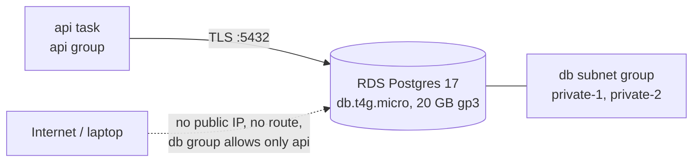

# RDS Postgres: private, single-AZ, subnet group

Area: AWS Data · Status: ✅ built · Step doc: [14 data](../../14-infra-data.md)

## 1. In one line

**RDS** runs a managed Postgres 17 server for us (patching, backups, storage) inside our private
subnets, reachable only by the api.

## 2. Real-life comparison

A bank vault in the basement with a vault company that maintains it. Only the api's staff badge
opens the basement corridor, and only with the vault's combination.

## 3. Picture it



## 4. Where in our code

- Anchor: `infra/src/data/postgres.ts` · `createPostgres`: the subnet group and the database instance.

Step by step:

1. `subnetGroup`: only the private subnets, in 2 AZs (RDS demands 2 even for a single-AZ database).
2. `engine: "postgres"`, `engineVersion: "17"` (same major as local Docker `postgres:17.6`; AWS
   picks the newest 17.x).
3. `instanceClass: "db.t4g.micro"`, `allocatedStorage: 20`, `storageType: "gp3"`.
4. `storageEncrypted: true` ([encryption-at-rest](encryption-at-rest.md)).
5. `dbName` and `username`: `minitickets`; `manageMasterUserPassword: true`
   ([rds-managed-password](rds-managed-password.md)).
6. `vpcSecurityGroupIds: [dbSgId]`, `publiclyAccessible: false`, `port: 5432`.
7. `multiAz: false`, and the dev-only settings: `deletionProtection: false`,
   `skipFinalSnapshot: true`, `backupRetentionPeriod: 1`, `applyImmediately: true`
   ([backups-dr](backups-dr.md)).
8. Returns `address`, `port` and `masterSecretArn`, never the password.

The api connects with TLS and verifies the certificate ([tls-in-transit](tls-in-transit.md));
Postgres 15+ on RDS refuses non-TLS connections by default (`rds.force_ssl = 1`).

## 5. See it yourself

```bash
aws rds describe-db-instances --profile ticketlite --db-instance-identifier minitickets-dev-db \
  --query "DBInstances[0].[PubliclyAccessible,StorageEncrypted,MultiAZ,EngineVersion,DBInstanceClass]"
dig +short $(cd infra && pulumi stack output dbEndpoint)      # a private 10.0.x.x address
```

**Break it on purpose (scratch branch):** remove the `db-in-5432` rule. New connections time out;
`/ready` returns 503 via ECS Exec.

## 6. How it connects

- **Uses ←** [private subnets](subnets.md), the db [security group](security-groups.md).
- **Gives →** `DB_HOST`/`DB_PORT` and the secret ARN to the [task definition](task-definition.md); the
  api's `users` table (Phase 3 `drizzle-schema`, `migrations` cards).

## 7. Our settings and WHY

| Setting | Value | Why |
| ------- | ----- | --- |
| Class | `db.t4g.micro` | Smallest Graviton class; burstable CPU is fine for dev. |
| Storage | 20 GB gp3 | Minimum size; gp3 is cheaper and faster than gp2. |
| Private | yes | The database must never be reachable from the internet. |
| Multi-AZ | off | Doubles cost; dev can be down for a while. |
| Dev teardown settings | on | The data switch deletes it cheaply. Production flips all four. |

## 8. Trade-offs

- **Pros:** no server work; encryption, backups and patching built in.
- **Cons:** hourly price whether used or not; single-AZ means an AZ problem is an outage; burstable
  CPU can run out of credits under steady load.

## 9. Alternatives and when to choose them

- **Aurora PostgreSQL / Aurora Serverless v2:** faster failover, storage that grows by itself,
  scale-down when idle.
- **Postgres in a container:** never for real data on AWS.
- **DynamoDB:** key-value access patterns at huge scale (we need SQL and constraints).

## 10. What breaks, and how we'd notice

| Symptom | Cause |
| ------- | ----- |
| Connection timeout | Security group rule missing (Reach) |
| `password authentication failed` | Wrong or rotated password (Password) |
| `self-signed certificate in certificate chain` | RDS CA bundle not trusted |
| `relation "users" does not exist` | Migrations not run (`pnpm infra:migrate`) |

## 11. Reach / Allowed / Password

See [aws-foundations, chapter 3](../aws-foundations.md#3-the-three-questions-reach-allowed-password):
**Reach** = db group allows 5432 from the api group, private subnets, no public IP. **Allowed** =
not asked for the SQL connection (no IAM database auth); the execution role read the password
secret at start. **Password** = user `minitickets` with the RDS-managed password, over verified TLS.

## 12. Cost

About $0.016 an hour for the instance plus $0.003 for 20 GB gp3: roughly $14 a month if left on
([docs/14](../../14-infra-data.md), section 3.11).

## 13. Interview answers at 3 levels

- **Simple:** A managed Postgres database in a private network that only our api can reach.
- **Senior:** Postgres 17 on `db.t4g.micro` in a subnet group of the two private subnets, not
  publicly accessible, behind a security group that admits only the api group on 5432, encrypted at
  rest, with an RDS-managed password in Secrets Manager. The api connects over TLS and verifies the
  RDS CA.
- **Lead:** For production: Multi-AZ, deletion protection, final snapshot, 7-35 days of
  point-in-time recovery, a separate least-privilege app user, rotation-safe secret reading or IAM
  auth, and maybe RDS Proxy once connection counts grow.

## 14. Follow-up questions interviewers ask

- *Why two subnets for one database?* RDS requires two AZs in the subnet group so it can move or
  fail over.
- *Can you connect from your laptop?* No, by design; use ECS Exec from inside the VPC.

## 15. Say it in 30 seconds

"Postgres 17 on RDS, smallest Graviton class, in the two private subnets with no public address. Only
the api's security group can reach 5432, the storage is encrypted, the password is managed by RDS in
Secrets Manager, and the api connects over verified TLS. Single-AZ and easy teardown, because it's
dev."

## 16. Status

✅ built for dev. **To make it production-grade:** Multi-AZ, deletion protection, final snapshot,
longer backups.
