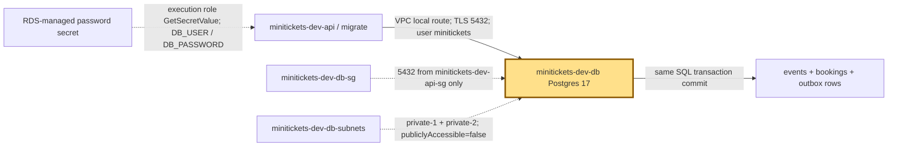
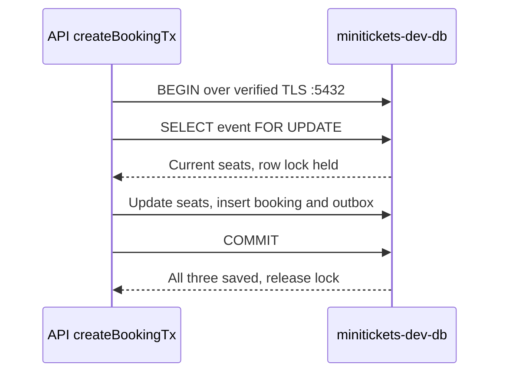

# RDS Postgres: the city’s booking vault

History: see [CHANGELOG.md](../CHANGELOG.md) or run `pnpm docs:history`
Area: AWS Data · Status: ✅ built · Step doc: [14 data](../../14-infra-data.md)
<!-- interview-card: v1 -->

## 1. In one line

When MiniTickets sells seats, [Postgres](../glossary.md#rds) commits the booking, seat count and outbox together inside our private RDS vault.

## 2. Where it sits

[Open this piece in the city explorer](../guides/infra-explorer.html?concept=rds-postgres#chapter=5&piece=rds).

## 3. How it works

## 4. What happens in MiniTickets

1. RDS runs Postgres 17 as `minitickets-dev-db`, `db.t4g.micro`, with 20 GB encrypted gp3 storage.
2. Its subnet group contains both private subnets; the instance itself is single-AZ.
3. Only the API security group reaches :5432. The migration task wears that same group.
4. ECS injects the RDS-managed username/password. Node checks the server certificate.
5. Postgres is the final seat authority; Redis hints cannot overrule its locked transaction.

## 5. Reach / Allowed / Password

**Reach:** private VPC route plus db guard allowing 5432 from minitickets-dev-api-sg.

**Allowed:** SQL login uses no IAM database authentication; execution role reads its secret first.

**Password:** user `minitickets`, RDS-managed password, verified TLS.

## 6. In our code

`infra/src/data/postgres.ts` → `createPostgres`.

`apps/api/src/config/database.ts` → `DatabaseEnvSchema`; `apps/api/src/db/client.ts` → `pool`.

`apps/api/src/queries/bookings.ts` → `createBookingTx`.

## 7. In the AWS console

`us-east-1` → RDS → Databases → `minitickets-dev-db` → Connectivity & security / Configuration / Maintenance & backups. See private endpoint, attached guards, encryption and single-AZ setting. These settings are from code; live state not checked.

## 8. Good / Bad

**Good:** Transactions protect seat truth. AWS handles database host maintenance.

**Bad:** One AZ can fail. Dev deletion settings can discard all data.

## 9. Other choices

- Multi-AZ RDS: pick it when a lost AZ must fail over.
- Aurora PostgreSQL: pick it when its scaling and availability model justify the cost.

## 10. Connected to

| Neighbor | Direction | What allows it | Console check |
| --- | --- | --- | --- |
| [Security groups](security-groups.md) | Guard | 5432 from minitickets-dev-api-sg | RDS → Connectivity & security → VPC security groups |
| [Secrets](secrets-manager.md) | In ← | Execution-role GetSecretValue | RDS → Configuration → Master credentials |
| [Outbox](outbox.md) | In/out ↔ | Same DB transaction | RDS → Monitoring; inspect SQL inside VPC |

## 11. When it breaks

Timeout → guards/routes and pool → restore intended private path.

Password failure → secret rotation/task age → refresh task credentials.

Missing relation → migration logs → apply the release’s migration through the authorized workflow.

## 12. Say it in 30 seconds

“RDS is our booking vault: private Postgres 17 with verified TLS. Only the API guard reaches it, including our migration task. A transaction locks the event row and saves seats, booking and outbox together. It is single-AZ with short backups for dev; that is not a production recovery plan.”

## 13. Likely follow-ups

- Two subnets means two databases? No; placement choices are not a standby.
- Why not trust Redis seats? Only the database transaction commits the sale.

## 14. Remember it

The vault decides who owns the seat; the noticeboard only suggests availability.

## 15. More detail

Settings, limits and deeper interview notes

- Anchor: `infra/src/data/postgres.ts` · `createPostgres`: the subnet group and the database instance.

The database name and master username are `minitickets`. `manageMasterUserPassword: true` lets RDS manage the secret. We return its ARN, endpoint and port, never its plaintext password. The app currently uses the master user: a separate app user with fewer SQL rights is a production improvement.

`publiclyAccessible: false` supplies no public address. A subnet group in at least two availability zones gives RDS placement choices even with `multiAz: false`; it does not create a second running copy. `db.t4g.micro` is a small burstable ARM instance, so sustained CPU use can exhaust credits.

Dev values are `backupRetentionPeriod: 1`, `deletionProtection: false`, `skipFinalSnapshot: true` and `applyImmediately: true`. Production needs deliberate retention, deletion protection, a final snapshot and restore drills. Old $14/month arithmetic was a historical estimate, not a checked price. Storage and instance runtime are both billed.

AWS DB settings use `DB_HOST`, `DB_PORT`, `DB_NAME`, `DB_USER`, `DB_PASSWORD`; local/CI use `DATABASE_URL`. The Zod transform rejects incomplete or mixed forms. AWS sets `ssl.rejectUnauthorized: true`, using the RDS CA installed in the API image; never bypass certificate checks to hide a configuration error. Pool maximum is 10 per API task, connection/acquisition budget 2000 ms, SQL statement budget 5000 ms including lock waits.

ECS resolves the secret at startup. Rotation can leave a long-running task holding an old password; automatic runtime secret refresh is not claimed. Multi-AZ, replicas, RDS Proxy and stronger recovery targets remain choices requiring separate work.

[Official RDS encryption console check](https://docs.aws.amazon.com/AmazonRDS/latest/UserGuide/Overview.Encryption.html).

## Where it appears in the story

- [Infra story: 7. RDS Postgres](../infra-story.md#7-rds-postgres)
- [Big picture: 4. Components](../00-big-picture.md#4-components)
