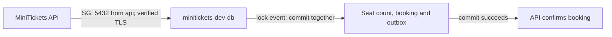

# RDS Postgres: the city’s booking vault

History: see [CHANGELOG.md](../CHANGELOG.md) or run `pnpm docs:history`
Area: AWS Data · Status: ✅ built · Step doc: [14 data](../../14-infra-data.md)
<!-- interview-card: v2 -->

## 1. What is it?

[RDS](../glossary.md#rds) runs our Postgres database while AWS maintains the database host. Postgres permanently records who booked each seat.

## 2. Why do we need it?

Two people may try to buy the last seat together. MiniTickets needs one place that can check availability and save the whole sale together, without selling that seat twice.

## 3. How does it work?

1. The API starts a transaction and locks the event row.
2. It checks seats and saves seats, booking and outgoing notice.
3. Commit makes all changes durable together; failure rolls them back.

## 4. How do we use it in MiniTickets?

Postgres is our final seat authority. Redis availability is only a hint. The API uses database queries such as `createBookingTx`; the migration task uses the same permitted network path to apply schema changes.

## 5. Interview-ready answer

“MiniTickets uses private RDS Postgres for booking truth. A transaction locks the event row, checks seats and saves the booking, seat count and outbox together. Competing buyers wait for that decision. AWS manages the database host, but we still own query performance, credentials, migrations and a recovery plan.”

## 6. Important follow-up questions

- **Does a row lock solve every race?** Only work that follows the same locking and validation rules is protected; constraints provide another safeguard.
- **What if the API loses the commit response?** Retry the same booking intent so durable idempotency can resolve the outcome.
- **Do two subnet choices mean a standby?** No. Our dev database is single-AZ.
- **What if Redis disagrees?** The locked Postgres transaction decides whether the sale can proceed.

## 7. Advanced details

Technical reference

### Configuration and security

The instance is Postgres 17, `db.t4g.micro`, with 20 GB encrypted gp3 storage. The database guard is `minitickets-dev-db-sg`; its only database ingress is TCP 5432 from `minitickets-dev-api-sg`. `minitickets-dev-db-subnets` contains private-1 and private-2.

The migration task uses `minitickets-dev-api-sg`, just like API. RDS-managed secret fields are injected into ECS as `DB_USER` / `DB_PASSWORD`; secret reading uses the execution role. SQL uses password authentication, not IAM database authentication. VPC routing, the database guard and verified TLS are all needed; having valid credentials does not bypass the network guard.

### Implementation and operational limits

- Anchor: `infra/src/data/postgres.ts` · `createPostgres`: the subnet group and the database instance.

The database name and master username are `minitickets`. `manageMasterUserPassword: true` lets RDS manage the secret. We return its ARN, endpoint and port, never its plaintext password. The app currently uses the master user: a separate app user with fewer SQL rights is a production improvement.

`publiclyAccessible: false` supplies no public address. A subnet group in at least two availability zones gives RDS placement choices even with `multiAz: false`; it does not create a second running copy. `db.t4g.micro` is a small burstable ARM instance, so sustained CPU use can exhaust credits.

Dev values are `backupRetentionPeriod: 1`, `deletionProtection: false`, `skipFinalSnapshot: true` and `applyImmediately: true`. Production needs deliberate retention, deletion protection, a final snapshot and restore drills. Old $14/month arithmetic was a historical estimate, not a checked price. Storage and instance runtime are both billed.

AWS DB settings use `DB_HOST`, `DB_PORT`, `DB_NAME`, `DB_USER`, `DB_PASSWORD`; local/CI use `DATABASE_URL`. The Zod transform rejects incomplete or mixed forms. AWS sets `ssl.rejectUnauthorized: true`, using the RDS CA installed in the API image; never bypass certificate checks to hide a configuration error. Pool maximum is 10 per API task, connection/acquisition budget 2000 ms, SQL statement budget 5000 ms including lock waits.

ECS resolves the secret at startup. Rotation can leave a long-running task holding an old password; automatic runtime secret refresh is not claimed. Multi-AZ, replicas, RDS Proxy and stronger recovery targets remain choices requiring separate work.

[Official RDS encryption console check](https://docs.aws.amazon.com/AmazonRDS/latest/UserGuide/Overview.Encryption.html).

### Source references

`infra/src/data/postgres.ts` → `createPostgres`.

`apps/api/src/config/database.ts` → `DatabaseEnvSchema`; `apps/api/src/db/client.ts` → `pool`.

`apps/api/src/queries/bookings.ts` → `createBookingTx`.

### Console and troubleshooting

`us-east-1` → RDS → Databases → `minitickets-dev-db` → Connectivity & security / Configuration / Maintenance & backups. See private endpoint, attached guards, encryption and single-AZ setting. These settings are from code; live state not checked.

Timeout → guards/routes and pool → restore intended private path.

Password failure → secret rotation/task age → refresh task credentials.

Missing relation → migration logs → apply the release’s migration through the authorized workflow.

### Trade-offs and related concepts

- Multi-AZ RDS: pick it when a lost AZ must fail over.
- Aurora PostgreSQL: pick it when its scaling and availability model justify the cost.

| Neighbor | Direction | What allows it | Console check |
| --- | --- | --- | --- |
| [Security groups](security-groups.md) | Guard | 5432 from minitickets-dev-api-sg | RDS → Connectivity & security → VPC security groups |
| [Secrets](secrets-manager.md) | In ← | Execution-role GetSecretValue | RDS → Configuration → Master credentials |
| [Outbox](outbox.md) | In/out ↔ | Same DB transaction | RDS → Monitoring; inspect SQL inside VPC |

[Open this piece in the city explorer](../guides/infra-explorer.html?concept=rds-postgres#chapter=5&piece=rds).

## Where it appears in the story

- [Infra story: 7. RDS Postgres](../infra-story.md#7-rds-postgres)
- [Big picture: 4. Components](../00-big-picture.md#4-components)

