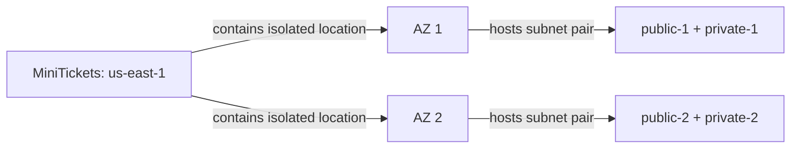

# Regions and availability zones

History: see [CHANGELOG.md](../CHANGELOG.md) or run `pnpm docs:history`

Area: AWS Network · Status: ✅ built · Deep dive: [aws-foundations, chapter 1](../aws-foundations.md#1-regions-availability-zones-and-accounts)
<!-- interview-card: v2 -->

## 1. What is it?

A region is an AWS geographic area. An availability zone is an isolated group of data centres inside that region, designed so one local failure need not affect its neighbours.

## 2. Why do we need it?

If every MiniTickets component sits in one location, a power or network failure there can stop bookings. Separate zones give us places to put redundant copies.

## 3. How does it work?



1. Choose a region for the application.
2. Discover available zones and place a public/private subnet pair in each.
3. Add redundant application and data copies when the availability goal requires them.

## 4. How do we use it in MiniTickets?

MiniTickets builds its network across two zones. That gives the load balancer and database placement choices. Our dev API, web, database and cache still each run one desired copy; network shape alone cannot guarantee availability.

## 5. Interview-ready answer

“A region chooses where MiniTickets runs geographically; zones give isolated locations within it. We build subnets in two zones, but our dev system still has single copies of important components. Real resilience needs redundant capacity, data failover and tested recovery, rather than just a multi-zone network.”

## 6. Important follow-up questions

- **Does two-zone networking mean high availability?** No. A required single database or task can still interrupt the app.
- **Why discover zone names?** Availability and account-specific names vary; the code should use the available choices.
- **What survives a whole-region outage?** Another-region design, with replicated data and an explicit recovery plan; we have not built it.
- **How would you choose a region?** Start with user latency and data-residency requirements, then services, cost and recovery needs.

## 7. Advanced details

<details>
<summary>Technical reference</summary>

### Current reading notes

Current source uses the first two available zones from `infra/src/network.ts`. ALB and RDS require the two-zone subnet shape; do not infer that a single-node Valkey subnet group itself requires two zones. Live placement and failure recovery were not checked.

### Implementation reference

- Anchor: `infra/src/network.ts` · `azs`, `azNames`: asks AWS which AZs are available and keeps the first 2.

What the code does, step by step:

1. `aws.getAvailabilityZonesOutput({ state: "available" })` asks AWS for the AZ names of the region
   Pulumi runs in. The region itself comes from `aws:region: us-east-1` in `infra/Pulumi.dev.yaml`.
2. `names.slice(0, 2)` keeps the first two. No AZ name is typed by hand, so the code works in any
   region.
3. Every subnet gets `availabilityZone: azNames.apply((names) => names[i])`: subnet 1 of each kind
   goes to AZ #1, subnet 2 to AZ #2.
4. Later layers need the two AZs: the ALB (`infra/src/entry/alb.ts` → `subnets`) and the RDS subnet group (`infra/src/data/postgres.ts`) require at least two zones. The Valkey subnet group (`infra/src/data/cache.ts`) uses the same private pair; that does not create a replica.

### Inspection and historical evidence

```bash
aws ec2 describe-availability-zones --region us-east-1 --profile ticketlite \
  --query "AvailabilityZones[].[ZoneName,ZoneId]" --output table
aws ec2 describe-subnets --profile ticketlite \
  --filters Name=tag:Project,Values=minitickets \
  --query "Subnets[].[Tags[?Key=='Name']|[0].Value,AvailabilityZone,CidrBlock]" --output table
```

Expect 4 subnets: `public-1` and `private-1` in the same AZ, `public-2` and `private-2` in the other.

**Break it on purpose (read-only thought experiment):** change `slice(0, 2)` to `slice(0, 1)`. The
`pulumi preview` still works for the network, but the ALB and the RDS subnet group would be refused
by AWS when created, because both need subnets in at least two AZs.

### Settings and reasoning

| Setting | Value | Why |
| ------- | ----- | --- |
| Region | `us-east-1` | Chosen to match the existing AWS account setup. Trade-offs (latency, cost, availability, data residency, outage history) in [aws-foundations, chapter 1](../aws-foundations.md#7-our-settings-and-why). |
| AZ count | 2 | The ALB and RDS subnet group's minimum; Valkey shares the pair. |
| AZ names | looked up, not typed | AZ names differ per account and region. |

### Trade-offs

- **Pros:** cheapest shape that the ALB and RDS accept; the second AZ is ready for redundancy.
- **Cons:** in dev only the subnets use both AZs. The api, web, RDS and Valkey each run once, in one
  AZ, so a failure in a zone hosting a required single copy can interrupt the app.

### Alternatives and scaling

- **3 AZs:** production systems that need a majority to survive one AZ loss.
- **Another region** (for example `ap-south-1` for users in India): see the region table in
  aws-foundations.
- **Multi-region:** only with a business case for surviving a whole-region outage.

### Failure diagnosis

- **An AZ goes down:** whatever single copy lives there stops. `/ready` turns 503 if it was RDS or
  Valkey; the ALB can fail requests if no usable task remains; all-unhealthy fail-open is distinct from an empty target group.
- **Commands without `--region`:** "not found" errors for resources that exist.

### Access boundaries

**Reach:** subnets in different AZs of one VPC reach each other through the built-in `local`
route. Regions are separate: nothing in `us-east-1` reaches another region's VPC without extra
networking.

### Cost

Regions and AZs are free. Data sent between AZs is billed per GB; ours is tiny and not measured.

### Further questions

- *Why can `us-east-1a` be a different building in another account?* AWS maps names to physical
  AZs per account; the `ZoneId` is the same everywhere.
- *Why not hard-code AZ names?* They differ per account and region, and some AZs can be
  unavailable for new resources.

### Status and remaining work

✅ built. **To make it production-grade:** a copy of every tier in each AZ (see
[high-availability](high-availability.md)).

### Related reading

- [subnet](subnets.md)
- [ALB](alb.md)
- [RDS](rds-postgres.md)
- [Valkey](elasticache-valkey.md)

[Open this piece in the city explorer](../guides/infra-explorer.html?concept=regions-and-azs#chapter=1&piece=region).

## Where it appears in the story

- [Infra story: 10. The network: VPC, subnets, route tables, internet gateway](../infra-story.md#10-the-network-vpc-subnets-route-tables-internet-gateway)
- [Big picture: 4. Components](../00-big-picture.md#4-components)

</details>
