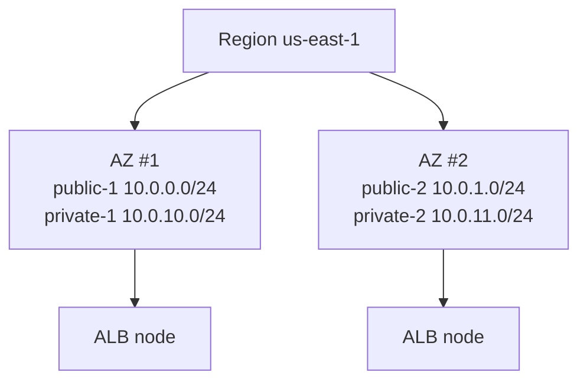

# Regions and availability zones

History: see [CHANGELOG.md](../CHANGELOG.md) or run `pnpm docs:history`

Area: AWS Network · Status: ✅ built · Deep dive: [aws-foundations, chapter 1](../aws-foundations.md#1-regions-availability-zones-and-accounts)

## 1. In one line

A **region** is a group of AWS data centres in one area of the world (ours: `us-east-1`); an
**availability zone (AZ)** is one isolated part of a region, with its own power and network.

## 2. Real-life comparison

A region is a city where a business-park chain operates. An AZ is one building in that city, far
enough from the others that a fire in one does not reach the next.

## 3. Picture it



## 4. Where in our code

- Anchor: `infra/src/network.ts` · `azs`, `azNames`: asks AWS which AZs are available and keeps the first 2.

What the code does, step by step:

1. `aws.getAvailabilityZonesOutput({ state: "available" })` asks AWS for the AZ names of the region
   Pulumi runs in. The region itself comes from `aws:region: us-east-1` in `infra/Pulumi.dev.yaml`.
2. `names.slice(0, 2)` keeps the first two. No AZ name is typed by hand, so the code works in any
   region.
3. Every subnet gets `availabilityZone: azNames.apply((names) => names[i])`: subnet 1 of each kind
   goes to AZ #1, subnet 2 to AZ #2.
4. Later layers need the two AZs: the ALB (`infra/src/entry/alb.ts` → `subnets`) and both subnet
   groups (`infra/src/data/postgres.ts`, `infra/src/data/cache.ts`) refuse to work with fewer.

## 5. See it yourself

```bash
aws ec2 describe-availability-zones --region us-east-1 --profile ticketlite \
  --query "AvailabilityZones[].[ZoneName,ZoneId]" --output table
aws ec2 describe-subnets --profile ticketlite \
  --filters Name=tag:Project,Values=minitickets \
  --query "Subnets[].[Tags[?Key=='Name']|[0].Value,AvailabilityZone,CidrBlock]" --output table
```

Expect 4 subnets: `public-1` and `private-1` in the same AZ, `public-2` and `private-2` in the other.

**Break it on purpose (read-only thought experiment):** change `slice(0, 2)` to `slice(0, 1)`. The
`pulumi preview` still works for the network, but the ALB and the RDS subnet group would be refused
by AWS when created, because both need subnets in at least two AZs.

## 6. How it connects

- **Uses ←** nothing. The region is set in Pulumi config.
- **Gives →** the AZ for every [subnet](subnets.md); the 2-AZ shape that the [ALB](alb.md),
  [RDS](rds-postgres.md) and [Valkey](elasticache-valkey.md) subnet groups need; the base of
  [high availability](high-availability.md).

## 7. Our settings and WHY

| Setting | Value | Why |
| ------- | ----- | --- |
| Region | `us-east-1` | Chosen to match the existing AWS account setup. Trade-offs (latency, cost, availability, data residency, outage history) in [aws-foundations, chapter 1](../aws-foundations.md#7-our-settings-and-why). |
| AZ count | 2 | The minimum the ALB and the subnet groups accept. |
| AZ names | looked up, not typed | AZ names differ per account and region. |

## 8. Trade-offs

- **Pros:** cheapest shape that the ALB and RDS accept; the second AZ is ready for redundancy.
- **Cons:** in dev only the subnets use both AZs. The api, web, RDS and Valkey each run once, in one
  AZ, so an AZ failure still takes the app down.

## 9. Alternatives and when to choose them

- **3 AZs:** production systems that need a majority to survive one AZ loss.
- **Another region** (for example `ap-south-1` for users in India): see the region table in
  aws-foundations.
- **Multi-region:** only with a business case for surviving a whole-region outage.

## 10. What breaks, and how we'd notice

- **An AZ goes down:** whatever single copy lives there stops. `/ready` turns 503 if it was RDS or
  Valkey; the ALB returns 503 if it was a task.
- **Commands without `--region`:** "not found" errors for resources that exist.

## 11. Reach / Allowed / Password

**Reach:** subnets in different AZs of one VPC reach each other through the built-in `local`
route. Regions are separate: nothing in `us-east-1` reaches another region's VPC without extra
networking.

## 12. Cost

Regions and AZs are free. Data sent between AZs is billed per GB; ours is tiny and not measured.

## 13. Interview answers at 3 levels

- **Simple:** A region is a geographic area; AZs are isolated data centre groups inside it. We use
  `us-east-1` with two AZs.
- **Senior:** Our network code looks up the available AZs and builds a public and a private subnet
  in each of the first two. The ALB and the RDS and ElastiCache subnet groups require two AZs, so
  the shape is multi-AZ even though dev runs a single copy of each stateful part.
- **Lead:** Two AZs is only real redundancy when every tier has a copy in each: RDS Multi-AZ, a
  cache replica with failover, and at least two tasks per service. I would pick the region by user
  latency and data-residency rules first, cost second.

## 14. Follow-up questions interviewers ask

- *Why can `us-east-1a` be a different building in another account?* AWS maps names to physical
  AZs per account; the `ZoneId` is the same everywhere.
- *Why not hard-code AZ names?* They differ per account and region, and some AZs can be
  unavailable for new resources.

## 15. Say it in 30 seconds

"We run in `us-east-1`. The network code asks AWS for the available AZs and builds a public and a
private subnet in each of the first two, because the ALB and the database subnet groups need two
AZs. In dev only the shape is multi-AZ; each stateful part runs once."

## 16. Status

✅ built. **To make it production-grade:** a copy of every tier in each AZ (see
[high-availability](high-availability.md)).
