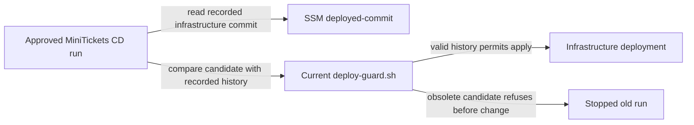

# Release guard

History: see [CHANGELOG.md](../CHANGELOG.md) or run `pnpm docs:history`

Area: DevOps & CI/CD · Status: ✅ built in repository; live AWS acceptance is separate

<!-- interview-card: v2 -->

## 1. What is it?

A release guard checks whether a deployment is still allowed to run. MiniTickets rejects an obsolete infrastructure version before it can change the environment.

## 2. Why do we need it?

An old release can sit waiting for approval while a newer release adds resources. Approving the old run afterward could remove those newer resources because its code does not know they exist.

## 3. How does it work?

1. Read the infrastructure commit recorded for the environment.
2. Compare it with the candidate’s Git history using the current guard.
3. Refuse obsolete changes before applying; keep image rollback separate.

## 4. How do we use it in MiniTickets?

CD runs `deploy-guard.sh` before infrastructure changes. Its record is separate from the chosen application image tag. The guard accounts for started partial applies, so the recorded commit is a safety boundary rather than proof every smoke test passed.

## 5. Interview-ready answer

“MiniTickets prevents stale approvals from applying an old infrastructure program. The current guard compares the candidate’s history with the environment’s recorded commit and refuses obsolete runs before changes. Cancelling old jobs helps, but is not the whole safeguard. Application image rollback remains explicit and uses current infrastructure code rather than replaying an old resource graph.”

## 6. Important follow-up questions

- **Why not rely only on cancellation?** Approval queues and concurrency can still leave an old run eligible.
- **Does the record prove deployment succeeded?** No. It can record a started partial apply even if later checks fail.
- **Is drift detection enough?** No. Seeing differences does not prevent an obsolete program applying them.
- **Can infrastructure rollback happen?** Only through its separate deliberate override and review; it is not ordinary image rollback.

## 7. Advanced details

Technical reference

### Implementation and acceptance

`scripts/deploy-guard.sh` compares ancestry; `infra/src/release.ts` defines SSM `/minitickets/dev/deployed-commit`. `.github/workflows/cd.yml` runs the current guard before applying infrastructure. Current main supplies guard logic. `/minitickets/dev/image-tag` is a separate application-release choice. A stale graph may interpret newly created resources as removals.

The record includes started partial applies, not only completed healthy releases. Unit tests cover stale runs and rollback conditions; `pnpm test` runs them. Owner runbook bootstrap and current AWS guard permissions still need live acceptance. No live apply or rollback was performed for this rewrite.

### Trade-offs and future controls

SSM holds environment state without granting repository writes. Pending-run cancellation and superseding complement ancestry checks. Later controls could include approval expiry, environment rules, policy-as-code against destructive stateful changes and separate deployment accounts. Drift detection identifies differences but does not itself stop a dangerous stale apply.

### Code anchors

- Anchor: `infra/src/release.ts` — `imageTagParameterName`; follow the numbered comments at this boundary.
- Anchor: `scripts/deploy-guard.sh` — `module configuration`; follow the numbered comments at this boundary.

### Related reading

[current system](../00-big-picture.md) · [scenario](../guides/interview-scenarios.md#old-deploy) · [explorer tour](../guides/infra-explorer.html?tour=deploy)

[Open this concept in the city explorer](../guides/infra-explorer.html?concept=release-guard#chapter=13&piece=ssm).

## Where it appears in the story

- [app-story: 16b. Publish, approval and stale-run safety](../app-story.md#16b-publish-approval-and-stale-run-safety)

