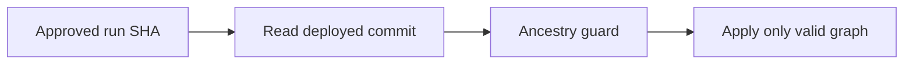

# Release guard

History: see [CHANGELOG.md](../CHANGELOG.md) or run `pnpm docs:history`

Area: DevOps & CI/CD · Status: ✅ built in repository; live AWS acceptance is separate

## 1. In one line

The release guard refuses obsolete infrastructure programs before apply. Current main supplies the guard; SSM tracks the applied commit, including started partial applies, separately from the deployed image tag.

## 2. Real-life comparison

A sealed package is built once, then checked at a gate before the manager installs that exact version.

## 3. Picture it

## 4. Where in our code

- Anchor: `infra/src/release.ts` — `imageTagParameterName`; follow the numbered comments at this boundary.
- Anchor: `scripts/deploy-guard.sh` — `module configuration`; follow the numbered comments at this boundary.

`scripts/deploy-guard.sh` compares ancestry; `infra/src/release.ts` defines the deployed-commit parameter; `.github/workflows/cd.yml` checks it before changes. Unit tests cover stale runs and rollback conditions. Run `pnpm test` and follow runbook bootstrap; current guard permissions still need AWS acceptance.

## 5. See it yourself

Run `pnpm test` and inspect the asserted outcome described above.

Failure thought experiment: Why not just cancel pending runs? Human approval and queued concurrency can still select an obsolete run. Do not change a live stack to demonstrate it.

## 6. How it connects

Uses the [current system](../00-big-picture.md); gives a concrete decision to the [scenario](../guides/interview-scenarios.md#old-deploy) and [explorer tour](../guides/infra-explorer.html?tour=deploy).

## 7. Our settings and WHY

The release guard refuses obsolete infrastructure programs before apply. Current main supplies the guard; SSM tracks the applied commit, including started partial applies, separately from the deployed image tag. A stale infrastructure program can interpret newer resources as removed.

## 8. Trade-offs

SSM records AWS release state without granting repo writes. Drift detection finds differences but does not itself prevent a destructive stale apply.

## 9. Alternatives and when to choose them

10x: approval expiry and environment rules. 100x: policy-as-code denying destructive stateful changes and separate deployment accounts.

## 10. What breaks and how we notice

Why not just cancel pending runs? Human approval and queued concurrency can still select an obsolete run.

## 13. Interview answers at 3 levels

- **Simple:** The release guard refuses obsolete infrastructure programs before apply.
- **Senior:** Approvals can outlive the commit they refer to. Record the deployed commit and refuse an older ancestor before applying infrastructure. Cancel/supersede waiting runs, but keep a server-side guard: concurrency alone may still leave an old pending run. Allow app rollback explicitly without applying an old infrastructure graph.
- **Lead:** 10x: approval expiry and environment rules. 100x: policy-as-code denying destructive stateful changes and separate deployment accounts.

## 14. Follow-up questions with answers

Why not just cancel pending runs? Human approval and queued concurrency can still select an obsolete run.

What should an ancestor infrastructure run do? **Refuse before applying.**

## 15. Say it in 30 seconds

Approvals can outlive the commit they refer to. Record the deployed commit and refuse an older ancestor before applying infrastructure. Cancel/supersede waiting runs, but keep a server-side guard: concurrency alone may still leave an old pending run. Allow app rollback explicitly without applying an old infrastructure graph.

## 16. Status and production work

Repository implementation and local evidence are described above. Live AWS/CI execution remains owner acceptance. 10x: approval expiry and environment rules. 100x: policy-as-code denying destructive stateful changes and separate deployment accounts.

## Where it appears in the story

- [app-story: 16b. Publish, approval and stale-run safety](../app-story.md#16b-publish-approval-and-stale-run-safety)
