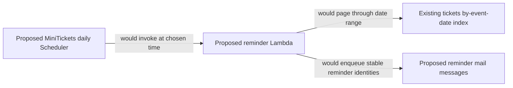

# Reminders

History: see [CHANGELOG.md](../CHANGELOG.md) or run `pnpm docs:history`

Area: Async · Status: 📖 explain-only
<!-- interview-card: v2 -->

## 1. What is it?

A reminder is a message sent near a future event. MiniTickets has a proposed scheduled design for this; no reminder schedule or worker is built.

## 2. Why do we need it?

A customer may book weeks before an event and forget it. A background schedule would find the relevant tickets without needing the customer to open the website that day.

## 3. How does it work?

1. A proposed schedule would start a bounded worker.
2. The worker would page through the relevant date range.
3. It would enqueue deduplicated reminders through the mail boundary.

## 4. How do we use it in MiniTickets?

The existing ticket date index and mail pipeline are integration points. A reminder schema, worker, schedule, permissions and user experience remain proposed. Time zones, missed runs and duplicate invocation behavior need product decisions before implementation.

## 5. Interview-ready answer

“For MiniTickets I would run reminders outside user requests, query a bounded date window and enqueue work with a stable ticket-plus-reminder identity. Schedules can repeat or miss their intended time, so I would design catch-up and deduplication explicitly. This is an explain-only design; the existing date index does not mean reminders are implemented.”

## 6. Important follow-up questions

- **What if the schedule runs twice?** Deduplicate by ticket plus reminder date/type, not invocation ID.
- **What if an index update arrives late?** Use a deliberate overlapping window and deduplication policy.
- **Can TTL schedule the email exactly?** No. Expiry cleanup is asynchronous.
- **How would missed runs recover?** Use bounded catch-up and checkpoints, with monitored failures rather than unbounded replay.

## 7. Advanced details

Technical reference

### Source references

Not in our app as an anchored feature. The proposed or observational location is explained below; it must not be mistaken for a deployed resource.

WHERE IN MINITICKETS: proposed infra/src/jobs/reminders.ts after ticket table, proposed worker reminder handler with paginated date-index queries, and existing SNS/SQS mail boundary extended with a versioned reminder schema. Trust scheduler.amazonaws.com for invoke-only execution role; Lambda role queries only the date index and publishes only the mail destination. No Scheduler, reminder Lambda, IAM grants or reminder UI is built. Do not run a nonexistent demo.

Existing integration point: `infra/src/tickets/storage.ts`.

### Configuration and design

Explain-only: a daily Scheduler would invoke a paginated date-index worker and enqueue stable reminder identities; there is no schedule, Lambda or reminder IAM grant. Scheduled work belongs outside user requests and must survive retries.

### Checks and troubleshooting

Use the linked scenario and tour to trace the existing integration point. This proposed extension has no runnable feature demo.

What if the schedule runs twice? Dedup by stable reminder identity, not invocation id. Do not change a live stack to demonstrate it.

Which id should deduplicate a reminder? **Ticket plus reminder date/type.**

### Trade-offs and alternatives

GSI lag means use overlapping windows plus dedup; TTL is not an exact scheduler. Flexible windows spread load but affect delivery timing. Missed schedules need bounded catch-up and DLQ alarms.

10x: page sizes and sending rate. 100x: shard date partitions, incremental checkpoints and user-local time-zone batches.

### Further technical context

Use one daily EventBridge schedule to invoke a reminder Lambda, query a bounded date range and enqueue reminder messages. Use explicit reminder identity such as ticketId plus reminder date/type to prevent duplicate sends. Time zone and missed-run semantics are product decisions. A daily schedule does not guarantee exactly one invocation.

### Related reading

Uses the [current system](../00-big-picture.md); gives a concrete decision to the [scenario](../guides/interview-scenarios.md#reminders) and [explorer tour](../guides/infra-explorer.html?tour=chapter-20).

[Open this piece in the city explorer](../guides/infra-explorer.html?concept=reminders#chapter=20&piece=reminder-scheduler).

## Where it appears in the story

- [app-story: 9c. Side path: outbox, fan-out and recoverable work](../app-story.md#9c-side-path-outbox-fan-out-and-recoverable-work)

