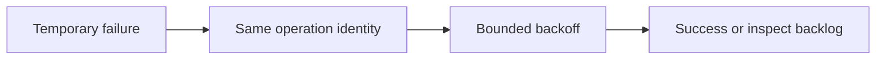

# Retry policy: retry only what is safe

History: see [CHANGELOG.md](../CHANGELOG.md) or run `pnpm docs:history`

Area: Reliability · Status: ✅ built in repository; live AWS acceptance is separate

## 1. In one line

General mutations do not auto-retry. Booking explicitly retries network/5xx at most twice with the same intent; worker and outbox policies differ, and jitter remains explain-only.

## 2. Real-life comparison

A durable work tray keeps the task after the customer leaves; a completed stamp identifies a repeat.

## 3. Picture it

## 4. Where in our code

- Anchor: `apps/web/src/providers/query-provider.tsx` — `shouldRetry`; follow the numbered comments at this boundary.
- Anchor: `apps/worker/src/retry-later.ts` — `delayFailedMessages`; follow the numbered comments at this boundary.

`apps/web/src/features/bookings/lib/booking-retry.ts`, `apps/worker/src/backoff.ts` and `apps/api/src/services/outbox.ts` implement separate policies. Run `pnpm demo:outbox`. Outbox retries cap at 60 s without a maximum attempt count; worker failures use 10/40/120 s and a DLQ after 3 receives.

## 5. See it yourself

Run `pnpm demo:outbox` and inspect the asserted outcome described above.

Failure thought experiment: What if the response is lost after send? A retry may duplicate delivery; the consumer must be idempotent. Do not change a live stack to demonstrate it.

## 6. How it connects

Uses the [current system](../00-big-picture.md); gives a concrete decision to the [scenario](../guides/interview-scenarios.md#retry-backoff) and [explorer tour](../guides/infra-explorer.html?tour=failing-email).

## 7. Our settings and WHY

General mutations do not auto-retry. Booking explicitly retries network/5xx at most twice with the same intent; worker and outbox policies differ, and jitter remains explain-only. Immediate retries turn a partial failure into more load.

## 8. Trade-offs

Do not retry validation/authorization failures. Layered retries multiply attempts; choose one responsible layer. Proposed jitter belongs in retryInMs/backoff with bounded randomized tests.

## 9. Alternatives and when to choose them

10x: retry budgets and attempt metrics. 100x: per-destination admission and circuit breakers with durable backlog.

## 10. What breaks and how we notice

What if the response is lost after send? A retry may duplicate delivery; the consumer must be idempotent.

## 13. Interview answers at 3 levels

- **Simple:** General mutations do not auto-retry.
- **Senior:** Retry only failures likely to be temporary, bound attempts/time and retain operation identity. Exponential backoff reduces pressure; jitter prevents synchronized clients. MiniTickets retries ambiguous booking network failures with the same key, caps worker retries into a DLQ and keeps outbox retries durable. Jitter is a proposed improvement, not a claim about current fixed schedules.
- **Lead:** 10x: retry budgets and attempt metrics. 100x: per-destination admission and circuit breakers with durable backlog.

## 14. Follow-up questions with answers

What if the response is lost after send? A retry may duplicate delivery; the consumer must be idempotent.

Which error should normally not be retried? **Invalid input.**

## 15. Say it in 30 seconds

Retry only failures likely to be temporary, bound attempts/time and retain operation identity. Exponential backoff reduces pressure; jitter prevents synchronized clients. MiniTickets retries ambiguous booking network failures with the same key, caps worker retries into a DLQ and keeps outbox retries durable. Jitter is a proposed improvement, not a claim about current fixed schedules.

## 16. Status and production work

Repository implementation and local evidence are described above. Live AWS/CI execution remains owner acceptance. 10x: retry budgets and attempt metrics. 100x: per-destination admission and circuit breakers with durable backlog.

## Where it appears in the story

- [app-story: 9c. Side path: outbox, fan-out and recoverable work](../app-story.md#9c-side-path-outbox-fan-out-and-recoverable-work)
