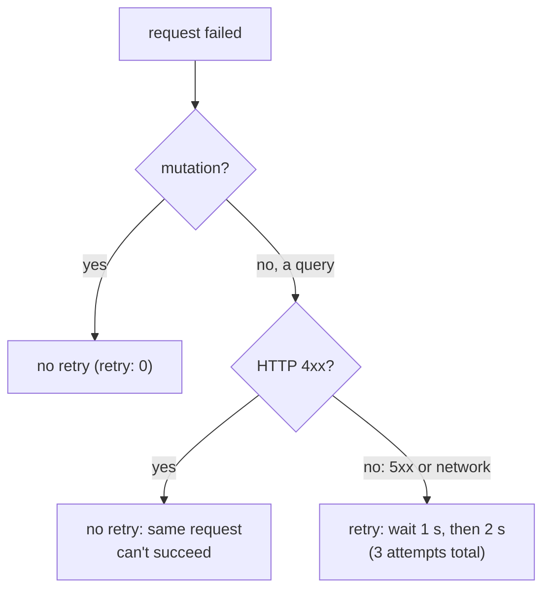

# Retry policy: retry only what is safe

History: see [CHANGELOG.md](../CHANGELOG.md) or run `pnpm docs:history`

Area: Reliability · Status: ✅ built · Step doc: [06 signup api](../../06-signup-api.md)

## 1. In one line

In the browser, failed **queries** are retried up to 2 more times unless the error is a 4xx, and
**mutations are never retried**, because retrying a write can do it twice.

## 2. Real-life comparison

If a phone call drops, you call back to ask a question again (a read). You don't automatically
re-send a bank transfer because the confirmation didn't arrive: you check first.

## 3. Picture it

## 4. Where in our code

- Anchor: `apps/web/src/providers/query-provider.tsx` · `shouldRetry`, `defaultOptions: { queries: { retry: shouldRetry }, mutations: { retry: 0 } }`.

Step by step:

1. `shouldRetry(failureCount, error)` reads `error.data.httpStatus`.
2. 400-499 → `false`: bad input, no session, duplicate email won't change by retrying.
3. Otherwise (5xx, network error with no status) → `failureCount < 2`.
4. Delays come from TanStack's default: `Math.min(1000 * 2 ** failureCount, 30000)`. With our rule
   that is 1 s, then 2 s, then give up: 3 attempts in total. (Verified in the installed
   `@tanstack/query-core` 5.104.1 `retryer.js`; TanStack's own default would be 3 retries.)
5. Mutations: `retry: 0`. The comment explains the case: signup succeeds, the response is lost, a
   retry hits the unique email and shows "Email already registered" for the user's own new account.

## 5. See it yourself

DevTools → Network → set throttling to **Offline**, then focus the window (it refetches `auth.me`):
you see the failed attempt and two retries about 1 s and 2 s apart. Set it back to **No throttling**.

`useProfile` without a cookie: one request, a 401, no retries.

**Break it on purpose:** set `mutations: { retry: 3 }` and make signup's response slow and flaky
(e.g. drop the connection in a proxy): a successful signup can end with a 409 error shown to the
user.

## 6. How it connects

- **Uses ←** [tanstack-query](tanstack-query.md), [http-status-codes](http-status-codes.md).
- **Gives →** resilience to blips (Spot task replaced, deploy); safety for non-idempotent writes
  ([idempotency](idempotency.md)).

## 7. Our settings and WHY

| Kind | Retries | Why |
| ---- | ------- | --- |
| Query, 4xx | 0 | Can't succeed; also avoids hammering on 401. |
| Query, 5xx/network | 2 (1 s, 2 s) | Short blips (task replacement) recover. |
| Mutation | 0 | Not idempotent; no idempotency keys yet. |

## 8. Trade-offs

- **Pros:** reads survive short outages; writes never duplicate.
- **Cons:** a lost signup response leaves the user unsure; retries add load during a real outage
  (only 2 per query).

## 9. Alternatives and when to choose them

- **Idempotency keys + mutation retries:** safe automatic retries for writes.
- **Jittered backoff:** spreads retries from many clients (TanStack's default has no jitter).
- **Retry budgets** server-side: cap total retries in a fleet.

## 10. What breaks, and how we'd notice

- Retrying 4xx: 401 loops and wasted requests; visible in the Network tab.
- Retrying mutations: duplicate side effects; would show as 409s after success.

## 13. Interview answers at 3 levels

- **Simple:** We try reading again if the network hiccups, but never send a change twice by
  ourselves.
- **Senior:** `shouldRetry` skips 4xx and allows 2 retries for 5xx and network errors with
  exponential backoff (1 s, 2 s); mutations have `retry: 0` because signup isn't idempotent: a
  retried successful signup would return 409.
- **Lead:** Retries need three things: only retry what's retryable, only retry what's idempotent,
  and cap them with backoff and jitter. To retry writes, add idempotency keys first.

## 14. Follow-up questions interviewers ask

- *Why not retry 429?* It's 4xx; with rate limiting we'd honour `Retry-After` instead.
- *What's a retry storm?* Many clients retrying at once, multiplying load on a struggling service.

## 15. Say it in 30 seconds

"Queries retry twice with 1 and 2 second backoff, but never on 4xx because those can't succeed.
Mutations never retry, because a write isn't idempotent: a retried signup that actually succeeded
would come back as 'Email already registered'."

## 16. Status

✅ built.

## Where it appears in the story

- [App story: 2. TanStack Query: cache, retries, invalidation](../app-story.md#2-tanstack-query-cache-retries-invalidation)
- [App story: 11. The error path back to the UI](../app-story.md#11-the-error-path-back-to-the-ui)
